# 首尔共享单车小时租借量预测研究

纯R报告撰写材料：完整逐日验证、ARIMA日周结构补强和强基线。数据处理、模型训练、图表、报告生成和验收均由R执行，不调用其他分析语言。研究对象为每小时实际发生的租借量。

## 摘要建议

本文使用2017-12-01至2018-11-30的8,760个连续小时记录，保留295个非运营零值。初始训练为前八个月，8—9月完整逐日验证，10—11月固定历史测试比较。对28个ARIMA类候选尝试完整验证，24个完成、4个记录失败；七组R ranger随机森林均以400棵树完成61个验证日。首次拟合后统一每周一重估，日内不读取真实租借量。

全部测试小时中RandomForest的RMSE最低，为443.390；SARIMA、SARIMAX、R随机森林分别为460.089、469.089、443.390。验证预先选出的最强基线为DayTypeMean28，其测试RMSE为458.132。

评价边界：原有10—11月测试结果已经查看。新配置仅按开发验证选择，新测试属于补充历史评价，不称为全新盲测。reference_v1/仅保留固定参照，最终R随机森林使用ranger重新训练，不能假定与早期其他实现得到相同数值。

## 第一章 概述与数据

任务是在前一天23:00，利用起点前租借量、历史天气和可提前知道的日历信息，预测次日00:00—23:00。数据没有站点库存、容量或调度成本，不直接生成调度方案，也不还原停运期间未满足的潜在需求。

数据来自UCI Seoul Bike Sharing Demand，DOI 10.24432/C5F62R，CC BY 4.0。官方页面：https://archive.ics.uci.edu/dataset/560/seoul+bike+sharing+demand 。原始ZIP、CSV与来源记录在data/raw/。日期按日/月/年解析，时区Asia/Seoul；保留完整小时轴，未插值、未删除停运零值。

表 1-1 数据核验

| check | value |
| --- | --- |
| rows | 8760 |
| columns_raw | 14 |
| missing_cells | 0 |
| duplicate_timestamps | 0 |
| non_hourly_steps | 0 |
| zeros | 295 |
| non_operating_hours | 295 |
| operating_zeros | 0 |
| raw_md5 | bf632307dcb419f67df589faaa0318e1 |

表 1-2 描述统计

| 评价范围 | 小时数 | mean | sd | min | q1 | median | q3 | max |
| --- | --- | --- | --- | --- | --- | --- | --- | --- |
| all | 8760 | 704.602 | 644.997 | 0 | 191 | 504.500 | 1065.250 | 3556 |
| operating | 8465 | 729.157 | 642.351 | 2 | 214 | 542.000 | 1084.000 | 3556 |
| initial_training | 5832 | 639.648 | 641.450 | 0 | 171 | 375.000 | 965.250 | 3556 |

表 1-3 时间划分与停运分布

| split | start | end | 小时数 | days | closure_hours | closure_percent |
| --- | --- | --- | --- | --- | --- | --- |
| initial_training | 2017-12-01 | 2018-07-31 23:00:00 | 5832 | 243 | 48 | 0.823 |
| test | 2018-10-01 | 2018-11-30 23:00:00 | 1464 | 61 | 151 | 10.314 |
| validation | 2018-08-01 | 2018-09-30 23:00:00 | 1464 | 61 | 96 | 6.557 |

测试非运营占10.31%，初始训练仅0.82%。运营标记未作为目标日输入。

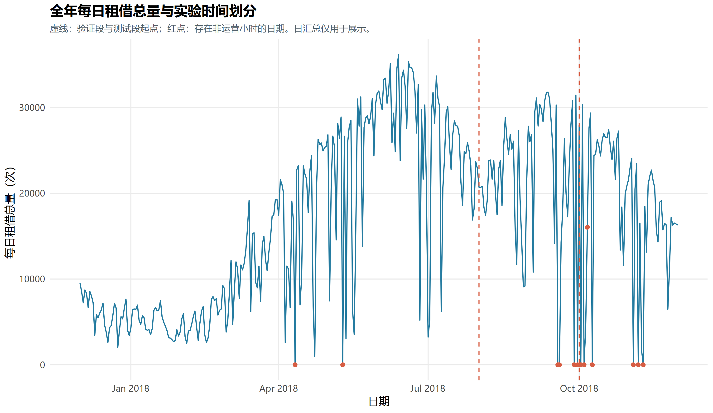

图 1-1 全年租借量、停运与时间划分

全年展示用于描述；仅一年历史不能证明跨年周期，天气相关不能作因果解释。

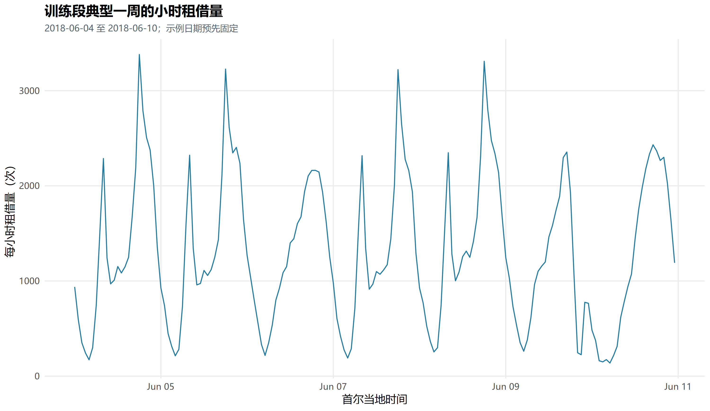

图 1-2 训练段一周小时曲线

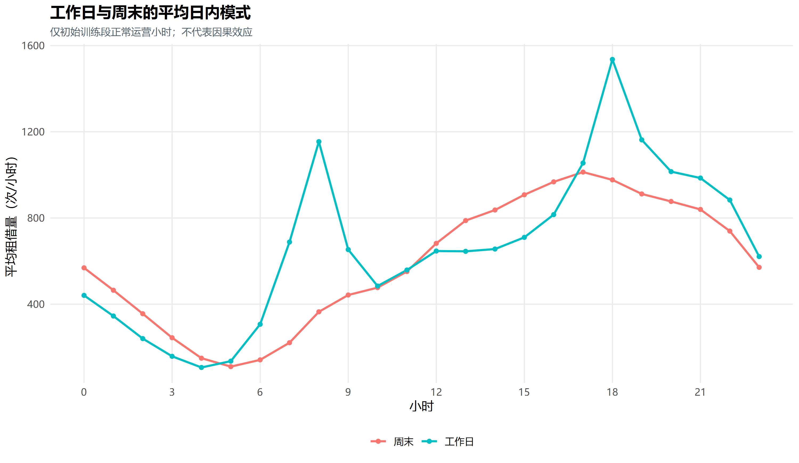

图 1-3 训练段工作日与周末小时模式

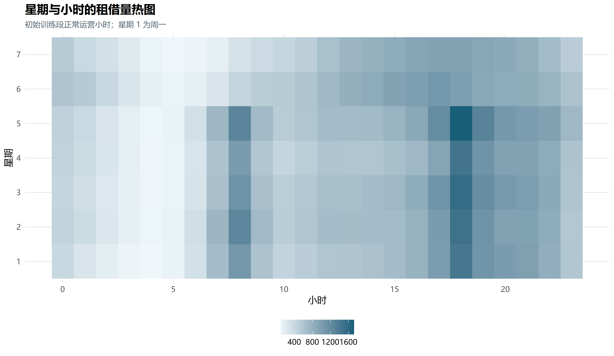

图 1-4 训练段星期与小时热图

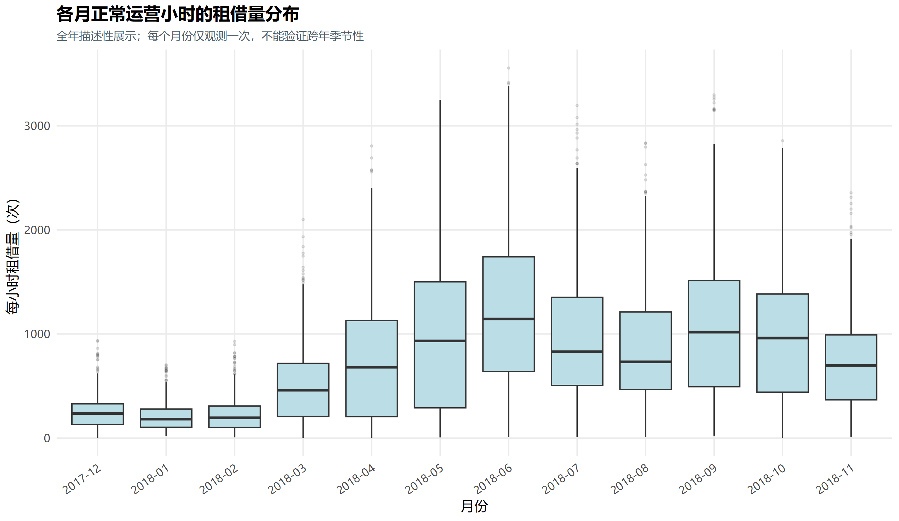

图 1-5 各月正常运营小时分布

全年展示用于描述；仅一年历史不能证明跨年周期，天气相关不能作因果解释。

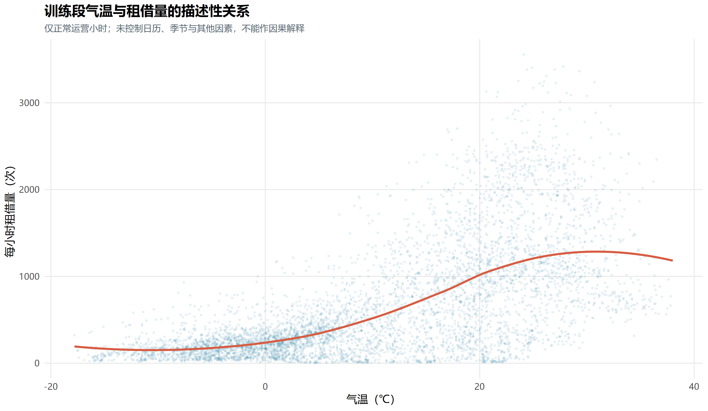

图 1-6 训练段气温与租借量

全年展示用于描述；仅一年历史不能证明跨年周期，天气相关不能作因果解释。

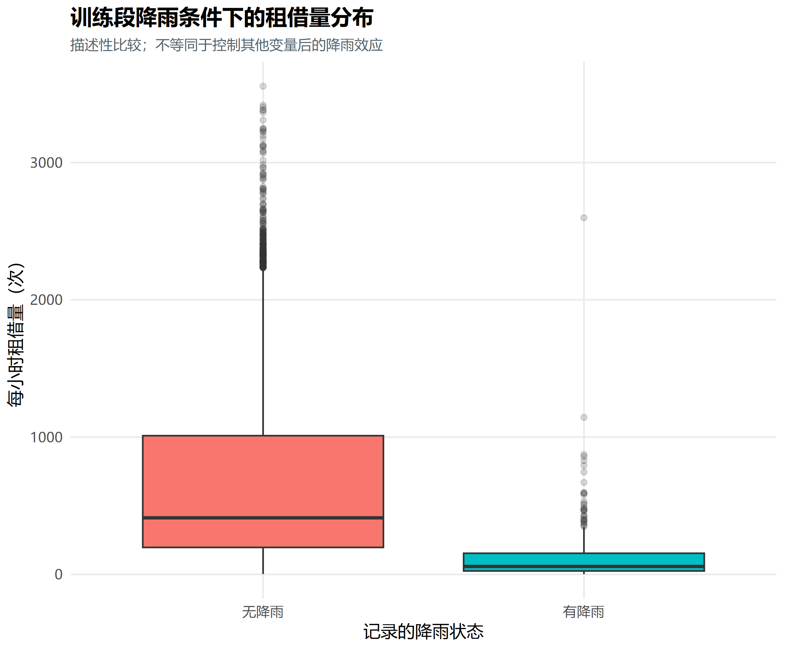

图 1-7 训练段降雨分组分布

全年展示用于描述；仅一年历史不能证明跨年周期，天气相关不能作因果解释。

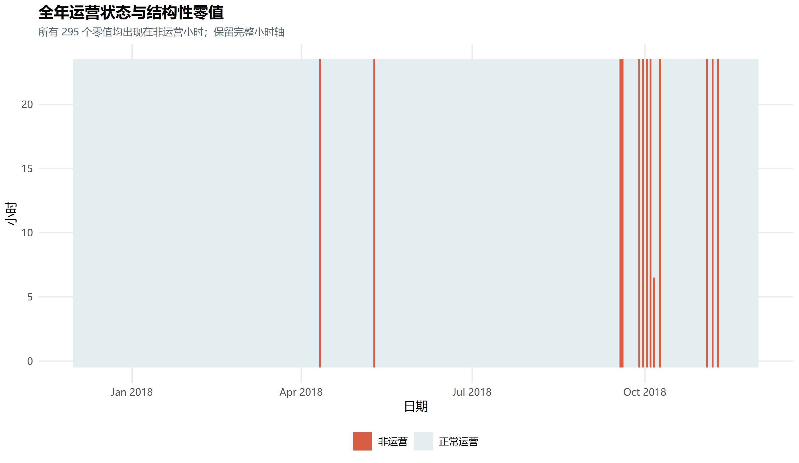

图 1-8 全年小时运营状态

## 第二章 模型识别与完整验证

ADF原假设为单位根，KPSS原假设为平稳。初始训练段检验存在分歧，使用168小时滞后或带宽后判断也会变化。结合差分、ACF/PACF、日周规律、训练窗口和完整验证选择模型，不能凭一个p值证明模型充分。

表 2-1 平稳性检验与敏感性

| 序列 | setting | ADF统计量 | ADF 5%临界值 | ADF拒绝单位根 | KPSS统计量 | KPSS 5%临界值 | KPSS拒绝平稳 |
| --- | --- | --- | --- | --- | --- | --- | --- |
| raw | ADF最大48/BIC；KPSS long | -7.051 | -3.410 | 是 | 0.611 | 0.146 | 是 |
| log1p | ADF最大48/BIC；KPSS long | -9.058 | -3.410 | 是 | 0.217 | 0.146 | 是 |
| diff1 | ADF最大48/BIC；KPSS long | -15.904 | -2.860 | 是 | 0.003 | 0.463 | 否 |
| diff24 | ADF最大48/BIC；KPSS long | -12.313 | -2.860 | 是 | 0.005 | 0.463 | 否 |
| diff1_diff24 | ADF最大48/BIC；KPSS long | -20.336 | -2.860 | 是 | 0.002 | 0.463 | 否 |
| raw | ADF固定168；KPSS带宽168 | -3.316 | -3.410 | 否 | 0.272 | 0.146 | 是 |
| log1p | ADF固定168；KPSS带宽168 | -4.529 | -3.410 | 是 | 0.138 | 0.146 | 否 |
| diff1 | ADF固定168；KPSS带宽168 | -9.159 | -2.860 | 是 | 0.025 | 0.463 | 否 |
| diff24 | ADF固定168；KPSS带宽168 | -8.229 | -2.860 | 是 | 0.025 | 0.463 | 否 |
| diff1_diff24 | ADF固定168；KPSS带宽168 | -13.014 | -2.860 | 是 | 0.015 | 0.463 | 否 |

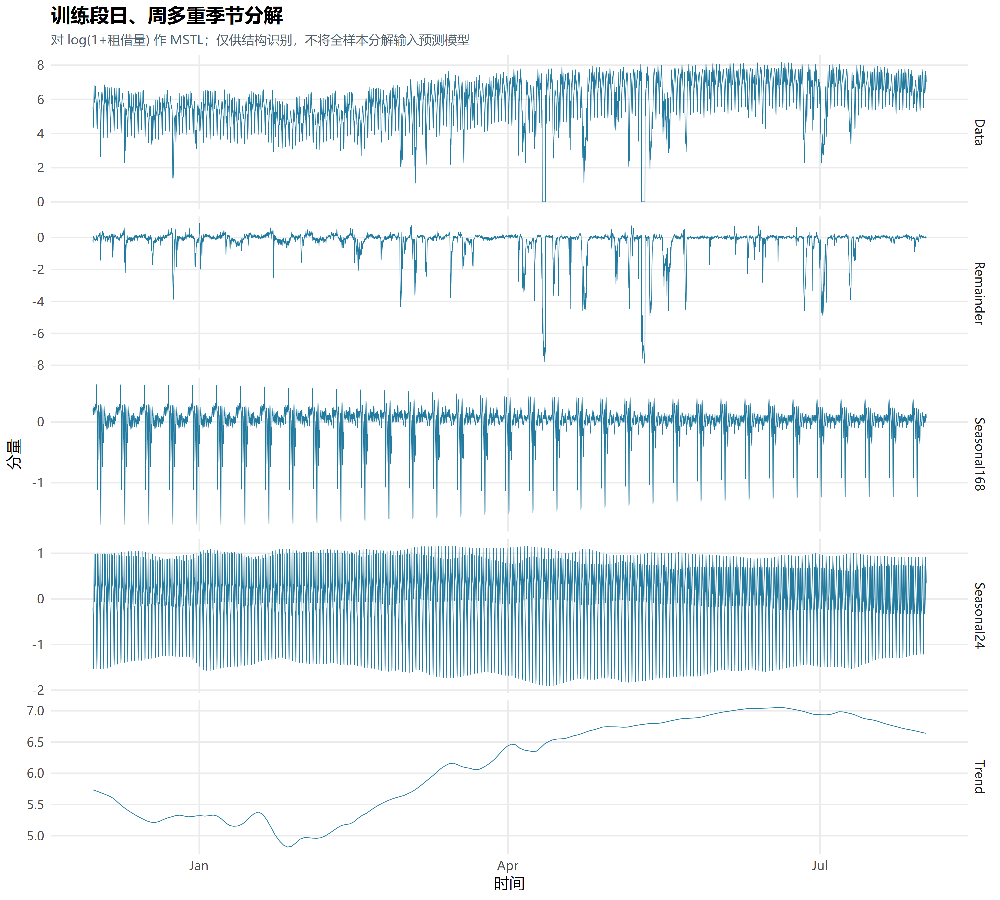

图 2-1 训练段多重季节分解

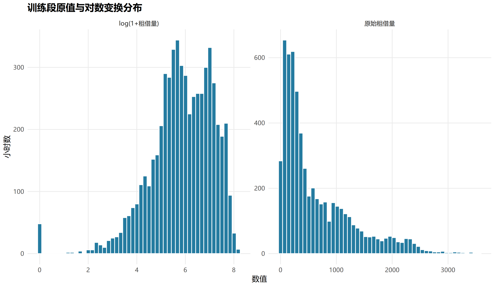

图 2-2 训练段原值与变换分布

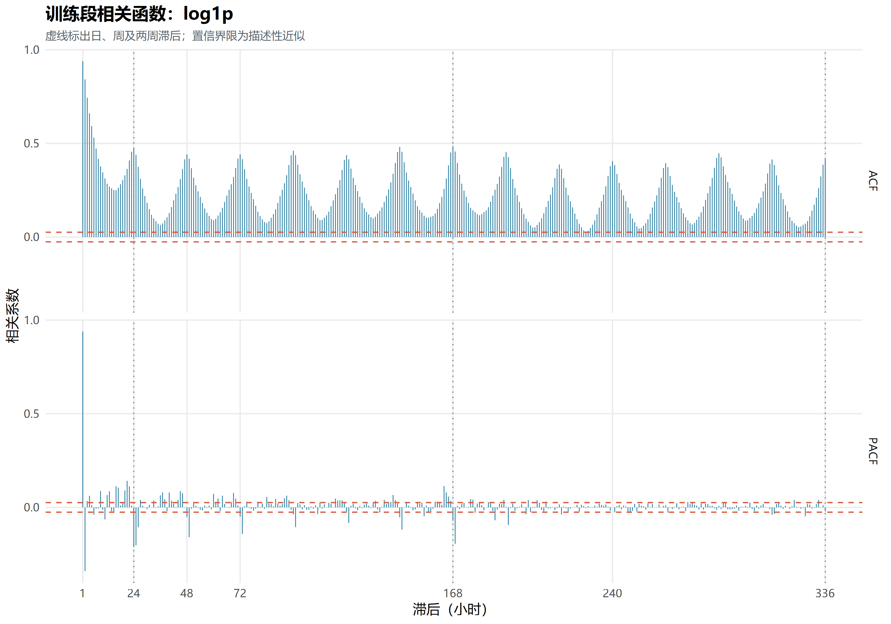

图 2-3 训练段 log1p 的 ACF/PACF

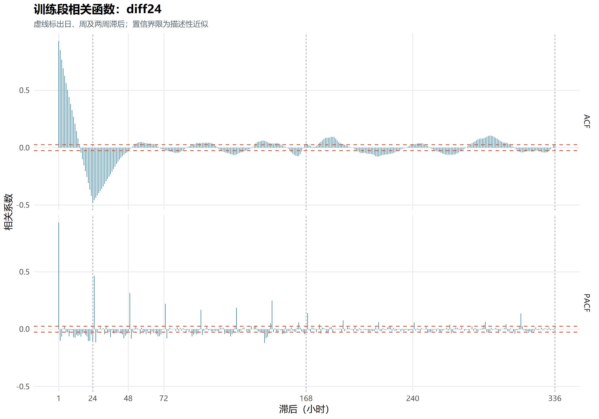

图 2-4 训练段 diff24 的 ACF/PACF

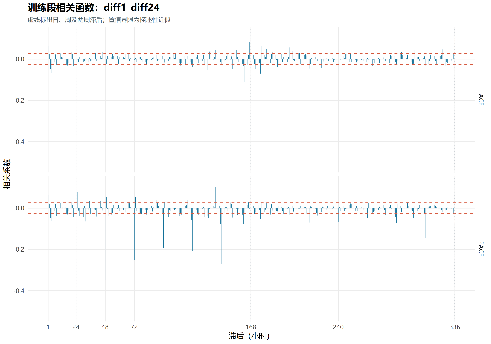

图 2-5 训练段 diff1_diff24 的 ACF/PACF

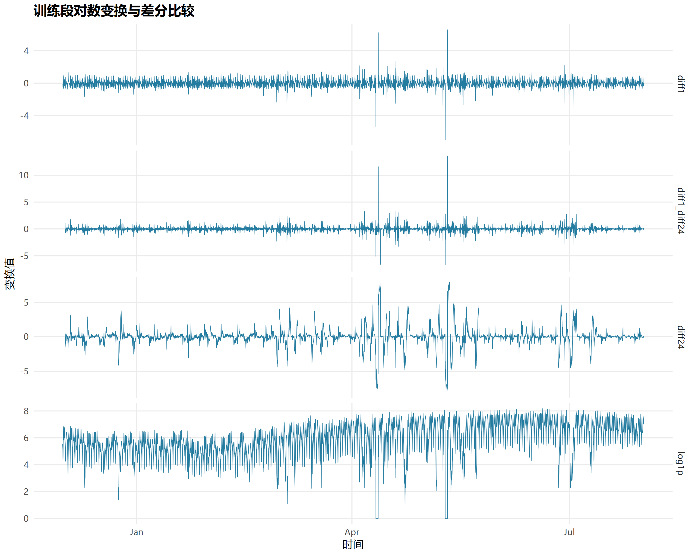

图 2-6 训练段不同差分方案比较

取消仅覆盖星期三的初筛，有限候选均尝试完整61天验证。验证起始日先拟合，此后每周一重估；测试使用相同日历规则。周内ARIMA更新状态，随机森林使用最新历史特征，全部完成候选覆盖周一至周日。失败候选记录收敛、协方差或预设计算预算原因，不将超时等同于统计表现差。

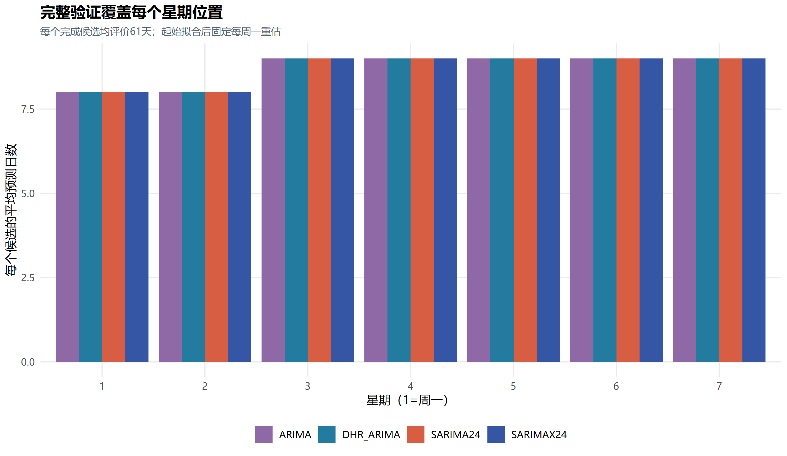

图 2-7 完整验证的星期覆盖

每个完成候选覆盖61日、1,464小时，各星期位置有8或9个预测日。

表 2-2 全候选完整验证

| 模型 | 评价范围 | 小时数 | MAE | RMSE | sMAPE（%） | MASE（周周期缩放） | 平均预测偏差 | 候选编号 |
| --- | --- | --- | --- | --- | --- | --- | --- | --- |
| ARIMA | all | 1464 | 551.296 | 667.475 | 68.365 | 2.197 | 79.683 | A_raw_312_84d |
| ARIMA | all | 1464 | 598.624 | 736.698 | 75.048 | 2.385 | 116.497 | A_raw_212_full |
| ARIMA | all | 1464 | 622.318 | 757.149 | 72.331 | 2.480 | 277.554 | A_log_302_84d_refined |
| ARIMA | all | 1464 | 648.270 | 764.758 | 75.944 | 2.583 | 300.371 | A_log_212_full |
| ARIMA | all | 1464 | 636.596 | 792.504 | 74.678 | 2.536 | 214.596 | A_log_312_84d |
| DHR_ARIMA | all | 1464 | 338.338 | 500.223 | 51.760 | 1.348 | 68.769 | D_raw_202_K5_weekend_84d_refined |
| DHR_ARIMA | all | 1464 | 374.642 | 533.873 | 58.181 | 1.493 | 11.014 | D_raw_K5_weather_84d |
| DHR_ARIMA | all | 1464 | 373.813 | 534.196 | 58.024 | 1.489 | 14.105 | D_raw_K5_84d |
| DHR_ARIMA | all | 1464 | 369.419 | 540.312 | 55.956 | 1.472 | -23.164 | D_raw_K5_56d |
| DHR_ARIMA | all | 1464 | 430.569 | 555.533 | 58.739 | 1.716 | 100.910 | D_raw_K3_full |
| DHR_ARIMA | all | 1464 | 378.340 | 558.193 | 57.796 | 1.507 | -23.261 | D_raw_K5_weather_56d |
| SARIMA24 | all | 1464 | 326.891 | 486.807 | 46.027 | 1.302 | 29.886 | S_raw_101_011_full |
| SARIMA24 | all | 1464 | 331.871 | 489.873 | 46.642 | 1.322 | 45.732 | S_raw_202_011_56d |
| SARIMA24 | all | 1464 | 334.911 | 490.901 | 46.897 | 1.334 | 45.996 | S_raw_201_011_84d |
| SARIMA24 | all | 1464 | 327.606 | 491.047 | 45.488 | 1.305 | 59.031 | S_raw_101_111_84d |
| SARIMA24 | all | 1464 | 371.159 | 546.753 | 52.448 | 1.479 | 49.548 | S_raw_101_100_84d_v2 |
| SARIMA24 | all | 1464 | 424.467 | 624.372 | 52.915 | 1.691 | 274.449 | S_log_101_011_full |
| SARIMA24 | all | 1464 | 405.922 | 624.478 | 50.648 | 1.617 | 214.091 | S_log_201_011_84d |
| SARIMA24 | all | 1464 | 574.657 | 1239.014 | 63.077 | 2.290 | 323.304 | S_log_101_100_84d_refined |
| SARIMAX24 | all | 1464 | 318.634 | 478.759 | 47.881 | 1.270 | 30.336 | C_raw_202_101_fullcalendar_84d |
| SARIMAX24 | all | 1464 | 319.364 | 479.969 | 47.774 | 1.272 | 31.212 | C_raw_302_011_week_84d |
| SARIMAX24 | all | 1464 | 312.581 | 481.785 | 47.260 | 1.245 | 41.120 | C_raw_301_111_week_84d |
| SARIMAX24 | all | 1464 | 313.336 | 481.813 | 45.231 | 1.248 | 50.979 | C_raw_101_111_week_84d |
| SARIMAX24 | all | 1464 | 313.888 | 500.076 | 48.469 | 1.251 | 60.375 | C_raw_302_100_fullcalendar_84d |

仅用全部小时验证RMSE选择，MAE辅助；失败候选不参与排名。

结构优化将周内日历及工作日类型交互与日周期随机误差结合，新增SARIMAX24。差分与回归项共同检查，避免24小时季节差分消除同周期Fourier项。窗口内全零、常量或差分后不可识别的回归列被删除，预测沿用相同列结构；无法估计的节假日效应不作额外解释。

表 2-3 所选模型结构

| id | family | p | d | q | P | D | Q | period | 变换 | 回看天数（0=扩展） | daily_K | weekly_K | weather_lag24 | weekend_interactions | calendar |
| --- | --- | --- | --- | --- | --- | --- | --- | --- | --- | --- | --- | --- | --- | --- | --- |
| A_raw_312_84d | ARIMA | 3 | 1 | 2 | 0 | 0 | 0 | 1 | raw | 84 | 0 | 0 | 否 | 否 | none |
| D_raw_202_K5_weekend_84d_refined | DHR_ARIMA | 2 | 0 | 2 | 0 | 0 | 0 | 1 | raw | 84 | 5 | 3 | 否 | 是 | fourier |
| S_raw_101_011_full | SARIMA24 | 1 | 0 | 1 | 0 | 1 | 1 | 24 | raw | 0 | 0 | 0 | 否 | 否 | none |
| C_raw_202_101_fullcalendar_84d | SARIMAX24 | 2 | 0 | 2 | 1 | 0 | 1 | 24 | raw | 84 | 5 | 3 | 否 | 是 | fourier |

window_days=0表示扩展窗口。

表 2-4 同口径信息准则

| 候选编号 | comparison_group | 训练残差数 | AIC | AICc | BIC | rank_within_group | complete_validation |
| --- | --- | --- | --- | --- | --- | --- | --- |
| A_log_212_full | log1p_1_5832_1_0 | 5832 | 6337.842 | 6337.852 | 6371.197 | 1 | 是 |
| A_log_302_84d_refined | log1p_3817_5832_0_0 | 2016 | 2390.884 | 2390.940 | 2430.146 | 2 | 是 |
| A_log_312_84d | log1p_3817_5832_1_0 | 2016 | 2388.978 | 2389.019 | 2422.628 | 2 | 是 |
| A_raw_212_84d_v2 | raw_3817_5832_1_0 | 2016 | 29321.110 | 29321.140 | 29349.152 | 4 | 否 |
| A_raw_212_full | raw_1_5832_1_0 | 5832 | 81020.311 | 81020.321 | 81053.665 | 2 | 是 |
| A_raw_312_84d | raw_3817_5832_1_0 | 2016 | 29190.611 | 29190.653 | 29224.262 | 3 | 是 |
| C_raw_101_111_week_84d | raw_3817_5832_0_1 | 2016 | 27320.742 | 27321.127 | 27427.083 | 3 | 是 |
| C_raw_202_101_fullcalendar_84d | raw_3817_5832_0_0 | 2016 | 27638.556 | 27639.621 | 27818.040 | 1 | 是 |
| C_raw_301_111_week_84d | raw_3817_5832_0_1 | 2016 | 27289.457 | 27289.926 | 27406.992 | 2 | 是 |
| C_raw_302_011_week_84d | raw_3817_5832_0_1 | 2016 | 27272.332 | 27272.801 | 27389.867 | 1 | 是 |
| C_raw_302_100_fullcalendar_84d | raw_3817_5832_0_0 | 2016 | 27975.547 | 27976.612 | 28155.031 | 2 | 是 |
| D_log_K5_84d | log1p_3817_5832_1_0 | 2016 | 1806.436 | 1806.944 | 1929.821 | 1 | 否 |
| D_raw_202_K5_weekend_84d_refined | raw_3817_5832_0_0 | 2016 | 28217.539 | 28218.476 | 28385.805 | 3 | 是 |
| D_raw_K3_full | raw_1_5832_1_0 | 5832 | 80224.075 | 80224.193 | 80344.152 | 1 | 是 |
| D_raw_K5_56d | raw_4489_5832_1_0 | 1344 | 18847.456 | 18848.293 | 18967.117 | 1 | 是 |
| D_raw_K5_84d | raw_3817_5832_1_0 | 2016 | 28237.806 | 28238.314 | 28361.190 | 2 | 是 |
| D_raw_K5_weather_56d | raw_4489_5832_1_0 | 1344 | 18853.124 | 18854.191 | 18988.393 | 2 | 是 |
| D_raw_K5_weather_84d | raw_3817_5832_1_0 | 2016 | 28237.212 | 28237.866 | 28377.422 | 1 | 是 |
| S_log_101_011_full | log1p_1_5832_0_1 | 5832 | 3953.124 | 3953.131 | 3979.792 | 1 | 是 |
| S_log_101_100_84d_refined | log1p_3817_5832_0_0 | 2016 | 2336.762 | 2336.792 | 2364.807 | 1 | 是 |
| S_log_201_011_84d | log1p_3817_5832_0_1 | 2016 | 1782.233 | 1782.264 | 1810.218 | 1 | 是 |
| S_raw_101_011_full | raw_1_5832_0_1 | 5832 | 76187.359 | 76187.365 | 76214.027 | 1 | 是 |
| S_raw_101_100_84d_v2 | raw_3817_5832_0_0 | 2016 | 28389.630 | 28389.660 | 28417.674 | 4 | 是 |
| S_raw_101_111_84d | raw_3817_5832_0_1 | 2016 | 27401.270 | 27401.300 | 27429.254 | 4 | 是 |
| S_raw_201_011_84d | raw_3817_5832_0_1 | 2016 | 27409.335 | 27409.365 | 27437.319 | 5 | 是 |
| S_raw_202_011_56d | raw_4489_5832_0_1 | 1344 | 18192.055 | 18192.119 | 18223.168 | 1 | 是 |

只在变换、起止与差分相同的组内比较AICc。最终模型仍按完整验证误差选择。

表 2-5 测试起点前完整参数

| 模型 | 参数 | 估计值 | 标准误 | 渐近p值 |
| --- | --- | --- | --- | --- |
| ARIMA | ar1 | 0.727 | 0.182 | 6.26e-05 |
| ARIMA | ar2 | 0.149 | 0.217 | 0.491 |
| ARIMA | ar3 | -0.122 | 0.070 | 0.082 |
| ARIMA | ma1 | -0.540 | 0.179 | 0.003 |
| ARIMA | ma2 | -0.460 | 0.179 | 0.010 |
| DHR_ARIMA | ar1 | 0.669 | 0.106 | 2.75e-10 |
| DHR_ARIMA | ar2 | 0.186 | 0.089 | 0.037 |
| DHR_ARIMA | ma1 | 0.180 | 0.104 | 0.084 |
| DHR_ARIMA | ma2 | -0.138 | 0.024 | 5.2e-09 |
| DHR_ARIMA | intercept | 951.815 | 44.569 | 3.43e-101 |
| DHR_ARIMA | sin24_1 | -455.033 | 28.495 | 2.1e-57 |
| DHR_ARIMA | cos24_1 | 134.982 | 28.385 | 1.98e-06 |
| DHR_ARIMA | sin24_2 | -437.968 | 16.195 | 4.56e-161 |
| DHR_ARIMA | cos24_2 | -22.667 | 16.098 | 0.159 |
| DHR_ARIMA | sin24_3 | 99.206 | 11.806 | 4.34e-17 |
| DHR_ARIMA | cos24_3 | 31.420 | 11.751 | 0.007 |
| DHR_ARIMA | sin24_4 | 76.862 | 8.133 | 3.36e-21 |
| DHR_ARIMA | cos24_4 | -75.651 | 8.131 | 1.35e-20 |
| DHR_ARIMA | sin24_5 | -94.926 | 7.055 | 2.88e-41 |
| DHR_ARIMA | cos24_5 | 69.759 | 7.054 | 4.64e-23 |
| DHR_ARIMA | sin168_1 | 42.945 | 64.965 | 0.509 |
| DHR_ARIMA | cos168_1 | 65.074 | 52.335 | 0.214 |
| DHR_ARIMA | sin168_2 | 23.445 | 47.879 | 0.624 |
| DHR_ARIMA | cos168_2 | -54.739 | 51.708 | 0.290 |
| DHR_ARIMA | sin168_3 | -64.874 | 40.646 | 0.110 |
| DHR_ARIMA | cos168_3 | -7.533 | 40.658 | 0.853 |
| DHR_ARIMA | holiday | -18.416 | 102.970 | 0.858 |
| DHR_ARIMA | weekend | -93.558 | 81.958 | 0.254 |
| DHR_ARIMA | weekend_sin24_1 | -134.836 | 54.587 | 0.014 |
| DHR_ARIMA | weekend_cos24_1 | 68.913 | 54.015 | 0.202 |
| DHR_ARIMA | weekend_sin24_2 | 273.735 | 30.776 | 5.87e-19 |
| DHR_ARIMA | weekend_cos24_2 | 125.368 | 30.170 | 3.25e-05 |
| DHR_ARIMA | weekend_sin24_3 | -77.561 | 22.353 | 5.21e-04 |
| DHR_ARIMA | weekend_cos24_3 | -63.886 | 22.004 | 0.004 |
| SARIMA24 | ar1 | 0.832 | 0.007 | <1e-15 |
| SARIMA24 | ma1 | 0.274 | 0.013 | 2.06e-99 |
| SARIMA24 | sma1 | -0.934 | 0.004 | <1e-15 |
| SARIMAX24 | ar1 | 1.096 | 0.159 | 6.12e-12 |
| SARIMAX24 | ar2 | -0.189 | 0.136 | 0.164 |
| SARIMAX24 | ma1 | -0.060 | 0.157 | 0.701 |
| SARIMAX24 | ma2 | -0.148 | 0.038 | 8.29e-05 |
| SARIMAX24 | sar1 | 0.985 | 0.005 | <1e-15 |
| SARIMAX24 | sma1 | -0.870 | 0.021 | <1e-15 |
| SARIMAX24 | intercept | 952.456 | 209.821 | 5.64e-06 |
| SARIMAX24 | sin24_1 | -463.416 | 131.589 | 4.29e-04 |
| SARIMAX24 | cos24_1 | 113.736 | 131.505 | 0.387 |
| SARIMAX24 | sin24_2 | -390.334 | 75.240 | 2.13e-07 |
| SARIMAX24 | cos24_2 | -34.379 | 75.083 | 0.647 |
| SARIMAX24 | sin24_3 | 90.867 | 54.047 | 0.093 |
| SARIMAX24 | cos24_3 | 36.156 | 54.027 | 0.503 |
| SARIMAX24 | sin24_4 | 61.070 | 42.419 | 0.150 |
| SARIMAX24 | cos24_4 | -64.270 | 42.404 | 0.130 |
| SARIMAX24 | sin24_5 | -92.059 | 34.827 | 0.008 |
| SARIMAX24 | cos24_5 | 62.932 | 34.830 | 0.071 |
| SARIMAX24 | sin168_1 | 61.432 | 60.104 | 0.307 |
| SARIMAX24 | cos168_1 | 63.317 | 49.276 | 0.199 |
| SARIMAX24 | sin168_2 | 17.359 | 44.548 | 0.697 |
| SARIMAX24 | cos168_2 | -62.762 | 47.841 | 0.190 |
| SARIMAX24 | sin168_3 | -65.673 | 37.751 | 0.082 |
| SARIMAX24 | cos168_3 | -5.772 | 37.774 | 0.879 |
| SARIMAX24 | holiday | -2.086 | 86.007 | 0.981 |
| SARIMAX24 | weekend | -121.263 | 72.967 | 0.097 |
| SARIMAX24 | weekend_sin24_1 | -131.119 | 51.064 | 0.010 |
| SARIMAX24 | weekend_cos24_1 | 73.714 | 50.611 | 0.145 |
| SARIMAX24 | weekend_sin24_2 | 265.651 | 28.767 | 2.59e-20 |
| SARIMAX24 | weekend_cos24_2 | 126.860 | 28.255 | 7.13e-06 |
| SARIMAX24 | weekend_sin24_3 | -78.031 | 20.572 | 1.49e-04 |
| SARIMAX24 | weekend_cos24_3 | -65.066 | 20.290 | 0.001 |

标准误与p值为选模后条件渐近量，不作因果解释。完整参数可置于附录。

ARIMA：z_t=y_t；(1 − 0.727025 B − 0.149356 B^2 + 0.121812 B^3)(1)(1−B)^1z_t = (1 − 0.540310 B − 0.459679 B^2)(1) ε_t。B为一小时滞后，MA符号遵循forecast。

DHR_ARIMA：z_t=y_t，z_t=951.815407+x_t'β+u_t；(1 − 0.668718 B − 0.186265 B^2)(1)u_t = (1 + 0.179532 B − 0.138181 B^2)(1) ε_t。B为一小时滞后，MA符号遵循forecast。

SARIMA24：z_t=y_t；(1 − 0.831856 B)(1)(1−B^24)^1z_t = (1 + 0.273726 B)(1 − 0.934000 B^24) ε_t。B为一小时滞后，MA符号遵循forecast。

SARIMAX24：z_t=y_t，z_t=952.455635+x_t'β+u_t；(1 − 1.096158 B + 0.188820 B^2)(1 − 0.984845 B^24)u_t = (1 − 0.060296 B − 0.148047 B^2)(1 − 0.869532 B^24) ε_t。B为一小时滞后，MA符号遵循forecast。

表 2-6 残差诊断

| 模型 | 训练残差数 | 检验滞后 | Ljung–Box统计量 | p值 | acf10 | acf24 | acf168 |
| --- | --- | --- | --- | --- | --- | --- | --- |
| ARIMA | 2015 | 24 | 1530.009 | 1.59e-313 | 0.331 | 0.646 | 0.654 |
| ARIMA | 2015 | 48 | 2512.321 | <1e-15 | 0.331 | 0.646 | 0.654 |
| ARIMA | 2015 | 168 | 7898.552 | <1e-15 | 0.331 | 0.646 | 0.654 |
| ARIMA | 2015 | 336 | 14129.244 | <1e-15 | 0.331 | 0.646 | 0.654 |
| DHR_ARIMA | 2016 | 24 | 1098.450 | 3.8e-220 | 0.331 | 0.452 | 0.414 |
| DHR_ARIMA | 2016 | 48 | 1694.575 | <1e-15 | 0.331 | 0.452 | 0.414 |
| DHR_ARIMA | 2016 | 168 | 4958.377 | <1e-15 | 0.331 | 0.452 | 0.414 |
| DHR_ARIMA | 2016 | 336 | 8725.858 | <1e-15 | 0.331 | 0.452 | 0.414 |
| SARIMA24 | 7272 | 24 | 821.820 | 2.14e-160 | 0.242 | 0.100 | 0.298 |
| SARIMA24 | 7272 | 48 | 1016.684 | 1.13e-183 | 0.242 | 0.100 | 0.298 |
| SARIMA24 | 7272 | 168 | 2612.550 | <1e-15 | 0.242 | 0.100 | 0.298 |
| SARIMA24 | 7272 | 336 | 4917.547 | <1e-15 | 0.242 | 0.100 | 0.298 |
| SARIMAX24 | 2016 | 24 | 322.657 | 1.03e-57 | 0.258 | 0.156 | 0.237 |
| SARIMAX24 | 2016 | 48 | 383.544 | 1.08e-56 | 0.258 | 0.156 | 0.237 |
| SARIMAX24 | 2016 | 168 | 934.696 | 6.78e-109 | 0.258 | 0.156 | 0.237 |
| SARIMAX24 | 2016 | 336 | 1737.167 | 2.08e-189 | 0.258 | 0.156 | 0.237 |

p值使用卡方生存函数。小于数值精度而返回零的值展示为<1e-15。工程验收不能替代白噪声检验。

表 2-7 残差结构的原版本参照

| 模型 | 检验滞后 | acf | 小时数 |
| --- | --- | --- | --- |
| SARIMA24 | 10 | 0.242 | 7272 |
| SARIMA24 | 24 | 0.100 | 7272 |
| SARIMA24 | 48 | -0.116 | 7272 |
| SARIMA24 | 168 | 0.298 | 7272 |
| SARIMA24 | 336 | 0.279 | 7272 |
| SARIMA24_v1 | 10 | 0.263 | 1992 |
| SARIMA24_v1 | 24 | 0.029 | 1992 |
| SARIMA24_v1 | 48 | -0.105 | 1992 |
| SARIMA24_v1 | 168 | 0.289 | 1992 |
| SARIMA24_v1 | 336 | 0.209 | 1992 |
| SARIMAX24 | 10 | 0.258 | 2016 |
| SARIMAX24 | 24 | 0.156 | 2016 |
| SARIMAX24 | 48 | -0.094 | 2016 |
| SARIMAX24 | 168 | 0.237 | 2016 |
| SARIMAX24 | 336 | 0.187 | 2016 |

各模型窗口与样本数可能不同，仅作诊断线索；两个开发起点的完整诊断另见training_diagnostics_two_origins.csv。

表 2-8 同一新协议内的结构优化

| family | initial_candidate | final_candidate | initial_validation_RMSE | final_validation_RMSE | change_percent | reason |
| --- | --- | --- | --- | --- | --- | --- |
| ARIMA | A_raw_312_84d | A_raw_312_84d | 667.475 | 667.475 | 0.000 | Same full-daily Monday-refit protocol; selection uses validation RMSE only |
| DHR_ARIMA | D_raw_202_K5_weekend_84d_refined | D_raw_202_K5_weekend_84d_refined | 500.223 | 500.223 | 0.000 | Same full-daily Monday-refit protocol; selection uses validation RMSE only |
| SARIMA24 | S_raw_101_011_full | S_raw_101_011_full | 486.807 | 486.807 | 0.000 | Same full-daily Monday-refit protocol; selection uses validation RMSE only |
| SARIMAX24 | S_raw_101_011_full | C_raw_202_101_fullcalendar_84d | 486.807 | 478.759 | -1.653 | Same full-daily Monday-refit protocol; selection uses validation RMSE only |

新SARIMAX与新协议下所选纯SARIMA比较，不将协议变化归因于单个特征。

ARIMA：残差ACF(24)=0.646、ACF(168)=0.654；168小时检验仍拒绝无自相关原假设，保留残余相关限制。

DHR_ARIMA：残差ACF(24)=0.452、ACF(168)=0.414；168小时检验仍拒绝无自相关原假设，保留残余相关限制。

SARIMA24：残差ACF(24)=0.100、ACF(168)=0.298；168小时检验仍拒绝无自相关原假设，保留残余相关限制。

SARIMAX24：残差ACF(24)=0.156、ACF(168)=0.237；168小时检验仍拒绝无自相关原假设，保留残余相关限制。

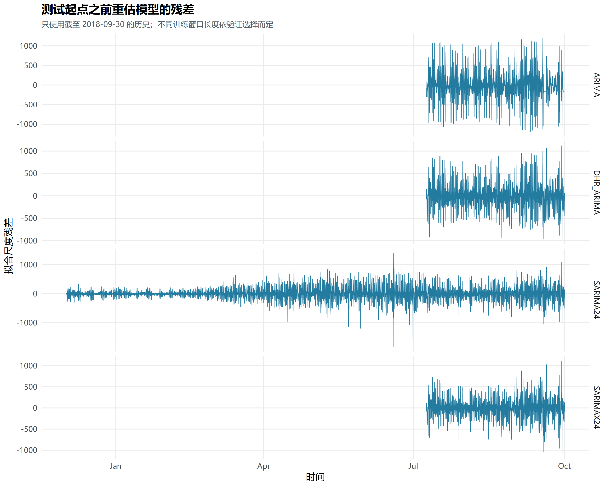

图 2-8 所选 ARIMA 类模型的训练残差

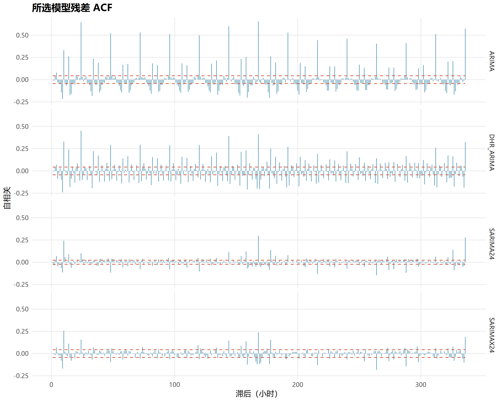

图 2-9 所选模型的残差自相关

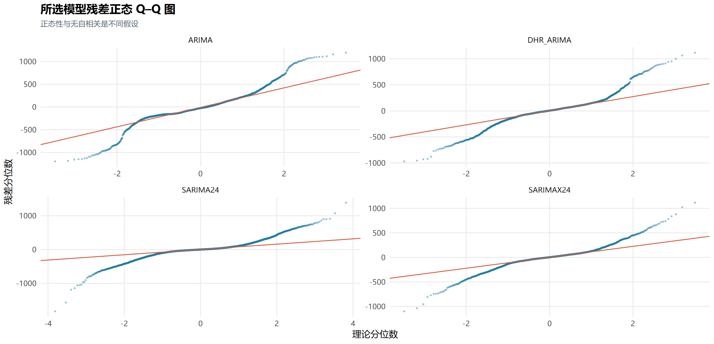

图 2-10 所选模型残差正态 Q–Q 图

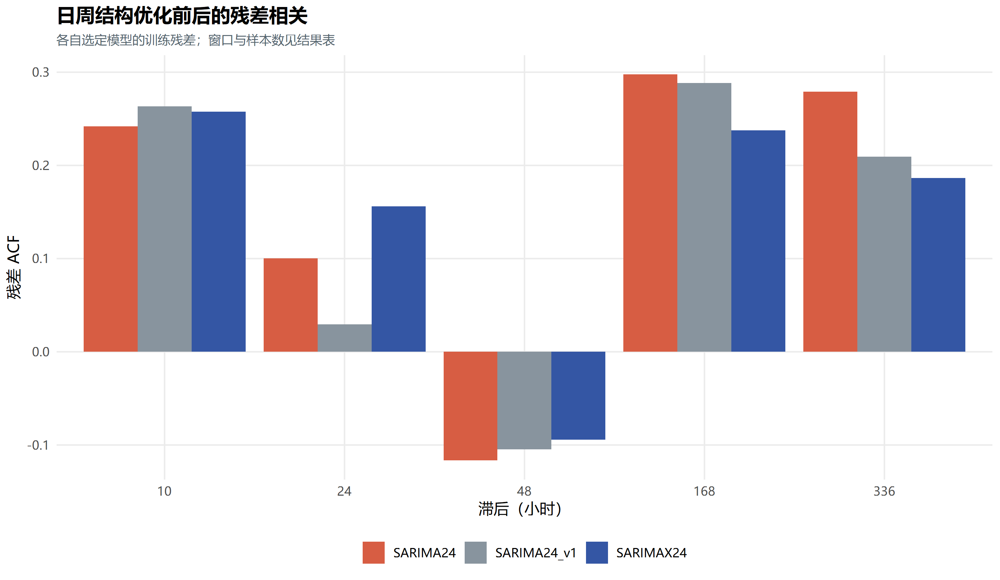

图 2-11 ARIMA结构优化的残差证据

## 第三章 短期预测与强基线

Mean7使用过去七天同小时均值，Median7使用其中位数，DayTypeMean28使用过去28天同属工作日或周末的同小时均值，后者不单独分类节假日、不删除历史零值。全部源时间不超过预测起点，明细见baseline_source_time_audit.csv。

表 3-1 五种透明基线

| 模型 | definition | lookback_days |
| --- | --- | --- |
| Naive24 | 前一天同小时 | 1.000 |
| Naive168 | 前一周同小时 | 7.000 |
| Mean7 | 过去七天同小时均值 | 7.000 |
| Median7 | 过去七天同小时中位数 | 7.000 |
| DayTypeMean28 | 过去28天同工作日/周末类型的同小时均值 | 28.000 |

表 3-2 基线与季节ARIMA测试比较

| 模型 | 评价范围 | 小时数 | MAE | RMSE | sMAPE（%） | MASE（周周期缩放） |
| --- | --- | --- | --- | --- | --- | --- |
| DayTypeMean28 | all | 1464 | 282.198 | 458.132 | 46.609 | 1.003 |
| DayTypeMean28 | operating | 1313 | 213.883 | 340.760 | 28.969 | 0.761 |
| Mean7 | all | 1464 | 308.002 | 452.327 | 53.531 | 1.095 |
| Mean7 | operating | 1313 | 262.617 | 390.565 | 36.686 | 0.934 |
| Median7 | all | 1464 | 314.346 | 528.607 | 57.074 | 1.118 |
| Median7 | operating | 1313 | 254.292 | 441.162 | 40.637 | 0.904 |
| Naive168 | all | 1464 | 378.691 | 610.054 | 68.743 | 1.347 |
| Naive168 | operating | 1313 | 329.754 | 540.637 | 57.303 | 1.173 |
| Naive24 | all | 1464 | 359.341 | 611.216 | 69.551 | 1.278 |
| Naive24 | operating | 1313 | 293.723 | 510.486 | 54.549 | 1.044 |
| SARIMA24 | all | 1464 | 304.916 | 460.089 | 52.965 | 1.084 |
| SARIMA24 | operating | 1313 | 247.094 | 370.195 | 37.579 | 0.879 |
| SARIMAX24 | all | 1464 | 312.218 | 469.089 | 57.221 | 1.110 |
| SARIMAX24 | operating | 1313 | 250.430 | 369.862 | 42.324 | 0.891 |

验证预先选择的最强基线为DayTypeMean28，验证RMSE=481.235；SARIMAX相对该基线的测试RMSE变化为+2.39%。全部五个基线均报告，不按测试误差重新选参照。

MAE/RMSE单位为次/小时，全部1,464小时是主要评价，正常运营1,313小时为事后补充。MASE分母仅取评价起点前168小时季节朴素历史误差，MASE大于1不等于比本测试段基线差。sMAPE对零值敏感，作为辅助。运营标记未作为目标日输入。

点预测及区间下界统一截为非负。对数ARIMA使用高斯变换方差作均值调整；随机森林对数候选直接逆变换，不宣称原尺度条件均值。区间同时评价覆盖、宽度与Winkler评分。

表 3-3 区间覆盖与宽度

| 模型 | 评价范围 | 名义覆盖率（%） | 小时数 | 覆盖小时数 | 实际覆盖比例 | 平均区间宽度 | Winkler评分 |
| --- | --- | --- | --- | --- | --- | --- | --- |
| ARIMA | all | 80 | 1464 | 1306 | 0.892 | 2042.646 | 2288.369 |
| ARIMA | all | 95 | 1464 | 1435 | 0.980 | 2798.111 | 3011.764 |
| ARIMA | operating | 80 | 1313 | 1211 | 0.922 | 2055.440 | 2268.626 |
| ARIMA | operating | 95 | 1313 | 1290 | 0.982 | 2816.931 | 3005.375 |
| DHR_ARIMA | all | 80 | 1464 | 1189 | 0.812 | 1050.872 | 1813.125 |
| DHR_ARIMA | all | 95 | 1464 | 1327 | 0.906 | 1529.097 | 2906.297 |
| DHR_ARIMA | operating | 80 | 1313 | 1146 | 0.873 | 1054.338 | 1456.586 |
| DHR_ARIMA | operating | 95 | 1313 | 1248 | 0.950 | 1532.221 | 2120.546 |
| SARIMA24 | all | 80 | 1464 | 1142 | 0.780 | 919.758 | 1716.606 |
| SARIMA24 | all | 95 | 1464 | 1293 | 0.883 | 1358.395 | 2832.702 |
| SARIMA24 | operating | 80 | 1313 | 1105 | 0.842 | 922.151 | 1366.193 |
| SARIMA24 | operating | 95 | 1313 | 1226 | 0.934 | 1361.273 | 2048.802 |
| SARIMAX24 | all | 80 | 1464 | 1178 | 0.805 | 1035.244 | 1759.859 |
| SARIMAX24 | all | 95 | 1464 | 1320 | 0.902 | 1499.025 | 2764.856 |
| SARIMAX24 | operating | 80 | 1313 | 1138 | 0.867 | 1038.624 | 1415.294 |
| SARIMAX24 | operating | 95 | 1313 | 1248 | 0.950 | 1501.039 | 2048.651 |

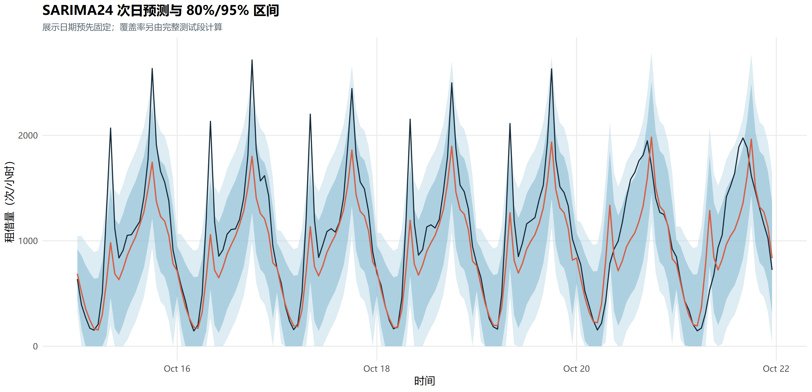

图 3-1 SARIMA24 测试段预测区间示例

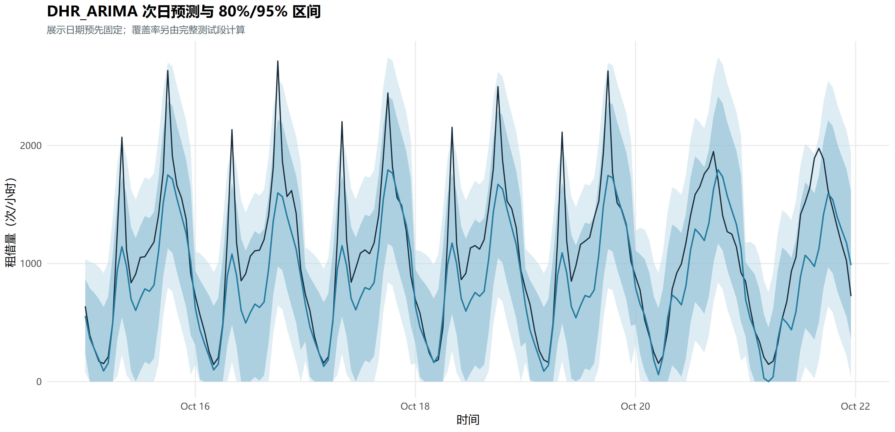

图 3-2 DHR_ARIMA 测试段预测区间示例

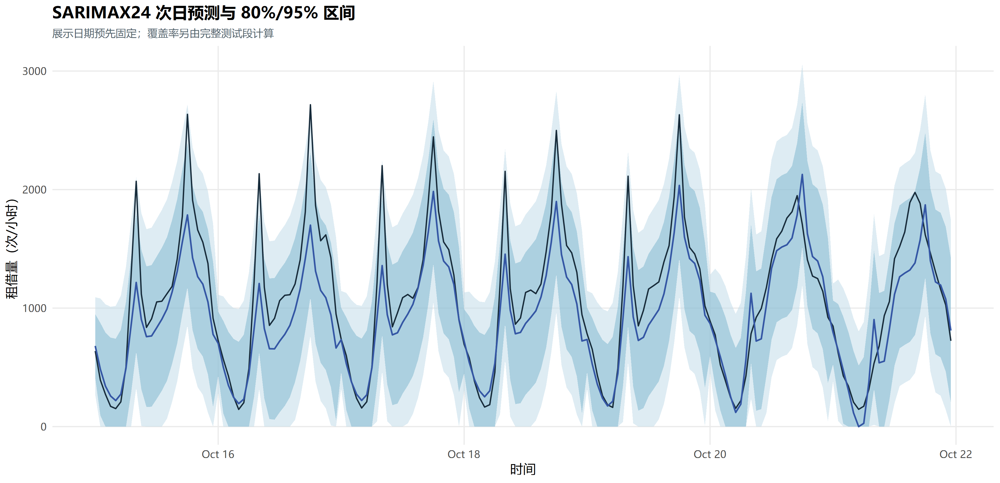

图 3-3 SARIMAX24 测试段预测区间示例

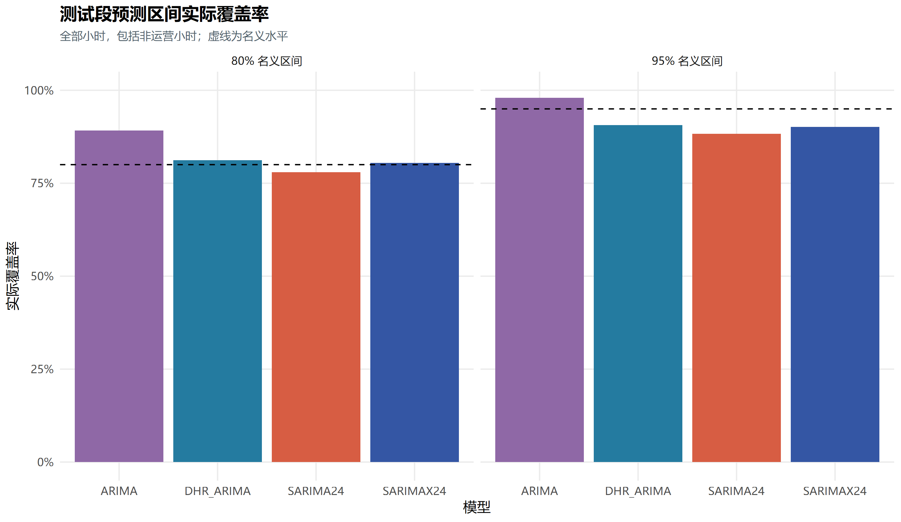

图 3-4 测试段 80%/95% 区间实际覆盖率

表 3-4 季节日历模型的末端24小时外推

| timestamp | horizon | prediction | lo80 | hi80 | lo95 | hi95 |
| --- | --- | --- | --- | --- | --- | --- |
| 2018-12-01 00:00:00 | 1 | 555.766 | 288.395 | 823.136 | 146.857 | 964.674 |
| 2018-12-01 01:00:00 | 2 | 528.979 | 146.412 | 911.546 | 0.000 | 1114.065 |
| 2018-12-01 02:00:00 | 3 | 439.852 | 2.883 | 876.821 | 0.000 | 1108.139 |
| 2018-12-01 03:00:00 | 4 | 329.817 | 0.000 | 803.413 | 0.000 | 1054.120 |
| 2018-12-01 04:00:00 | 5 | 171.240 | 0.000 | 671.991 | 0.000 | 937.073 |
| 2018-12-01 05:00:00 | 6 | 39.787 | 0.000 | 561.355 | 0.000 | 837.457 |
| 2018-12-01 06:00:00 | 7 | 52.759 | 0.000 | 590.537 | 0.000 | 875.219 |
| 2018-12-01 07:00:00 | 8 | 342.318 | 0.000 | 892.838 | 0.000 | 1184.265 |
| 2018-12-01 08:00:00 | 9 | 906.499 | 345.901 | 1467.097 | 49.138 | 1763.860 |
| 2018-12-01 09:00:00 | 10 | 471.014 | 0.000 | 1039.622 | 0.000 | 1340.625 |
| 2018-12-01 10:00:00 | 11 | 475.296 | 0.000 | 1050.291 | 0.000 | 1354.676 |
| 2018-12-01 11:00:00 | 12 | 739.826 | 159.723 | 1319.929 | 0.000 | 1627.017 |
| 2018-12-01 12:00:00 | 13 | 1007.339 | 423.143 | 1591.534 | 113.888 | 1900.789 |
| 2018-12-01 13:00:00 | 14 | 1114.685 | 527.204 | 1702.166 | 216.211 | 2013.159 |
| 2018-12-01 14:00:00 | 15 | 1087.729 | 497.608 | 1677.849 | 185.218 | 1990.239 |
| 2018-12-01 15:00:00 | 16 | 1000.781 | 408.537 | 1593.024 | 95.022 | 1906.539 |
| 2018-12-01 16:00:00 | 17 | 934.904 | 340.951 | 1528.857 | 26.531 | 1843.276 |
| 2018-12-01 17:00:00 | 18 | 1010.100 | 414.770 | 1605.430 | 99.621 | 1920.578 |
| 2018-12-01 18:00:00 | 19 | 1277.919 | 681.480 | 1874.359 | 365.743 | 2190.095 |
| 2018-12-01 19:00:00 | 20 | 868.213 | 270.878 | 1465.547 | 0.000 | 1781.757 |
| 2018-12-01 20:00:00 | 21 | 704.670 | 106.614 | 1302.726 | 0.000 | 1619.318 |
| 2018-12-01 21:00:00 | 22 | 712.857 | 114.218 | 1311.496 | 0.000 | 1628.396 |
| 2018-12-01 22:00:00 | 23 | 722.998 | 123.890 | 1322.107 | 0.000 | 1639.256 |
| 2018-12-01 23:00:00 | 24 | 584.976 | 0.000 | 1184.464 | 0.000 | 1501.814 |

日期2018-12-01，普通非节假日情景；没有未来真实值可核验，未输入未来实测天气或运营状态。

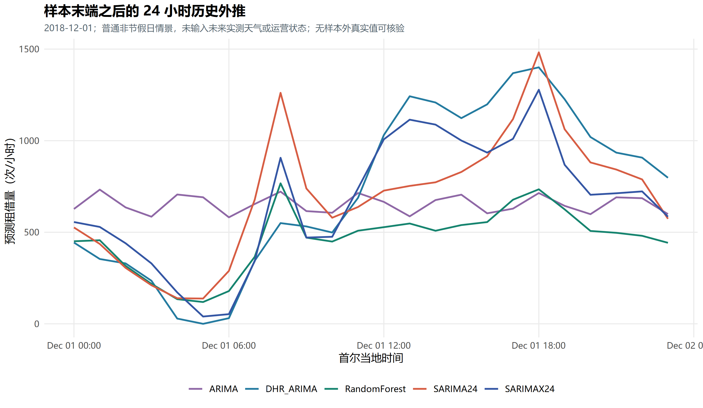

图 3-5 2018 年 12 月 1 日历史外推

## 第四章 R随机森林及模型比较

随机森林是第四章可选的机器学习对照，课程没有点名要求它。本项目用R ranger实现，输入为24/48/168/336小时历史、过去七天同小时均值、起点前24/168小时统计、前一天曲线、日历及可选24小时前天气。七组配置在相同61天、相同400棵树下验证。

R随机森林选定RF_raw_84_leaf5_weather：窗口84天、最小叶样本数5、候选特征比例0.8、400棵树、最大深度20、种子20261026；天气滞后使用情况为TRUE。模型保存在RDS中。

表 4-1 七组R随机森林完整验证

| 模型 | 评价范围 | 小时数 | MAE | RMSE | sMAPE（%） | MASE（周周期缩放） | 平均预测偏差 | 候选编号 |
| --- | --- | --- | --- | --- | --- | --- | --- | --- |
| RandomForest | all | 1464 | 292.376 | 471.183 | 41.149 | 1.165 | 7.114 | RF_raw_84_leaf5_calendar |
| RandomForest | operating | 1368 | 246.545 | 393.287 | 30.002 | 0.982 | -58.736 | RF_raw_84_leaf5_calendar |
| RandomForest | all | 1464 | 291.322 | 470.005 | 41.005 | 1.161 | 9.320 | RF_raw_84_leaf5_weather |
| RandomForest | operating | 1368 | 245.888 | 393.740 | 29.848 | 0.980 | -55.903 | RF_raw_84_leaf5_weather |
| RandomForest | all | 1464 | 298.119 | 475.639 | 41.251 | 1.188 | 8.504 | RF_raw_84_leaf15_weather |
| RandomForest | operating | 1368 | 250.735 | 395.755 | 30.111 | 0.999 | -59.204 | RF_raw_84_leaf15_weather |
| RandomForest | all | 1464 | 305.903 | 496.271 | 41.853 | 1.219 | 4.003 | RF_raw_56_leaf5_weather |
| RandomForest | operating | 1368 | 256.163 | 407.218 | 30.755 | 1.021 | -66.923 | RF_raw_56_leaf5_weather |
| RandomForest | all | 1464 | 290.878 | 482.829 | 40.425 | 1.159 | 26.981 | RF_raw_112_leaf5_weather |
| RandomForest | operating | 1368 | 242.402 | 398.070 | 29.227 | 0.966 | -40.014 | RF_raw_112_leaf5_weather |
| RandomForest | all | 1464 | 289.156 | 473.033 | 39.364 | 1.152 | 44.308 | RF_raw_full_leaf15_weather |
| RandomForest | operating | 1368 | 235.982 | 378.599 | 28.091 | 0.940 | -26.049 | RF_raw_full_leaf15_weather |
| RandomForest | all | 1464 | 314.273 | 506.834 | 45.763 | 1.252 | -75.501 | RF_log_84_leaf5_weather |
| RandomForest | operating | 1368 | 283.020 | 462.639 | 34.939 | 1.128 | -134.106 | RF_log_84_leaf5_weather |

表 4-2 所选模型与基线验证比较

| 模型 | 评价范围 | 小时数 | MAE | RMSE | sMAPE（%） | MASE（周周期缩放） |
| --- | --- | --- | --- | --- | --- | --- |
| ARIMA | all | 1464 | 551.296 | 667.475 | 68.365 | 2.197 |
| ARIMA | operating | 1368 | 524.487 | 644.013 | 59.127 | 2.090 |
| DHR_ARIMA | all | 1464 | 338.338 | 500.223 | 51.760 | 1.348 |
| DHR_ARIMA | operating | 1368 | 296.099 | 430.971 | 42.235 | 1.180 |
| DayTypeMean28 | all | 1464 | 316.203 | 481.235 | 42.362 | 1.260 |
| DayTypeMean28 | operating | 1368 | 268.909 | 398.934 | 31.299 | 1.071 |
| Mean7 | all | 1464 | 327.361 | 498.559 | 44.863 | 1.304 |
| Mean7 | operating | 1368 | 280.591 | 418.794 | 33.976 | 1.118 |
| Median7 | all | 1464 | 324.581 | 526.548 | 44.981 | 1.293 |
| Median7 | operating | 1368 | 270.200 | 425.706 | 34.102 | 1.077 |
| Naive168 | all | 1464 | 398.221 | 666.452 | 55.117 | 1.587 |
| Naive168 | operating | 1368 | 351.730 | 598.672 | 44.950 | 1.401 |
| Naive24 | all | 1464 | 349.629 | 592.950 | 50.051 | 1.393 |
| Naive24 | operating | 1368 | 306.529 | 509.287 | 43.037 | 1.221 |
| RandomForest | all | 1464 | 291.322 | 470.005 | 41.005 | 1.161 |
| RandomForest | operating | 1368 | 245.888 | 393.740 | 29.848 | 0.980 |
| SARIMA24 | all | 1464 | 326.891 | 486.807 | 46.027 | 1.302 |
| SARIMA24 | operating | 1368 | 282.032 | 411.835 | 36.099 | 1.124 |
| SARIMAX24 | all | 1464 | 318.634 | 478.759 | 47.881 | 1.270 |
| SARIMAX24 | operating | 1368 | 273.684 | 401.109 | 38.083 | 1.090 |

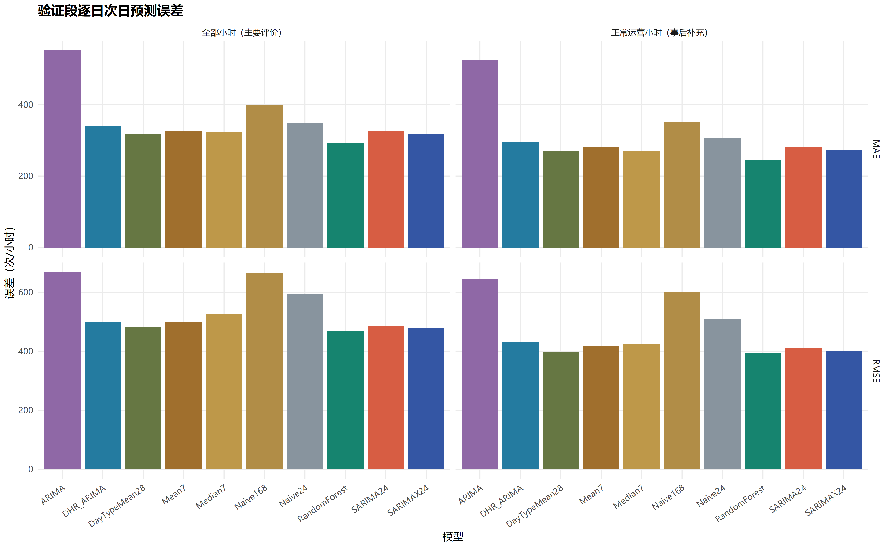

图 4-1 验证段所选模型与基线误差

表 4-3 固定历史测试完整比较

| 模型 | 评价范围 | 小时数 | MAE | RMSE | sMAPE（%） | MASE（周周期缩放） | 平均预测偏差 | RMSE_improvement_over_Naive168_percent | RMSE_improvement_over_strongest_baseline_percent |
| --- | --- | --- | --- | --- | --- | --- | --- | --- | --- |
| RandomForest | all | 1464 | 289.249 | 443.390 | 50.799 | 1.029 | 15.797 | 27.320 | 3.218 |
| Mean7 | all | 1464 | 308.002 | 452.327 | 53.531 | 1.095 | 1.864 | 25.855 | 1.267 |
| DayTypeMean28 | all | 1464 | 282.198 | 458.132 | 46.609 | 1.003 | 43.643 | 24.903 | 0.000 |
| SARIMA24 | all | 1464 | 304.916 | 460.089 | 52.965 | 1.084 | 26.440 | 24.582 | -0.427 |
| SARIMAX24 | all | 1464 | 312.218 | 469.089 | 57.221 | 1.110 | 9.667 | 23.107 | -2.392 |
| DHR_ARIMA | all | 1464 | 339.397 | 496.785 | 64.336 | 1.207 | 35.701 | 18.567 | -8.437 |
| Median7 | all | 1464 | 314.346 | 528.607 | 57.074 | 1.118 | 58.023 | 13.351 | -15.383 |
| ARIMA | all | 1464 | 488.248 | 606.216 | 79.396 | 1.736 | -78.206 | 0.629 | -32.324 |
| Naive168 | all | 1464 | 378.691 | 610.054 | 68.743 | 1.347 | 20.824 | 0.000 | -33.161 |
| Naive24 | all | 1464 | 359.341 | 611.216 | 69.551 | 1.278 | -11.132 | -0.190 | -33.415 |
| DayTypeMean28 | operating | 1313 | 213.883 | 340.760 | 28.969 | 0.761 | -52.106 | 36.971 | 0.000 |
| RandomForest | operating | 1313 | 237.634 | 369.389 | 33.641 | 0.845 | -67.267 | 31.675 | -8.402 |
| SARIMAX24 | operating | 1313 | 250.430 | 369.862 | 42.324 | 0.891 | -86.916 | 31.588 | -8.540 |
| SARIMA24 | operating | 1313 | 247.094 | 370.195 | 37.579 | 0.879 | -63.409 | 31.526 | -8.638 |
| Mean7 | operating | 1313 | 262.617 | 390.565 | 36.686 | 0.934 | -78.728 | 27.758 | -14.616 |
| DHR_ARIMA | operating | 1313 | 278.335 | 394.782 | 50.866 | 0.990 | -60.287 | 26.978 | -15.853 |
| Median7 | operating | 1313 | 254.292 | 441.162 | 40.637 | 0.904 | -31.508 | 18.400 | -29.464 |
| Naive24 | operating | 1313 | 293.723 | 510.486 | 54.549 | 1.044 | -119.356 | 5.577 | -49.808 |
| Naive168 | operating | 1313 | 329.754 | 540.637 | 57.303 | 1.173 | -69.270 | 0.000 | -58.656 |
| ARIMA | operating | 1313 | 459.804 | 581.296 | 65.526 | 1.635 | -171.793 | -7.521 | -70.588 |

最强基线先在验证段选定；新测试属于补充历史评价。

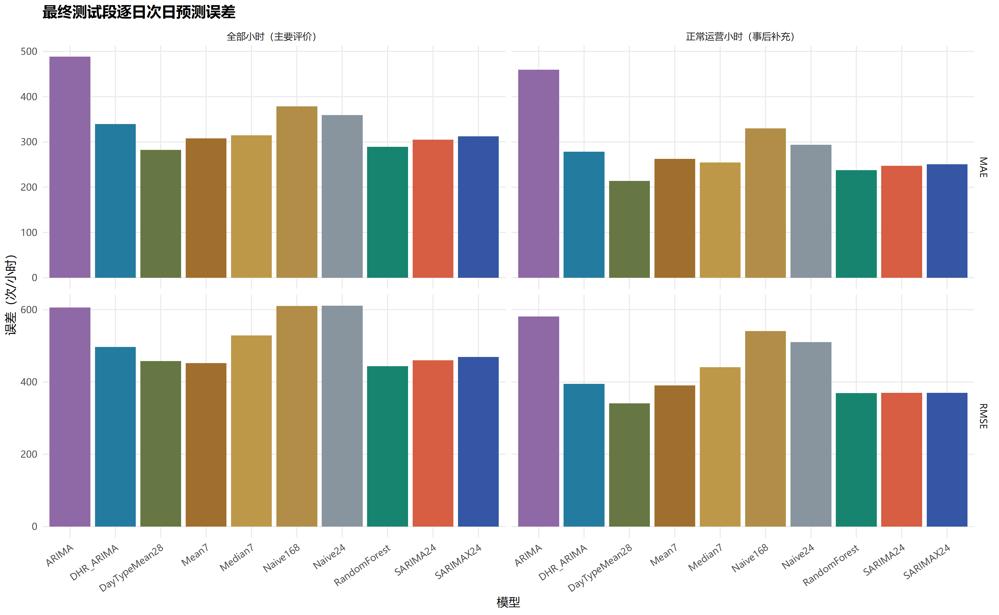

图 4-2 测试段全部小时及正常运营小时误差

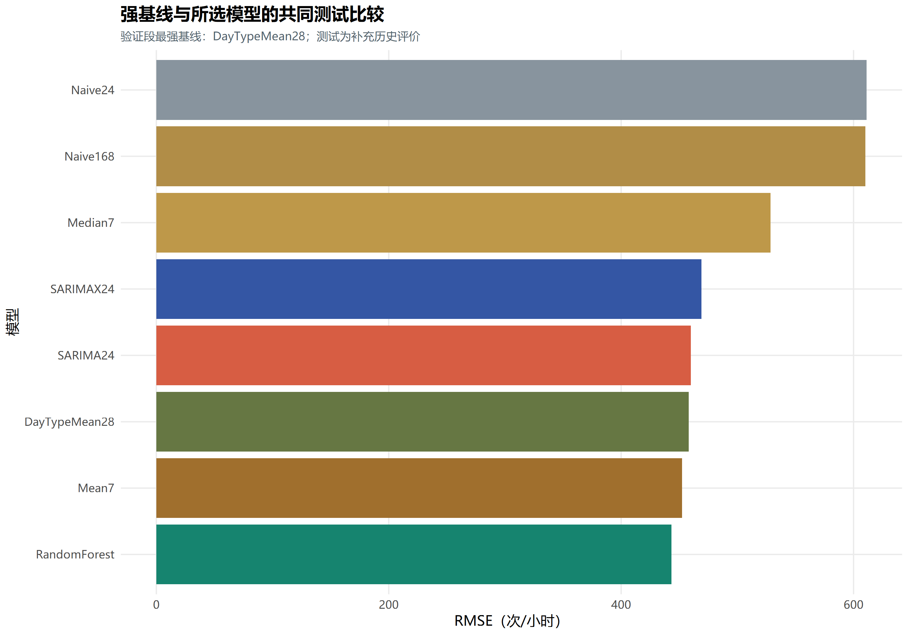

图 4-3 强基线与模型的测试误差

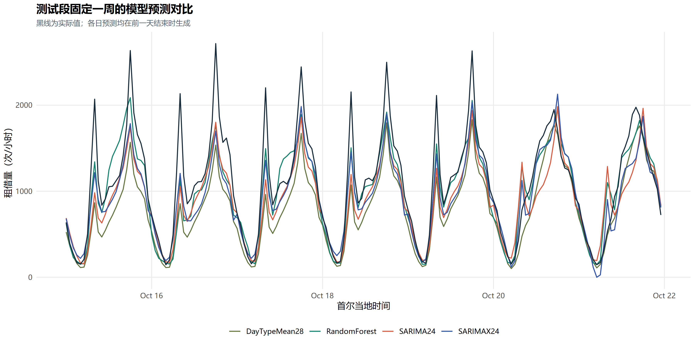

图 4-4 测试段固定一周的模型预测对比

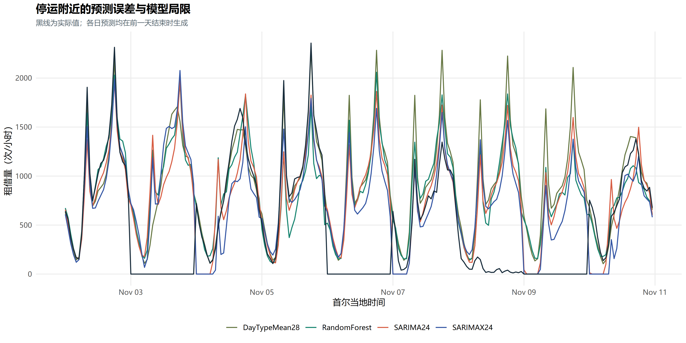

图 4-5 停运附近的预测误差与模型局限

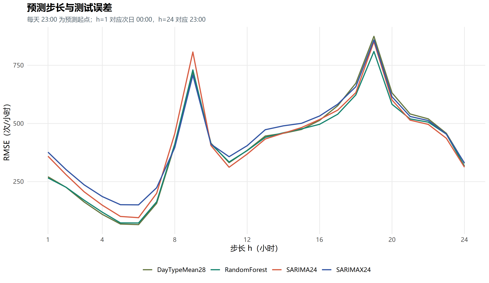

图 4-6 不同预测步长的测试误差

固定起点使步长与目标小时对应，曲线同时反映日内时段难度。

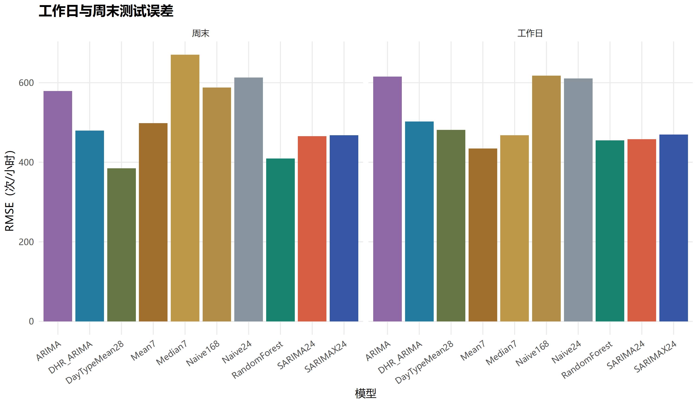

图 4-7 工作日与周末的测试误差

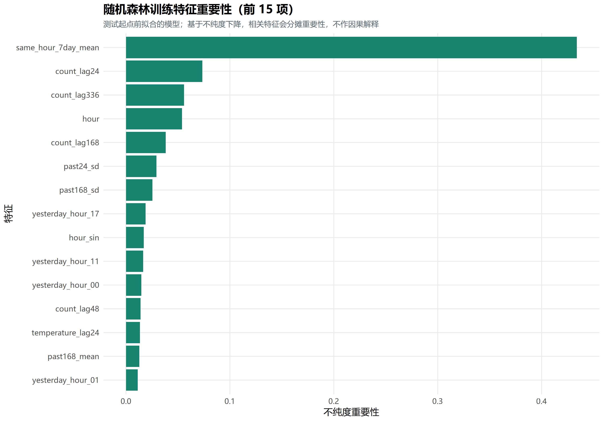

图 4-8 随机森林训练特征重要性

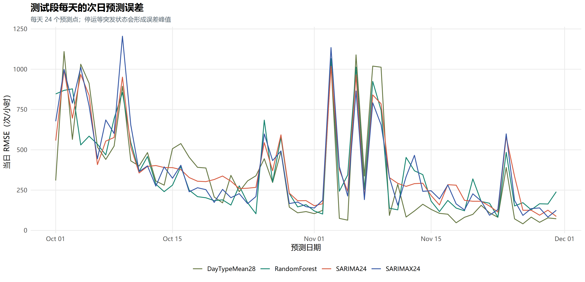

图 4-9 逐日次日预测误差

表 4-4 不同时段误差

| 模型 | 分组 | 小时数 | MAE | RMSE | sMAPE（%） | MASE（周周期缩放） | 平均预测偏差 |
| --- | --- | --- | --- | --- | --- | --- | --- |
| ARIMA | 00–06 夜间 | 427 | 407.666 | 474.208 | 95.471 | 1.450 | 364.603 |
| DHR_ARIMA | 00–06 夜间 | 427 | 159.544 | 239.972 | 90.364 | 0.567 | -74.568 |
| DayTypeMean28 | 00–06 夜间 | 427 | 105.897 | 167.351 | 45.038 | 0.377 | 13.389 |
| Mean7 | 00–06 夜间 | 427 | 113.527 | 167.771 | 50.977 | 0.404 | -1.283 |
| Median7 | 00–06 夜间 | 427 | 121.208 | 194.959 | 55.628 | 0.431 | 10.885 |
| Naive168 | 00–06 夜间 | 427 | 149.841 | 246.460 | 66.415 | 0.533 | 1.349 |
| Naive24 | 00–06 夜间 | 427 | 153.422 | 247.723 | 70.595 | 0.546 | -4.686 |
| RandomForest | 00–06 夜间 | 427 | 109.161 | 169.880 | 49.106 | 0.388 | -1.169 |
| SARIMA24 | 00–06 夜间 | 427 | 122.536 | 217.426 | 58.069 | 0.436 | -14.190 |
| SARIMAX24 | 00–06 夜间 | 427 | 139.289 | 244.538 | 69.030 | 0.495 | -1.006 |
| ARIMA | 07–09 早高峰 | 183 | 551.072 | 658.038 | 81.003 | 1.960 | -191.760 |
| DHR_ARIMA | 07–09 早高峰 | 183 | 394.196 | 539.930 | 56.693 | 1.402 | -71.544 |
| DayTypeMean28 | 07–09 早高峰 | 183 | 376.010 | 534.901 | 55.603 | 1.337 | -36.199 |
| Mean7 | 07–09 早高峰 | 183 | 471.748 | 585.526 | 69.493 | 1.678 | -30.744 |
| Median7 | 07–09 早高峰 | 183 | 469.153 | 684.140 | 75.134 | 1.668 | 84.224 |
| Naive168 | 07–09 早高峰 | 183 | 440.164 | 682.688 | 74.791 | 1.565 | -32.383 |
| Naive24 | 07–09 早高峰 | 183 | 477.115 | 714.815 | 84.293 | 1.697 | -16.863 |
| RandomForest | 07–09 早高峰 | 183 | 421.752 | 539.236 | 64.956 | 1.500 | -65.603 |
| SARIMA24 | 07–09 早高峰 | 183 | 489.948 | 584.070 | 69.561 | 1.742 | -58.777 |
| SARIMAX24 | 07–09 早高峰 | 183 | 382.594 | 524.897 | 59.818 | 1.360 | -53.198 |
| ARIMA | 10–16 日间 | 427 | 411.283 | 528.297 | 65.568 | 1.462 | -147.775 |
| DHR_ARIMA | 10–16 日间 | 427 | 380.951 | 491.620 | 58.264 | 1.355 | -43.380 |
| DayTypeMean28 | 10–16 日间 | 427 | 326.667 | 460.870 | 49.452 | 1.162 | 45.836 |
| Mean7 | 10–16 日间 | 427 | 327.958 | 457.468 | 52.578 | 1.166 | 10.916 |
| Median7 | 10–16 日间 | 427 | 325.536 | 521.090 | 55.116 | 1.158 | 26.047 |
| Naive168 | 10–16 日间 | 427 | 455.410 | 648.673 | 72.925 | 1.619 | 39.419 |
| Naive24 | 10–16 日间 | 427 | 401.541 | 628.531 | 68.887 | 1.428 | -11.761 |
| RandomForest | 10–16 日间 | 427 | 315.789 | 451.922 | 50.845 | 1.123 | 47.494 |
| SARIMA24 | 10–16 日间 | 427 | 317.211 | 453.813 | 48.951 | 1.128 | 33.485 |
| SARIMAX24 | 10–16 日间 | 427 | 349.357 | 482.349 | 54.172 | 1.242 | -2.781 |
| ARIMA | 17–20 晚间 | 244 | 803.444 | 910.320 | 88.981 | 2.857 | -600.811 |
| DHR_ARIMA | 17–20 晚间 | 244 | 535.536 | 735.842 | 48.753 | 1.904 | 257.935 |
| DayTypeMean28 | 17–20 晚间 | 244 | 444.149 | 690.706 | 42.113 | 1.579 | 116.077 |
| Mean7 | 17–20 晚间 | 244 | 492.626 | 653.706 | 51.098 | 1.752 | 10.385 |
| Median7 | 17–20 晚间 | 244 | 516.857 | 773.229 | 54.333 | 1.838 | 154.553 |
| Naive168 | 17–20 晚间 | 244 | 597.619 | 890.765 | 64.943 | 2.125 | 50.373 |
| Naive24 | 17–20 晚间 | 244 | 556.344 | 892.511 | 63.879 | 1.978 | -17.205 |
| RandomForest | 17–20 晚间 | 244 | 457.013 | 642.685 | 47.413 | 1.625 | 21.325 |
| SARIMA24 | 17–20 晚间 | 244 | 478.142 | 661.519 | 46.357 | 1.700 | 99.464 |
| SARIMAX24 | 17–20 晚间 | 244 | 496.057 | 676.264 | 48.069 | 1.764 | 58.554 |
| ARIMA | 21–23 夜间 | 183 | 372.773 | 475.529 | 59.764 | 1.326 | -138.736 |
| DHR_ARIMA | 21–23 夜间 | 183 | 345.778 | 512.420 | 46.188 | 1.230 | 288.454 |
| DayTypeMean28 | 21–23 夜间 | 183 | 280.056 | 442.615 | 40.647 | 0.996 | 92.380 |
| Mean7 | 21–23 夜间 | 183 | 305.304 | 412.546 | 48.994 | 1.086 | 9.330 |
| Median7 | 21–23 夜间 | 183 | 314.066 | 497.903 | 50.612 | 1.117 | 87.716 |
| Naive168 | 21–23 夜间 | 183 | 380.290 | 574.257 | 63.435 | 1.352 | 36.683 |
| Naive24 | 21–23 夜间 | 183 | 360.907 | 592.147 | 61.481 | 1.283 | -10.874 |
| RandomForest | 21–23 夜间 | 183 | 291.342 | 432.872 | 45.005 | 1.036 | 55.454 |
| SARIMA24 | 21–23 夜间 | 183 | 285.784 | 421.897 | 42.639 | 1.016 | 92.654 |
| SARIMAX24 | 21–23 夜间 | 183 | 313.569 | 438.925 | 46.388 | 1.115 | 61.298 |

表 4-5 运营状态分组误差

| 模型 | 分组 | 小时数 | MAE | RMSE | sMAPE（%） | MASE（周周期缩放） | 平均预测偏差 |
| --- | --- | --- | --- | --- | --- | --- | --- |
| ARIMA | closed | 151 | 735.575 | 790.455 | 200.000 | 2.616 | 735.575 |
| DHR_ARIMA | closed | 151 | 870.354 | 1018.614 | 181.457 | 3.095 | 870.354 |
| DayTypeMean28 | closed | 151 | 876.214 | 1012.535 | 200.000 | 3.116 | 876.214 |
| Mean7 | closed | 151 | 702.640 | 810.725 | 200.000 | 2.499 | 702.640 |
| Median7 | closed | 151 | 836.530 | 1008.366 | 200.000 | 2.975 | 836.530 |
| Naive168 | closed | 151 | 804.219 | 1032.828 | 168.212 | 2.860 | 804.219 |
| Naive24 | closed | 151 | 929.914 | 1164.501 | 200.000 | 3.307 | 929.914 |
| RandomForest | closed | 151 | 738.066 | 848.287 | 200.000 | 2.625 | 738.066 |
| SARIMA24 | closed | 151 | 807.706 | 927.731 | 186.755 | 2.872 | 807.706 |
| SARIMAX24 | closed | 151 | 849.494 | 971.547 | 186.755 | 3.021 | 849.494 |
| ARIMA | operating | 1313 | 459.804 | 581.296 | 65.526 | 1.635 | -171.793 |
| DHR_ARIMA | operating | 1313 | 278.335 | 394.782 | 50.866 | 0.990 | -60.287 |
| DayTypeMean28 | operating | 1313 | 213.883 | 340.760 | 28.969 | 0.761 | -52.106 |
| Mean7 | operating | 1313 | 262.617 | 390.565 | 36.686 | 0.934 | -78.728 |
| Median7 | operating | 1313 | 254.292 | 441.162 | 40.637 | 0.904 | -31.508 |
| Naive168 | operating | 1313 | 329.754 | 540.637 | 57.303 | 1.173 | -69.270 |
| Naive24 | operating | 1313 | 293.723 | 510.486 | 54.549 | 1.044 | -119.356 |
| RandomForest | operating | 1313 | 237.634 | 369.389 | 33.641 | 0.845 | -67.267 |
| SARIMA24 | operating | 1313 | 247.094 | 370.195 | 37.579 | 0.879 | -63.409 |
| SARIMAX24 | operating | 1313 | 250.430 | 369.862 | 42.324 | 0.891 | -86.916 |

非运营小时占10.31%，事后分组不意味着能提前知道停运。

表 4-6 原版本与新版本固定参照

| 模型 | RMSE_v1 | RMSE_v2 |
| --- | --- | --- |
| ARIMA | 673.453 | 606.216 |
| DHR_ARIMA | 496.785 | 496.785 |
| DayTypeMean28 | — | 458.132 |
| Mean7 | — | 452.327 |
| Median7 | — | 528.607 |
| Naive168 | 610.054 | 610.054 |
| Naive24 | 611.216 | 611.216 |
| RandomForest | 447.151 | 443.390 |
| SARIMA24 | 477.154 | 460.089 |
| SARIMAX24 | — | 469.089 |

验证更新日、候选覆盖和随机森林实现变化，差异不能归因于单一因素；不按测试结果保留方案。

本轮改善的具体范围：普通ARIMA测试RMSE由673.453降至606.216（下降9.98%），纯SARIMA由477.154降至460.089（下降3.58%），DHR未变化。这些是同一固定历史测试段的描述性差异，不能分离候选覆盖、重估日和模型配置各自的贡献，也没有据此证明在其他时期显著更优。

结构补强没有带来全面提升：SARIMAX相对纯SARIMA的完整验证RMSE下降1.65%，但测试RMSE为469.089，高于纯SARIMA的460.089（增加1.96%）。因此保留SARIMAX作为有收益也有局限的实验，不能将其宣称为优于SARIMA的最终答案。

强基线改变了结论的力度：七日同小时均值的测试RMSE为452.327，优于两个季节ARIMA；验证预选的DayTypeMean28在测试段MAE为282.198，也低于R随机森林的289.249。R随机森林虽然全小时RMSE最低，但只比验证预选基线降低3.22%、比七日均值降低1.98%，且其早期与本轮实现不同，不能把前后差值全部归因于模型优化。不同损失函数的排名应分别解释。

点预测改善也不等于区间已校准：纯SARIMA与SARIMAX的名义95%区间在全部测试小时仅覆盖88.32%和90.16%。结合残差相关，区间仍存在覆盖不足，不能只展示一周图形就宣称不确定性估计可靠。

## 第五章 课程总结与局限

本轮完成完整逐日验证、ARIMA日周结构补强与更强基线；语言统一为R。仍需保留：仅一年历史、秋季测试的范围限制、未知停运、没有真实天气预报、时间相关误差、残余相关和重尾对推断与区间的影响。没有使用独立样本假设证明模型普遍更优。

高阶候选因收敛、协方差或计算预算失败时记录为未完成，不证明统计表现差。当前仍是有限候选集合，后续研究需固定规则，避免反复依据已经查看的测试段调整。

## 参考文献

[1] UCI. Seoul Bike Sharing Demand. DOI:10.24432/C5F62R. https://archive.ics.uci.edu/dataset/560/seoul+bike+sharing+demand

[2] Hyndman RJ, Athanasopoulos G. Forecasting: Principles and Practice. https://otexts.com/fpp3/

[3] forecast documentation. https://pkg.robjhyndman.com/forecast/

[4] Breiman L. Random Forests. Machine Learning. 2001;45:5–32.

[5] Wright MN, Ziegler A. ranger. Journal of Statistical Software. 2017;77(1). https://doi.org/10.18637/jss.v077.i01

## 附录 纯R复现与材料使用

运行Rscript --vanilla scripts/run_all.R或run.ps1。全部实验、报告和验收仅依赖R；主要包为forecast、ggplot2、urca、ranger和jsonlite。模型以RDS保存，软件版本见r_package_versions.csv及r_session_info.txt。候选起点拟合对象按代码、数据和协议签名缓存。

report_ready.html离线查看，report_materials.md可编辑，results/report_tables/提供表格，report_figure_manifest.csv提供图号。原结果参照、协议、星期覆盖、删列记录和时间边界审计在results/。正文可精选图表，完整参数等放附录。
