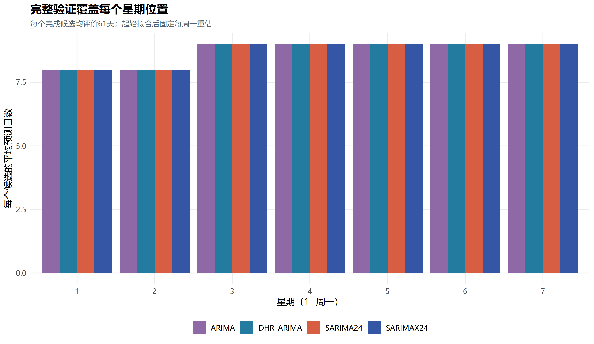
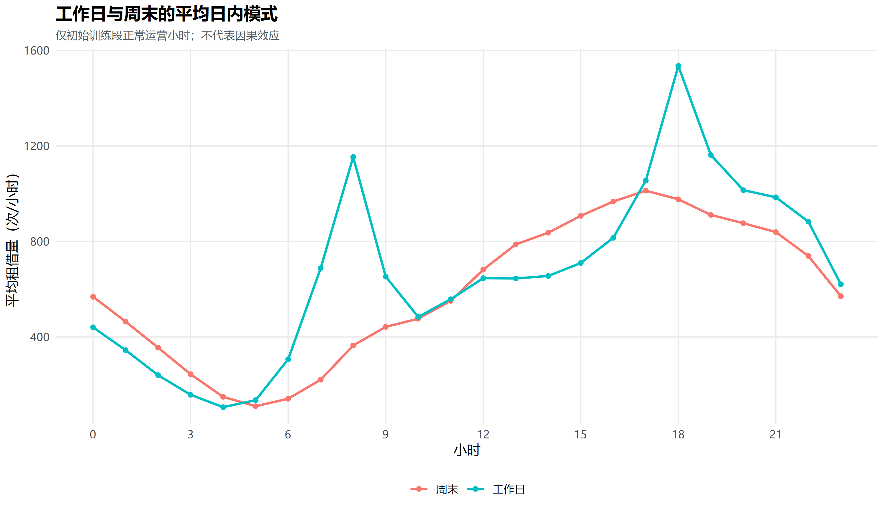
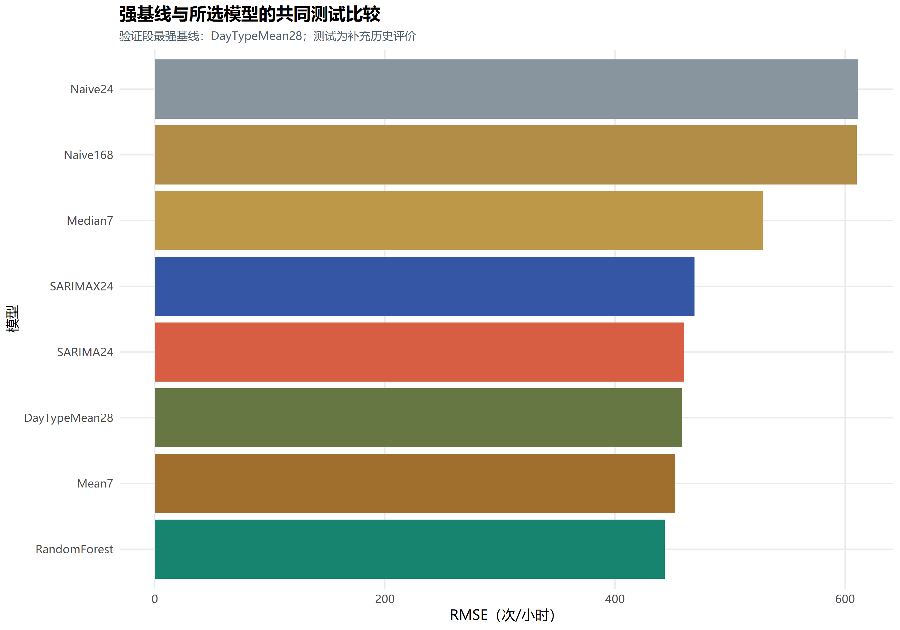
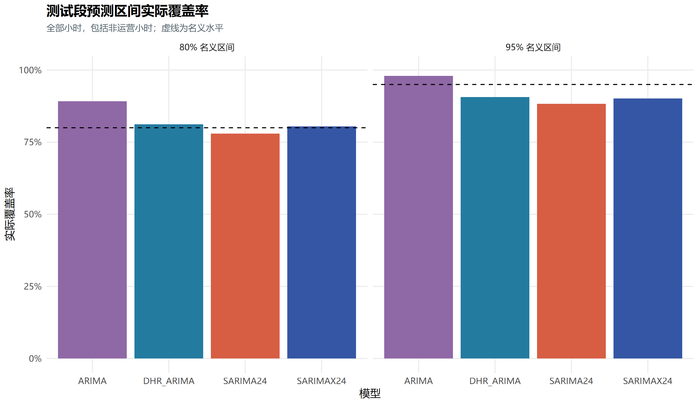
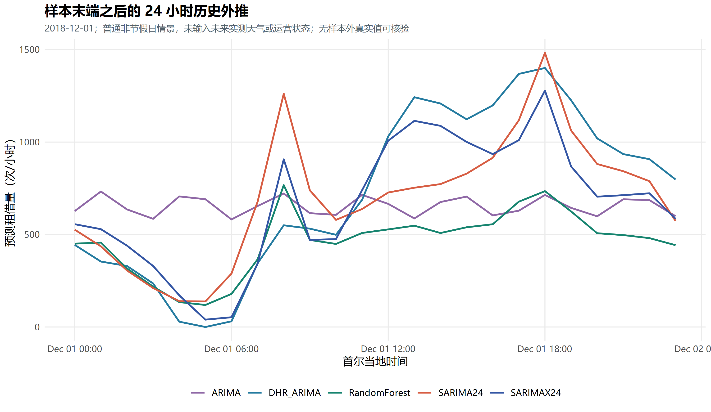

# 首尔共享单车时间序列实验过程详解

> 阅读用途：理解本次实验为什么这样设计、代码怎样运行、困难如何处理，以及结果究竟能说明什么。
>
> 内容依据：当前项目中的 R 脚本、实际运行结果与最后一次完整复跑记录。结果版本为 2026-10-26 的完整逐日验证版本。文中的指标保留三位小数，百分比通常保留两位。
>
> 建议先读第 1—4 节建立整体概念，再读第 5—10 节理解建模，最后用第 11—16 节理解结果、困难和报告写法。公式看不懂时，可以先读公式后面的文字解释。

## 1. 目前到底完成到了哪一步

实验流程已经完成，包括读取数据、检查数据、探索分析、平稳性检验、模型识别、验证选模、滚动测试、残差诊断、区间评价和样本末端外推。完整入口 `scripts/run_all.R` 已实际运行成功。

| 内容 | 当前状态 | 阅读位置 |
| --- | --- | --- |
| R 实验代码与模型运行 | 已完成，模型与预测已经保存 | [scripts/](scripts/)、[results/models/](results/models/) |
| 数据、验证和测试结果 | 已完成 | [results/](results/) |
| 报告图表 | 33 张 PNG，按 300 DPI 导出 | [figures/](figures/) |
| 报告表格 | 21 张，有 CSV 与 Markdown 版本 | [results/report_tables/](results/report_tables/) |
| 五章报告内容材料、参考文献及附录 | 已生成，包含方法、结果和局限 | [report_materials.md](report_materials.md) |
| 可离线阅读的图文报告材料 | 已生成 | [report_ready.html](report_ready.html) |
| 独立工程核验 | 54 项通过 | [results/validation_summary.md](results/validation_summary.md) |
| 套入学校模板、填好个人信息并完成最终排版的 Word 提交版 | 尚未制作 | 根目录原课程 `.docx` 仍是模板文件 |

因此，“实验和报告撰写材料已经完成”是准确的；“已经有一份完全排好版、可以直接交给老师的最终 Word 报告”还不准确。现有 `report_materials.md` 的定位是完整撰写材料，保留了“摘要建议”等提示性文字，以及可供正文或附录选用的全部结果。

本文件则是一份讲解文档：它帮助你理解实验，不替代课程报告正文。

## 2. 我们研究的究竟是什么问题

### 2.1 一句话说明任务

每天结束时，利用当时已经知道的信息，预测第二天 24 个小时分别会发生多少次共享单车租借。

设每小时实际租借量为 `y_t`。在某一天 23:00 的预测起点 `o`，一次生成：

$$
\hat y_{o+1\mid o},\hat y_{o+2\mid o},\ldots,\hat y_{o+24\mid o}。
$$

这 24 个数依次对应第二天 00:00、01:00，直到 23:00。预测途中不读取第二天刚发生的真实租借量来修正当天后续小时的预测。

例如：预测 2018-10-01 的全天租借量时，只使用截至 2018-09-30 23:00 的观测和可以提前知道的日历信息。

### 2.2 为什么研究小时数据

数据有 8,760 条连续小时记录。如果全部汇总为每天一个数，就只有 365 条数据，还会丢失早晚高峰与工作日、周末日内曲线的差异。

因此，模型始终以小时为单位。报告中的每日总量曲线用于展示全年变化，没有把主实验变成日频预测。

### 2.3 “实际租借量”与“潜在需求”有什么区别

数据里有停运时段。停运时实际租借量为零，但这不能证明没有人想租车。因此，本实验预测的是记录中实际发生的租借量，不能据此还原停运期间没有被满足的潜在需求。

数据也没有各站点库存、车辆容量和调度成本，所以我们没有直接计算“每个站点该调多少辆车”。报告主题应围绕租借量预测，避免把预测结果写成已经验证的调度方案。

## 3. 第一步：把数据变成可信的时间序列

对应代码：[01_data_preparation.R](scripts/01_data_preparation.R)。

### 3.1 数据有哪些内容

使用 UCI 的 [Seoul Bike Sharing Demand 数据集](https://archive.ics.uci.edu/dataset/560/seoul+bike+sharing+demand)，时间范围为 2017-12-01 至 2018-11-30，原始数据有 14 列。

| 类型 | 主要字段 | 实验中的作用 |
| --- | --- | --- |
| 时间与目标 | 日期、小时、租借量 | 构造连续小时序列与预测目标 |
| 天气观测 | 气温、湿度、风速、能见度、露点温度、太阳辐射、降雨、降雪 | 描述性分析；部分历史天气进入候选模型 |
| 日历类别 | 季节、节假日 | 帮助理解规律；模型实际使用哪些变量由设计决定 |
| 运营记录 | 是否正常运营 | 解释零值，进行事后分组评价 |

“原始表里有这个字段”与“预测时允许把这个字段输入模型”是两回事。例如，目标日的实测天气和实际运营状态不能因为已经出现在历史文件中，就被当作预测前已知信息。

### 3.2 为什么先固定原始文件

程序先检查原始 CSV 的 MD5：

```text
bf632307dcb419f67df589faaa0318e1
```

它用于确认本次复现读到的文件与已经核验的数据快照一致。若文件发生变化，程序停止，避免把另一份数据和旧模型缓存混在一起。

MD5 在这里是文件一致性标记，不是用来证明数据中的业务记录一定没有错误。数据内容还需要后续检查。

### 3.3 编码、日期和小时轴为什么容易出问题

原始列名包含特殊单位字符，读取时显式指定 `latin1`。日期按“日/月/年”解析，不能依赖系统自动猜测。

```r
raw <- utils::read.csv(raw_path, fileEncoding = "latin1",
                      check.names = FALSE)
d$date <- as.Date(d$date, "%d/%m/%Y")
d$timestamp <- as.POSIXct(
  paste(d$date, sprintf("%02d:00:00", d$hour)),
  tz = "Asia/Seoul"
)
```

我们把日期与小时合成时间戳，按时间排序，再检查相邻记录是否严格相差 3,600 秒。导出时保留完整的“日期＋时分秒”，读回时也明确解析。

这么做是因为，时间序列里一行错位会影响一整串滞后特征。例如“前一天同小时”一旦指向错误的行，模型可能仍然可以运行，但实验已经变成另一个问题。

最终核验结果为：8,760 行、无缺失值、无重复时间戳、无小时断点，租借量均为非负整数。

### 3.4 最大的数据处理难点：295 个零值怎么办

核验发现，全部 295 个零值都对应非运营小时，正常运营小时没有零租借量记录。

我们的处理是：**保留全部零值，也保留原来的连续小时轴。**

原因有三点：

1. 它们是实际发生的非运营记录，没有证据可以把它们当成缺失值进行插补。
2. 删除它们再把余下记录拼接起来，会破坏“间隔 24 行就是前一天同小时”的含义。
3. 主任务包含未来可能出现的非运营小时，只在正常运营时段计算误差，会避开任务的一部分难度。

但保留零值并不等于已经解决停运预测。当前模型没有提前获知停运计划，因此突然停运仍会带来明显误差。

| 数据阶段 | 小时数 | 非运营小时 | 非运营比例 |
| --- | ---: | ---: | ---: |
| 初始训练 | 5,832 | 48 | 0.82% |
| 验证 | 1,464 | 96 | 6.56% |
| 测试 | 1,464 | 151 | 10.31% |

这也说明测试阶段的业务状态与初始训练阶段不同。我们可以把这种变化视为模型泛化的困难，但不能仅凭这张表证明全部误差都是停运造成的。

证据：[data_quality.csv](results/data_quality.csv)、[split_information.csv](results/split_information.csv)、[closure_intervals.csv](results/closure_intervals.csv)。

## 4. 第二步：设计一个符合真实预测顺序的实验

### 4.1 为什么不能随机划分训练集和测试集

预测未来时不可能先看到未来，再回到过去建模。随机拆分小时记录，会把未来记录分到训练集，也可能让相邻时刻或同一日的高度相关记录分散到两边，使评价过于乐观。

本实验按时间划分：

| 阶段 | 时间范围 | 小时数 | 主要用途 |
| --- | --- | ---: | --- |
| 初始训练 | 2017-12-01—2018-07-31 | 5,832 | 结构分析、初始拟合 |
| 验证 | 2018-08-01—2018-09-30 | 1,464 | 比较候选、选择配置 |
| 固定历史测试 | 2018-10-01—2018-11-30 | 1,464 | 评价已选配置的后续表现 |

“训练集八个月”指初始训练范围。进入滚动评价后，已经发生的历史会逐步变长，模型按既定规则使用最新可用历史。

### 4.2 验证集和测试集各做什么

验证集负责回答“选哪种结构、窗口、变换和超参数”。选择标准固定为全部验证小时的 RMSE；有相同 RMSE 时再按 MAE 排序。

测试集负责回答“锁定的配置在后续这段历史上表现怎样”。不能因为某个方案测试结果不好，就不断回头调整它，再把同一个测试段称为从未看过的检验。

本项目原有测试结果在前一版本中已经查看，所以本轮新结果明确称为**补充历史评价**。当前配置按开发验证选择，但这不能消除研究者已经知道测试表现带来的影响，也不能把本轮包装为一场全新的盲测。根据开发诊断补充候选，也可能让验证分数出现选模乐观偏差。

### 4.3 “滚动预测”究竟怎样滚动

| 生成预测的时间 | 预测目标 | 可以看到的真实记录 | 参数处理 |
| --- | --- | --- | --- |
| 2018-09-30 23:00 | 10 月 1 日全天 | 截至 9 月 30 日 | 为测试起始日拟合 |
| 2018-10-01 23:00 | 10 月 2 日全天 | 包括已结束的 10 月 1 日 | 更新历史与状态，沿用本周参数 |
| 2018-10-07 23:00 | 10 月 8 日全天 | 截至 10 月 7 日 | 因次日为周一，重新估计参数 |

所以，“不能用测试数据选超参数”不等于“测试期间任何真实数据都不能再使用”。预测 10 月 2 日时，10 月 1 日已经过去，使用这一天的观测符合滚动预测场景。

### 4.4 为什么不是每天重新拟合所有模型

我们区分了两个操作：

- **参数重估**：重新求 AR、MA、季节项或随机森林的参数与结构，计算较重。
- **利用新历史预测**：ARIMA 在固定参数下更新状态；随机森林使用新一天可以获取的历史特征。

规则是：每个评价阶段开始先拟合，此后固定每周一重估。验证从 8 月 1 日开始，首次拟合后，下一个重估日是 8 月 6 日。测试从 10 月 1 日开始，该日恰好为周一。

两个阶段各有 61 个预测日，每个完成的学习模型候选各有 9 个重估日。这样兼顾更新及时性与计算成本，也让验证与测试执行相同的日历规则。

### 4.5 本轮为什么取消“只选星期三”的初筛

此前的稀疏筛选只覆盖特定星期位置。共享单车工作日与周末的曲线不同，若只凭某一种星期位置筛选，可能过早排除更适合其他日期的候选。

现在，全部登记候选都尝试完整的 61 天验证。完成候选均覆盖周一至周日，每种星期位置有 8 或 9 天。只有完成全部 1,464 小时预测的候选参与正式排名，失败候选另行记录。



这项调整最直接的收益是评估更完整，不保证每个模型的预测指标一定下降。

证据：[experiment_protocol.csv](results/experiment_protocol.csv)、[arima_validation_weekday_coverage.csv](results/arima_validation_weekday_coverage.csv)、[validation_refit_log.csv](results/validation_refit_log.csv)。

## 5. 第三步：先理解数据的规律，再讨论模型

对应代码：[02_exploratory_analysis.R](scripts/02_exploratory_analysis.R)。

我们先看全年每日变化、典型一周小时曲线、工作日和周末的平均曲线、星期与小时热图、各月分布、天气关系以及运营状态。

其中，帮助模型识别的日内曲线、热图和天气关系主要使用初始训练段；全年图用于描述时间划分和数据背景。不能把全年分解得到的未来信息当作训练特征。

### 5.1 日周期与周周期是两个不同层次

一天是 24 小时，一周是 168 小时。相同小时往往有相近的活动规律，但周末的出行时间分布不一定与工作日相同。



阅读这张图时，应关注曲线的形状、峰值出现时刻以及两类日期之间的差异。它支持我们尝试日周期、周周期和周末交互，而不是只使用一个普通 ARIMA 模型。

训练段还做了日、周多重季节分解 MSTL，帮助观察重复规律和趋势。分解结果用于识别结构，没有直接作为全样本预测输入。

### 5.2 月份差异为什么不能直接称为已验证的年度季节性

虽然覆盖四季，但每个月份只出现一次。天气、长期变化、节假日和业务状态都会同时变化。

因此，我们可以说“这份数据中的不同月份存在分布差异”，但不能说“已经证明每一年都会重复相同变化”。8,760 个小时提供了较多日、周重复，并没有提供多个年度重复。

### 5.3 天气相关为什么不能直接解释成因果关系

气温和租借量相关，可能同时反映月份、时段、工作日类型等因素。散点图和相关系数没有控制全部这些影响。

我们将天气图作为探索分析，并把历史天气是否有预测帮助交给验证结果比较；没有据此宣称“气温升高一度必然带来多少次租借增长”。

## 6. 第四步：平稳性检验、差分与模型识别

对应代码：[03_stationarity_analysis.R](scripts/03_stationarity_analysis.R)。

### 6.1 为什么需要讨论平稳性

ARIMA 的基本思路是，对序列做适当处理后，利用过去值与过去误差描述剩余的时间关系。如果序列水平、变化结构或周期模式持续变化，直接套一个简单模型可能不合适。

我们比较了原始租借量、`log(1+y)`、一阶差分、24 小时季节差分，以及两种差分的组合。

```text
一阶差分：             z_t - z_(t-1)
24 小时季节差分：      z_t - z_(t-24)
组合差分：             对季节差分结果再做一阶差分
```

对数使用 `log(1+y)`，是为了让零值有定义，并减轻大值带来的尺度差异。但“变换后图形更集中”并不意味着预测必然更好，所以我们同时保留原尺度候选。最终选出的四个 ARIMA 类模型都使用原尺度。

### 6.2 ADF 和 KPSS 的原假设正好不同

| 检验 | 原假设 | 拒绝原假设意味着什么 |
| --- | --- | --- |
| ADF | 存在单位根 | 对该设定下的单位根假设不利 |
| KPSS | 平稳；是否含趋势取决于设定 | 对该设定下的平稳假设不利 |

不能把两个检验都理解成“p 值小就说明平稳”，也不能用“没有拒绝”替代“已经证明”。本项目的 `urca` 结果主要依据统计量与 5% 临界值进行判断。

### 6.3 实际遇到的困难：两种检验会给出分歧

基础设定中，ADF 的最大滞后为 48，并在范围内按 BIC 选择；KPSS 使用 `long` 带宽。随后增加周尺度敏感性：ADF 固定 168 阶，KPSS 使用 168 的带宽。

| 序列与设定 | ADF 统计量 | ADF 5% 临界值 | 拒绝单位根 | KPSS 统计量 | KPSS 5% 临界值 | 拒绝平稳 |
| --- | ---: | ---: | --- | ---: | ---: | --- |
| 原值，基础设定 | -7.051 | -3.410 | 是 | 0.611 | 0.146 | 是 |
| 原值，168 小时敏感性 | -3.316 | -3.410 | 否 | 0.272 | 0.146 | 是 |
| 对数，基础设定 | -9.058 | -3.410 | 是 | 0.217 | 0.146 | 是 |
| 对数，168 小时敏感性 | -4.529 | -3.410 | 是 | 0.138 | 0.146 | 否 |

这说明判断对检验设定有敏感性。共享单车的日周结构、水平变化与停运记录，使得一个检验结果不足以决定全部建模步骤。

我们的解决方式是保留检验分歧，增加敏感性分析，再结合差分图、ACF/PACF 和完整验证比较候选。差分后的几个序列在当前两组设定下得到更一致的结果，但这也不意味着所有模型都必须同时做一阶差分和季节差分；不必要的差分可能损失有用结构。

### 6.4 ACF、PACF 分别看什么

ACF 描述序列与不同滞后值之间的相关；PACF 尝试剔除中间滞后的线性影响，观察某一滞后的额外联系。

本实验重点看 24、168 和 336 小时等位置。真实数据有多重季节性与非平稳因素，不能只凭某一个峰值就断言“阶数一定是多少”。我们用图形形成有限候选，再由统一验证选择。

绘图时还显式处理了滞后对齐：ACF 原输出包含 lag=0，要去掉；PACF 从 lag=1 开始。最终导出的两者都使用真实的 1—336 小时，防止图形看起来正常，横轴却整体错一位。

证据：[stationarity_tests.csv](results/stationarity_tests.csv)、[stationarity_sensitivity.csv](results/stationarity_sensitivity.csv)、[acf_pacf_training.csv](results/acf_pacf_training.csv)。图形可结合 [原对数序列的 ACF/PACF](figures/11_acf_pacf_log1p.png) 与 [24 小时差分后的 ACF/PACF](figures/12_acf_pacf_diff24.png) 阅读。

## 7. 第五步：建立五种简单但有竞争力的基线

对应代码：[03_baselines.R](scripts/03_baselines.R)。

基线的作用是建立一个可靠参照：如果一个简单的历史均值已经预测得很好，复杂模型的收益就应与它比较。

设目标小时为 `t=o+h`，其中 `h` 为 1—24。

| 基线 | 计算方法 | 直观含义 |
| --- | --- | --- |
| Naive24 | `y_(t-24)` | 昨天这个小时是多少，明天就先预测多少 |
| Naive168 | `y_(t-168)` | 沿用前一周同星期、同小时的值 |
| Mean7 | 过去 7 天同小时的平均值 | 用一周平均减少单日波动 |
| Median7 | 过去 7 天同小时的中位数 | 降低少量极端历史值的影响 |
| DayTypeMean28 | 过去 28 天中，同为工作日或同为周末的同小时均值 | 同时考虑近期水平和日期类型 |

Mean7 的表达式为：

$$
\hat y_{t\mid o}=\frac{1}{7}\sum_{k=1}^{7}y_{t-24k}。
$$

为什么这些值都已经可用？因为 `h≤24`，最近的源小时 `t-24=o+h-24≤o`，更早的源小时自然也不晚于预测起点。

DayTypeMean28 中的“工作日”仅按周一至周五划分，“周末”为周六、周日，没有额外将节假日单独分类，也没有只找“过去四个相同星期几”。所有基线都保留历史零值。

### 7.1 最强基线必须在验证阶段选

验证 RMSE 最低的基线是 DayTypeMean28，为 **481.235**，因此正式参照固定为它。

测试中 Mean7 的 RMSE 更低，但不能因为看到了测试结果，就回头把“预先选定的最强基线”改成 Mean7。我们保留预选参照，同时把五个基线的测试结果全部展示。

这是本轮很重要的改进：增加强基线后，复杂模型的优势变得更有限，但实验结论更可信。

证据：[baseline_validation_comparison.csv](results/baseline_validation_comparison.csv)、[strongest_baseline_selection.csv](results/strongest_baseline_selection.csv)、[baseline_source_time_audit.csv](results/baseline_source_time_audit.csv)。

## 8. 第六步：ARIMA 类模型是怎样逐步设计出来的

### 8.1 先认识模型名称中的字母

普通 ARIMA 写成 `ARIMA(p,d,q)`：`p` 是自回归阶数，`d` 是普通差分阶数，`q` 是移动平均误差阶数。

这里的 MA 不是第 7 节那种“直接计算过去几天均值”的基线，而是用过去的随机误差描述当前误差关系。

季节 ARIMA 写成：

$$
ARIMA(p,d,q)(P,D,Q)_{24}。
$$

其中大写的 `P、D、Q` 对应季节部分，24 表示一天。SARIMA 属于 ARIMA 家族，所以报告以它作为季节模型主线，仍然符合必须包含 ARIMA 的要求。我们也保留普通 ARIMA，展示不显式处理日周期时的表现。

### 8.2 本次比较了四类 ARIMA 结构

| 模型族 | 主要思路 | 为什么尝试 |
| --- | --- | --- |
| ARIMA | 用较近的值与误差描述动态变化 | 建立普通 ARIMA 参照 |
| SARIMA24 | 增加 24 小时季节动态 | 处理明显的日重复规律 |
| DHR_ARIMA | 日周 Fourier、日历及交互解释平均规律，剩余误差用 ARIMA | 以较少周期项同时描述日、周变化 |
| SARIMAX24 | 日周日历回归＋带日季节结构的 ARIMA 误差 | 同时描述平均规律与周期随机误差 |

后两者可理解为：

$$
y_t=\beta_0+x_t^\top\beta+u_t，
$$

其中 `x_t` 描述日历规律，`u_t` 仍可能有时间依赖；DHR 和 SARIMAX 的主要差别在于怎样描述这部分误差。模型名称中的 X 表示回归变量，不表示一定使用天气。最终所选 DHR 和 SARIMAX 都没有启用天气变量。

### 8.3 Fourier 项和周末交互在做什么

Fourier 项由不同频率的正弦、余弦组成。例如一天的基础波动可用 `sin(2πt/24)`、`cos(2πt/24)` 表示；增加谐波可以描述更复杂的双峰或多峰曲线。

本次所选日历模型使用 5 对日周期 Fourier 项、3 对周周期 Fourier 项，并加入周末主效应及前三对日周期项的周末交互，同时在可识别时保留节假日项。

周末交互的意义是让“周末与工作日的差别”随小时变化，而不只是在所有小时统一加上一个固定数。

这些时间位置在预测前就能计算。2018-12-01 外推时的节假日值则是明确指定的普通非节假日情景。

### 8.4 为什么要比较不同训练窗口

扩展窗口使用从样本开始到当前起点的全部历史；固定回看窗口只用最近若干天估计参数。

长窗口通常信息更多，但可能混入较旧的水平与结构；短窗口更贴近近期状态，但样本更少，也更容易出现某些节假日类别完全没出现的情况。

因此，我们比较了扩展窗口、56 天、84 天等设置，而不是预先认定“数据越多一定越好”。窗口选择服从验证结果。

### 8.5 最后选中了什么

| 模型族 | 最终结构 | 参数重估使用的窗口 | 验证 RMSE |
| --- | --- | --- | ---: |
| ARIMA | `(3,1,2)`，原尺度 | 最近 84 天 | 667.475 |
| SARIMA24 | `(1,0,1)(0,1,1)[24]`，原尺度 | 扩展窗口 | 486.807 |
| DHR_ARIMA | 日周日历＋`ARIMA(2,0,2)` 误差，原尺度 | 最近 84 天 | 500.223 |
| SARIMAX24 | 日周日历＋`(2,0,2)(1,0,1)[24]` 误差，原尺度 | 最近 84 天 | 478.759 |

`window_days=0` 在结果表中表示扩展窗口，不是零条训练数据。84 天指参数重估时的训练范围；周内沿用参数时，会继续利用新观测更新状态。

最终结构见 [selected_arima_specifications.csv](results/selected_arima_specifications.csv)，完整参数见 [selected_model_parameters.csv](results/selected_model_parameters.csv)，含实际估计系数的方程见 [model_equations.md](results/model_equations.md)。

### 8.6 为什么不是直接选 AIC 最小的模型

AIC、AICc、BIC 用于平衡训练拟合与复杂度，但不能随意跨不同变换、不同训练样本或不同差分方案比较数值大小。

本项目按变换、训练起止位置和差分阶数分组，只在同口径组内给 AICc 排名。最终配置仍按完整验证 RMSE 选择。

尤其不能把“某个短窗口模型 AIC 比长窗口模型小很多”直接解释为前者一定更好，因为两者可能连计算似然时使用的数据量都不同。

## 9. 第七步：拟合困难与计算成本是怎样处理的

对应代码：[04_model_engine.R](scripts/04_model_engine.R)、[04_arima_experiments.R](scripts/04_arima_experiments.R)、[04_refinement.R](scripts/04_refinement.R)。

### 9.1 回归列没有变化，为什么会让模型难以估计

假设某次短窗口中没有节假日，节假日指示列全为 0。该窗口没有提供估计节假日效应的对照信息；如果某列与截距或其他列完全重复，也无法单独识别其系数。

我们的处理是检查常量列和差分后的列，再用 QR 分解识别冗余列，记录删除的变量。预测时严格沿用拟合时保留下来的列及顺序。

删除的是“这个窗口中不可识别的模型列”，没有因此删除租借量记录，也没有把相关系数强行设为一个看起来合理的值。相应效应无法估计时，报告也不额外解释它。

### 9.2 为什么不能盲目叠加季节差分和日周期 Fourier

若 `x_t=sin(2πt/24)`，则 `x_t=x_(t-24)`，因此：

$$
(1-B^{24})x_t=0。
$$

也就是说，24 小时季节差分会消除一个严格重复的 24 小时 Fourier 项。若仍把这类列原样塞进差分后的回归结构，可能出现不可识别或秩不足。

所以，使用日季节差分的部分候选侧重周周期和日历结构；保留完整日周 Fourier 的候选则尝试不做日季节差分。程序还对实际差分后的设计矩阵再检查一次。

这不是为了让拟合“勉强运行”而随意删变量，而是要确保模型中每个参数确实有数据可以支持估计。

### 9.3 为什么“函数返回了模型”不等于拟合成功

程序会检查优化返回码、系数是否有限，以及参数协方差对角元是否有限且为正。对角元异常会让标准误失去正常含义。

首选最大似然估计 ML；若不符合有效性要求，再尝试 CSS-ML，以不同初始化方式进行重估。迭代上限设为 300，并为拟合设置 180 秒耗时预算。仍失败时记录原因，不伪造预测，也不悄悄用其他模型替代。

注意，当前检查的是上述数值有效性条件，不代表已经证明每个模型的所有统计假设成立。

### 9.4 当前实际有四个候选未完成

先对原有 19 个候选进行完整验证，再补充 9 个针对性结构，共登记 28 个。最新完整复跑中，24 个完成，4 个失败。

| 候选编号 | 失败日期 | 最新记录中的原因 | 怎样处理 |
| --- | --- | --- | --- |
| `D_log_K5_84d` | 2018-08-13 | 未收敛或参数协方差异常 | 记录失败，排除正式排名 |
| `A_raw_212_84d_v2` | 2018-08-27 | 未收敛或参数协方差异常 | 记录失败，排除正式排名 |
| `C_raw_601_111_week_84d` | 2018-08-01 | 数值差分计算出现非有限值 | 记录失败，排除正式排名 |
| `C_raw_1001_111_week_84d` | 2018-08-01 | 达到耗时限制 | 记录未完成，排除正式排名 |

失败原因以 [candidate_failures.csv](results/candidate_failures.csv) 为准。数值错误和超时都不能证明“该结构如果被成功估计，预测一定差”；它们说明当前实现、数据窗口与预算下，没有获得可纳入公平比较的完整结果。

一个候选只预测了容易的几天，即使局部 RMSE 很小，也不能与预测了全部 61 天的候选直接竞争。

### 9.5 为什么完整验证比较耗时

每个完成候选需要生成 61 次全天预测，还要进行 9 次参数重估。仅 24 个完成的 ARIMA 类候选，就对应 216 次验证重估任务；此外还有周内状态更新、失败重试、最终测试和末端拟合。

我们采用两种方式减少重复计算：

- 用 4 个 R 工作进程并行运行独立候选；同一候选内部仍保持时间顺序。
- 把拟合对象和完整阶段结果保存为 RDS，并核对代码、数据和协议签名，条件一致才复用。

未完成候选再次运行时会重试，所以有缓存也不一定瞬间结束。包版本另有记录；签名缓存不能替代软件版本管理，换版本复现时仍需核对环境。

### 9.6 预测阶段为什么还要保存回归矩阵

回归 ARIMA 在函数内部拟合时，拟合调用可能保留局部变量名。预测函数若之后重新解析这个名字，可能找不到原矩阵，或遇到列结构不一致。

当前实现显式保留实际回归矩阵，并记录保留列与删除列；状态更新和未来预测都按同一列结构构造输入。这样，模型的解释变量不仅在统计上可识别，在程序传递过程中也保持一致。

证据包括 [validation_refit_log.csv](results/validation_refit_log.csv) 中的估计方式、警告与删列记录，以及 [arima_validation_metrics.csv](results/arima_validation_metrics.csv) 中完成候选的共同评价范围。

## 10. 第八步：随机森林为什么加入，怎样适配时间序列

对应代码：[05_rf_engine.R](scripts/05_rf_engine.R)、[05_random_forest.R](scripts/05_random_forest.R)。

### 10.1 它在课程报告里承担什么角色

课程模板第四章允许使用神经网络、深度学习、机器学习等其他模型进行预测与比较，没有点名必须使用随机森林。随机森林是我们为这一章选择的比较方法，ARIMA 类模型仍然是实验的重要主线。

随机森林把许多有随机性的回归树预测取平均，能够表达变量之间的非线性关系和交互。但它本身不会自动理解“这一行发生在那一行之后”，时间结构需要通过特征设计和训练顺序提供。

### 10.2 我们给它哪些特征

所选模型共使用 45 个特征：

| 特征组 | 具体内容 | 为什么在起点可用 |
| --- | --- | --- |
| 目标时刻日历 | 小时、星期、周末、节假日、小时正余弦 | 日期和小时可以提前知道；节假日按已知日历或指定情景 |
| 同小时租借量滞后 | 24、48、168、336 小时前 | 对次日 24 小时预测均不晚于起点 |
| 同小时近期水平 | 过去 7 天同小时均值 | 全部是已经结束日期的观测 |
| 起点前整体状态 | 前 24/168 小时均值与波动、最后一次观测 | 只在预测起点之前计算 |
| 昨天的整条曲线 | 昨天 00:00—23:00 的 24 个值 | 昨天已经全部结束 |
| 历史天气 | 目标小时前 24 小时的气温、湿度、降雨、风速、太阳辐射 | 最晚对应昨天 23:00 |

预测次日某小时用到的“前 24 小时天气”，是昨天相同小时的天气，不是目标日已实现的天气，更不是已经获得了真实天气预报。

当前 24 个目标小时分别构造成 24 行特征，共用一个森林模型直接预测；没有把当天较早小时的真实租借量输入后续小时，也没有训练 24 套独立森林。

### 10.3 如何防止最隐蔽的信息泄漏

最容易出错的地方，不只是直接使用目标值，还包括滚动均值包含当天未来小时、训练行越过起点、天气未滞后，以及把实际停运状态当作提前已知。

程序排除目标值和运营状态等列，检查训练目标时间不晚于起点，并导出源时间边界。验收时又独立重建测试首日 24 行特征，读取已保存 RDS，确认重新得到的预测与结果文件一致。

这比单纯说“代码里没有使用未来数据”更具体，但仍应结合源代码阅读：审计表中的边界字段不能替代对特征公式本身的检查。

### 10.4 比较了哪些参数

七组配置全部使用 400 棵树，并完成同样的 61 天验证。

| 配置简述 | 验证 RMSE |
| --- | ---: |
| 84 天、最小叶样本 5、不含天气 | 471.183 |
| 84 天、最小叶样本 5、含历史天气 | **470.005** |
| 84 天、最小叶样本 15、含历史天气 | 475.639 |
| 56 天、最小叶样本 5、含历史天气 | 496.271 |
| 112 天、最小叶样本 5、含历史天气 | 482.829 |
| 扩展历史、最小叶样本 15、含历史天气 | 473.033 |
| 对数目标、84 天、最小叶样本 5、含历史天气 | 506.834 |

各组候选特征比例的具体差异见配置表。最终选中 `RF_raw_84_leaf5_weather`：最近 84 天、最小叶样本数 5、候选特征比例 0.8、最大深度 20、种子 20261026。

实现中 `min.bucket=5`，`min.node.size=10`；45 个特征中每次分裂随机考虑 `floor(0.8×45)=36` 个。树数和随机种子固定，便于复现与比较。

含历史天气相对不含天气的验证改善很小，不能把这点差异解释成天气产生了很大的独立作用。特征重要性也是预测模型内部的度量，相关特征会分摊重要性，不能当作因果效应。

证据：[rf_candidate_specifications.csv](results/rf_candidate_specifications.csv)、[rf_validation_metrics.csv](results/rf_validation_metrics.csv)、[selected_rf_specification.json](results/selected_rf_specification.json)、[rf_feature_time_audit.csv](results/rf_feature_time_audit.csv)。

## 11. 第九步：怎样算误差，怎样看最终结果

### 11.1 为什么需要不止一种指标

设真实值为 `y_i`，预测值为 `ŷ_i`，误差为 `e_i=y_i-ŷ_i`。

$$
MAE=\frac{1}{n}\sum_{i=1}^{n}|e_i|，\qquad
RMSE=\sqrt{\frac{1}{n}\sum_{i=1}^{n}e_i^2}。
$$

两者单位都是“次/小时”，越低越好。MAE 衡量平均偏离，RMSE 对少量大误差给予更重惩罚。本实验预先把全部小时 RMSE 设为选模主指标，MAE 等作为辅助。

完整验证 RMSE 是把 1,464 个小时的平方误差汇总后再开方，不是先算 61 个每日 RMSE，再把它们简单平均。

其他指标的阅读方式如下：

| 指标 | 在这里怎样使用 | 容易误读的地方 |
| --- | --- | --- |
| sMAPE | 比例误差辅助指标；真实值和预测值都为零时记为 0 | 存在大量零值时敏感，不宜作为唯一依据 |
| MASE168 | MAE 除以评价开始前历史上的 168 小时季节朴素误差 | 大于 1 不等于一定输给本次测试段的周朴素预测 |
| bias | 平均 `预测值−真实值` | 正值表示平均偏高，不能反映全部波动 |

MASE 的历史分母在验证期固定为 **250.979**，在测试期固定为 **281.221**。例如随机森林测试 MAE 为 289.249，MASE 因而略大于 1；但测试段周朴素 MAE 为 378.691，随机森林仍优于该段周朴素。这两种比较的分母不同，并不矛盾。

### 11.2 全部小时的实际比较结果

下表按测试 RMSE 从低到高排列。验证指标用于选模，测试排序只用于描述这段后续历史的表现。

| 方法 | 验证 RMSE | 测试 RMSE | 测试 MAE |
| --- | ---: | ---: | ---: |
| RandomForest | 470.005 | **443.390** | 289.249 |
| Mean7 | 498.559 | 452.327 | 308.002 |
| DayTypeMean28 | 481.235 | 458.132 | **282.198** |
| SARIMA24 | 486.807 | 460.089 | 304.916 |
| SARIMAX24 | 478.759 | 469.089 | 312.218 |
| DHR_ARIMA | 500.223 | 496.785 | 339.397 |
| Median7 | 526.548 | 528.607 | 314.346 |
| ARIMA | 667.475 | 606.216 | 488.248 |
| Naive168 | 666.452 | 610.054 | 378.691 |
| Naive24 | 592.950 | 611.216 | 359.341 |



这张表支持的结论是：

1. 显式处理日周期的 SARIMA 明显优于这里的普通 ARIMA，但仍没有在测试 RMSE 上胜过较强的均值基线。
2. SARIMAX 的验证 RMSE 比 SARIMA 低约 **1.65%**，测试 RMSE 却高约 **1.96%**，结构补强没有稳定转化成测试收益。
3. 随机森林的全部测试小时 RMSE 最低，但相对预选强基线的优势约为 **3.22%**，相对 Mean7 约为 **1.98%**。这不是压倒性的差距。
4. DayTypeMean28 的测试 MAE 最低，说明“最好”取决于损失函数，不能把 RMSE 排名写成所有指标都领先。

对强基线的发现应当保留。复杂模型没有赢得每一项比较，是实验结果的一部分，不是需要隐藏的失败。

### 11.3 与优化前相比，什么确实改善了

固定历史参照中，普通 ARIMA 的测试 RMSE 从 673.453 降至 606.216，下降约 **9.98%**；SARIMA 从 477.154 降至 460.089，下降约 **3.58%**；DHR 的该项指标没有变化。

但候选覆盖、参数重估日期和部分模型配置同时变化，所以这些差值不是严格控制其他因素后的单项改进效果。它们也没有经过检验来证明在其他时期统计显著地更优。

### 11.4 为什么还看正常运营小时

主结果包含全部 1,464 个测试小时。另将 1,313 个正常运营小时作为事后诊断，用来分辨“运营中的预测困难”和“未知停运带来的困难”。

正常运营子集的 RMSE 中，DayTypeMean28 为 340.760，随机森林为 369.389，SARIMA 为 370.195，SARIMAX 为 369.862。这个分组下，预选基线比上述学习模型更好。

所以，不能把“全小时 RMSE 最低”推广成“在正常运营、停运和所有时段都最好”。也不能把运营标记事后筛选得到的成绩当成模型提前知道了停运。

### 11.5 步长图为什么不能简单解释成“越远越难”

每天都在 23:00 起报，`h=1` 总对应 00:00，`h=24` 总对应 23:00。步长与目标小时一一对应。

因此，步长误差曲线同时包含“距离起点的远近”和“这一小时本身的需求难度”。某个步长误差大，可能与早晚高峰有关，不能只归因于预测更远。

证据：[validation_model_comparison.csv](results/validation_model_comparison.csv)、[test_model_comparison.csv](results/test_model_comparison.csv)、[test_errors_by_operating_status.csv](results/test_errors_by_operating_status.csv)、[mase_scaling.csv](results/mase_scaling.csv)。

## 12. 第十步：模型检验与区间预测，哪些问题仍没解决

### 12.1 训练残差与测试预测误差不是同一个量

残差诊断主要针对截至 2018-09-30、即测试开始前拟合的模型，分析其训练尺度上的剩余结构。测试误差则来自之后逐日生成的 24 小时预测。

训练残差较小或更接近白噪声，不保证 24 步预测误差一定更小；测试 RMSE 较低，也不意味着模型假设已经满足。

### 12.2 Ljung–Box 检验实际告诉了我们什么

我们检查了 24、48、168 和 336 小时的残差相关，并查看残差序列、ACF 与正态 Q–Q 图。当前四个 ARIMA 类模型仍然存在明显残余相关，不能宣称白噪声检验已经通过。

测试起点前的代表性数值为：

| 模型 | 诊断残差数 | ACF(24) | ACF(168) |
| --- | ---: | ---: | ---: |
| ARIMA | 2,015 | 0.646 | 0.654 |
| DHR_ARIMA | 2,016 | 0.452 | 0.414 |
| SARIMA24 | 7,272 | 0.100 | 0.298 |
| SARIMAX24 | 2,016 | 0.156 | 0.237 |

SARIMAX 的周滞后残差相关比当前 SARIMA 小，但日滞后相关反而更大。两者训练窗口和残差样本数也不同，不能仅凭这两个数就把差异完全归因于新增变量。

程序另保存了初始训练结束和测试开始前两个起点的诊断，避免仅报告一个时间点的现象。

### 12.3 极小 p 值为什么会显示成零

当统计量很大时，浮点运算可能把极小概率下溢为 0。它表示数值精度不足以表示这个值，不表示概率在数学上严格为零。

我们用卡方分布的上尾概率直接计算，减少 `1−很接近1的数` 带来的精度损失；对仍返回 0 的结果，报告采用极小值界限展示，而不把 0 写成一个有无限精度的结论。

同样，Q–Q 图用于看正态分布偏离，不等同于白噪声检验。即使某个无自相关检验没有拒绝，也不能证明独立且正态。

### 12.4 预测区间怎样评价

点预测给出一个数，预测区间给出一个范围。本实验为 ARIMA 类模型生成 80% 与 95% 区间，评价覆盖率、平均宽度和 Winkler 评分。

覆盖率看真实值有多少落入区间；宽度衡量区间是否过于宽泛；Winkler 评分同时惩罚过宽和漏掉真实值的区间，越低越好。

| 模型 | 80% 区间实际覆盖 | 95% 区间实际覆盖 | 95% 区间平均宽度 |
| --- | ---: | ---: | ---: |
| ARIMA | 89.21% | 98.02% | 2,798.111 |
| DHR_ARIMA | 81.22% | 90.64% | 1,529.097 |
| SARIMA24 | 78.01% | 88.32% | 1,358.395 |
| SARIMAX24 | 80.46% | 90.16% | 1,499.025 |

这里是全部测试小时的经验覆盖，不能理解成“任意具体一天必然有这么高的概率被覆盖”。

SARIMA 与 SARIMAX 的 95% 区间存在覆盖不足。普通 ARIMA 覆盖高，但区间很宽，点误差也较大，不能因此说其不确定性估计最好。



### 12.5 非负处理与变换有哪些细节

租借量不能为负，所以点预测和区间下界统一截为非负；没有为了评价而把预测强行四舍五入成整数。对数 ARIMA 候选逆变换时使用高斯变换方差进行均值调整，随机森林的对数候选则直接逆变换，不把它宣称为原尺度条件均值。

非负截断和分布假设都会影响区间性质，不能只因为区间来自模型函数，就认定名义覆盖水平已经兑现。

随机森林当前只报告点预测，没有为它编造 80% 或 95% 区间。

### 12.6 这些不足怎样写进报告

应当写“日周结构改善了部分预测表现，但残差仍有相关，区间仍有覆盖不足”。不能写“通过全部检验，证明模型充分正确”。

这部分没有靠继续抬高阶数完全解决。有限高阶候选中有数值失败，且验证收益未稳定转化为测试收益。当前将残余相关、未知停运与分布假设列为局限，没有为了获得好看的检验结果不断依据已查看的测试段调参。

证据：[selected_model_diagnostics.csv](results/selected_model_diagnostics.csv)、[training_diagnostics_two_origins.csv](results/training_diagnostics_two_origins.csv)、[prediction_interval_coverage.csv](results/prediction_interval_coverage.csv)。

## 13. 第十一步：样本末端的 24 小时预测是什么

滚动测试回答“在已有真实值的后续历史上，模型预测如何”。此外，我们还按锁定配置，在截至 2018-11-30 的可用历史上重新拟合，预测 2018-12-01。

这里的“全部历史已经可用”，不代表每个模型都把全部 8,760 行用于参数估计：扩展窗口模型使用全部适用历史，84 天窗口模型仍按锁定的最近 84 天规则拟合。

四个 ARIMA 类模型和一个随机森林各生成 24 个点，共 120 行。日历采用普通非节假日情景，没有读取未来实测天气或运营状态。



这是一项历史样本末端外推演示，没有 12 月 1 日的配套真实值可用来计算误差，也不是对当前年份的实时预测。曲线是否接近不能代替真实效果评价。

文件：[future_24h_forecasts.csv](results/future_24h_forecasts.csv)。

## 14. 实验困难与解决程度对照表

以下既包含实现中需要处理的问题，也包含统计和评价设计中的困难。它们的“解决”含义并不相同。

| 问题 | 当前采取的措施 | 为什么这样处理 | 当前程度 |
| --- | --- | --- | --- |
| 编码、日期与小时标签容易错位 | 显式编码、日期格式、时区，核验连续小时，完整导出时间 | 任何错位都会改变滞后含义 | 已落实并核验 |
| 非运营零值容易被误删或插补 | 保留全部 295 个零值，单列运营状态诊断 | 保留真实任务和等间隔时间轴 | 数据处理已解决；未来停运仍未知 |
| 训练、验证、测试的停运比例不同 | 报告比例，同时比较全部小时和运营子集 | 避免把业务状态变化隐藏在总指标中 | 已披露，未消除变化本身 |
| 稀疏验证只覆盖特定星期位置 | 全部候选尝试完整 61 天验证 | 避免按特定星期表现过早筛选 | 已修正 |
| 验证与测试重估起点不一致 | 首次拟合后统一每周一重估 | 对齐使用场景与更新规则 | 已修正 |
| ADF、KPSS 结论有分歧 | 增加 168 小时敏感性，结合图形与验证 | 单一检验不足以决定结构 | 已分析，未宣称唯一平稳结论 |
| 回归列常量、冗余或被季节差分消除 | 检查差分矩阵、QR 删列、保持预测列一致 | 保证参数可识别 | 已在实现中处理 |
| 非收敛、协方差异常、数值错误和超时 | ML/CSS-ML、有效性检查、预算、失败登记 | 保证只有完整有效结果参与排名 | 24 个完成，4 个未完成 |
| 候选与滚动拟合计算量大 | 4 个 R 进程、RDS 缓存、签名检查 | 降低重复计算，同时保留完整验证 | 已落实，首次运行仍较重 |
| 预测时回归输入丢失或不一致 | 保留实际矩阵与列名结构 | 避免局部变量作用域与列错配问题 | 已处理 |
| 基线太弱，容易夸大模型收益 | 增加三种均值/中位数基线，验证预选参照 | 给复杂模型设置有竞争力的比较对象 | 已修正 |
| 复杂模型验证改善、测试却退步 | 同时报告两段结果，保留失败的改进假设 | 防止按结果筛选叙事 | 已如实记录，不保证跨期提升 |
| 残差仍有日周相关、区间覆盖不足 | 多滞后检验、两起点诊断、覆盖与宽度评价 | 区分点预测能力与模型假设 | 仍是局限 |
| 报告数字与图表可能不同步 | 从结果文件生成表格与报告，独立重算 | 减少人工复制和旧结果混入 | 当前核验通过 |

## 15. 为什么说当前结果是经过核验的

### 15.1 核验不只看“程序是否退出成功”

完整复跑日志见 [seoul_20261026_185333.log](logs/seoul_20261026_185333.log)。日志中的 R 时间采用实验设置的首尔时区，文件名由入口启动时的系统时间生成，阅读时不应直接把两者当作同一时区。

独立核验主要覆盖：

1. 原始快照一致性、清洗值与原始记录逐行对应、小时轴和零值。
2. 十种方法是否都覆盖共同的 1,464 个验证小时与测试小时，目标值和步长是否对齐。
3. 从预测文件独立重算 MAE、RMSE、sMAPE、MASE、偏差及运营子集指标。
4. 独立重算五个基线，检查特征和基线源时间不晚于起点。
5. 候选是否完整覆盖各星期，选择是否服从验证指标，失败候选是否有记录。
6. 重估日期、随机森林树数、首日特征重建和 RDS 预测一致性。
7. 区间覆盖率、宽度、Winkler 评分，以及末端外推时间与非负性。
8. PNG 尺寸、报告图号、表格文件、关键数字、章节和局限说明是否一致。

另有 16 项 ARIMA 模型复核，检查保存对象的阶数、参数、Ljung–Box 复算与协方差对角元。54 项综合核验包含对这份模型复核结果的检查，不能简单相加宣称有 70 个互不重复的检查。

### 15.2 为什么“54 项通过”与“白噪声未通过”不矛盾

前者回答的是：“是否按声明的规则计算、保存和报告了结果？”

后者回答的是：“选定模型是否充分解释了残差中的时间相关？”

一个实验完全可以计算正确、过程可复现，同时得到一个不够充分的模型。反过来，一张看起来很平滑的预测图，也不能证明实现没有时间泄漏。

当前完成状态建立在工程核验通过、结果如实呈现的基础上，没有把它等同于模型已经完美。

核验文件：[validation_summary.md](results/validation_summary.md)、[validation_checks.csv](results/validation_checks.csv)、[r_model_validation.csv](results/r_model_validation.csv)。

## 16. 怎样把这些材料用于阅读、写报告和答辩

### 16.1 五章报告各自应该讲什么

| 课程章节 | 本实验可以写的主线 | 建议重点选用的材料 |
| --- | --- | --- |
| 第一章 概述 | 研究问题、数据适用性、字段、零值与时间划分 | 数据质量、时间划分、全年曲线、日内曲线 |
| 第二章 模型识别 | 平稳性分歧、差分、ACF/PACF、候选、参数与残差检验 | 平稳性表、相关图、所选结构、参数、残差诊断 |
| 第三章 模型预测 | 次日 24 小时预测、区间及末端外推 | 固定一周预测图、覆盖率、末端 24 小时表 |
| 第四章 其他模型及比较 | 随机森林特征、验证选择、与 ARIMA 和强基线比较 | 七组森林验证表、共同测试表、分组误差和重要性 |
| 第五章 课程总结 | 学到了什么、哪里改善、哪里仍不足 | 强基线启示、残余相关、停运、单年度和评价边界 |

33 张图和 21 张表全部保留供选择，不建议不加取舍地全部堆进正文。完整参数、所有候选和详细审计更适合放附录，正文围绕问题、方法、证据和限制展开。

图号映射见 [report_figure_manifest.csv](results/report_figure_manifest.csv)，表格清单见 [table_manifest.csv](results/table_manifest.csv)。

### 16.2 阅读图表时最容易犯的几个错误

- 看到气温相关，就写成气温的因果效应。
- 看到差分检验结果较好，就认为后续每个模型都必须做同一种差分。
- 看到某一周预测贴合，就忽略完整两个月的误差。
- 看到 RMSE 最低，就写成所有评价指标、所有运营状态都最好。
- 看到区间覆盖更高，就忽略区间可能非常宽。
- 看到残差检验拒绝，就认为代码一定出错；或者看到工程核验通过，就认为残差一定是白噪声。
- 看到已有一整年小时数据，就宣称证明了跨年稳定性。

### 16.3 可以怎样口头概括本次实验

> 我们使用首尔共享单车一年的连续小时数据，研究每天结束时预测次日 24 小时实际租借量的问题。先检查时间轴和停运零值，保留全部真实记录，再按时间划分训练、验证和测试。通过探索分析、平稳性检验和 ACF/PACF 设计普通 ARIMA、季节 ARIMA、日周回归 ARIMA 及随机森林候选。所有完成候选在相同的 61 天验证期比较，按验证 RMSE 选择，首次拟合后每周一重估。测试中随机森林的全小时 RMSE 最低，但强均值基线也很有竞争力；SARIMAX 的验证改善没有稳定转化为测试收益。我们同时报告残差相关、区间覆盖不足和未知停运等局限，因此结论是部分预测改善与评估过程完善，而不是证明复杂模型全面优越。

### 16.4 如果要自己沿代码阅读，按什么顺序

| 文件 | 建议关注的问题 |
| --- | --- |
| [00_setup.R](scripts/00_setup.R) | 日期边界、种子、重估规则、指标定义 |
| [01_data_preparation.R](scripts/01_data_preparation.R) | 如何构造小时轴、识别零值和划分阶段 |
| [02_exploratory_analysis.R](scripts/02_exploratory_analysis.R) | 哪些图只用训练段，哪些用于全年描述 |
| [03_stationarity_analysis.R](scripts/03_stationarity_analysis.R) | 检验设定、敏感性、差分与滞后对齐 |
| [03_baselines.R](scripts/03_baselines.R) | 每个预测到底取了哪些历史小时 |
| [04_model_engine.R](scripts/04_model_engine.R) | 窗口、回归矩阵、拟合有效性、状态更新、缓存 |
| [04_arima_experiments.R](scripts/04_arima_experiments.R) | 原有候选的完整验证 |
| [04_refinement.R](scripts/04_refinement.R) | 补充结构、失败记录、按验证选模及两起点诊断 |
| [05_rf_engine.R](scripts/05_rf_engine.R) | 特征时间边界、训练范围与森林参数 |
| [05_random_forest.R](scripts/05_random_forest.R) | 七组候选怎样比较，何时锁定选择 |
| [06_final_evaluation.R](scripts/06_final_evaluation.R) | 共同测试段、强基线参照、区间和外推 |
| [07_report_materials.R](scripts/07_report_materials.R)、[07_report_builder.R](scripts/07_report_builder.R) | 结果怎样变成表格、报告材料和 HTML |
| [08_validate_outputs.R](scripts/08_validate_outputs.R)、[08_full_checks.R](scripts/08_full_checks.R) | 哪些内容被独立重算和核验 |

完整入口是 [run_all.R](scripts/run_all.R)。主入口按 1—8 步运行，在第 4 步后追加结构补强；基线和模型引擎等辅助脚本由对应步骤加载。

复现命令为：

```powershell
Rscript --vanilla scripts/run_all.R
```

如果前置模型和结果都已经存在，只重新生成最终评价、报告材料和核验，可运行：

```powershell
Rscript --vanilla scripts/run_all.R --steps=6,7,8
```

后一个命令不会重新完成全部候选选择，不能用它替代首次完整运行。主要依赖为 `forecast`、`ggplot2`、`urca`、`ranger`、`jsonlite`，当前版本记录在 [r_package_versions.csv](results/r_package_versions.csv) 与 [r_session_info.txt](results/r_session_info.txt)。

阅读全文后，应能分清四件事：我们预测的对象是什么；预测起点究竟知道什么；模型怎样被选择和评价；实验已经修复了什么、又保留了哪些没有解决的限制。
