# 首尔共享单车租借量的时间序列建模与短期预测研究

## 摘要

共享单车小时租借量具有明显的日内波动和日期类型差异，对其进行短期预测有助于理解城市共享出行的时间规律。本文使用 UCI Seoul Bike Sharing Demand 数据集，研究在前一天 23:00 预测次日连续 24 小时实际租借量的问题。数据包含 2017 年 12 月 1 日至 2018 年 11 月 30 日的 8,760 条小时记录，保留全部 295 条非运营零值，并按时间顺序划分初始训练、验证和历史测试阶段。在描述统计、平稳性检验与相关函数分析的基础上，比较普通 ARIMA、SARIMA、日周回归 ARIMA、SARIMAX、随机森林及五种简单基线。模型按完整验证期的全小时 RMSE 选择，起始拟合后统一每周一重估。历史测试结果表明，随机森林的 RMSE 最低，为 443.390 次/小时，相对验证期预选强基线 DayTypeMean28 降低约 3.22%；但该基线的 MAE 为 282.198 次/小时，低于随机森林的 289.249 次/小时。SARIMA 的 RMSE 为 460.089 次/小时，优于普通 ARIMA，而更复杂的 SARIMAX 未稳定取得额外收益。正常运营子集的模型排名发生变化，所选 ARIMA 类模型仍存在残差相关，部分预测区间覆盖不足。研究说明，日周结构和历史特征具有预测价值，但复杂模型的优势取决于评价指标、运营状态及时间范围，应结合强基线和模型诊断审慎判断。由于测试结果此前已被查看，本文评价属于补充历史评价。

**关键词：**共享单车；小时租借量；SARIMA；随机森林；滚动预测；强基线

## 第一章 概述

本章明确研究对象和预测边界，并通过数据核验与描述性分析说明后续建模的依据。研究关注小时租借量的变化规律，以及不同方法能否在相同信息条件下预测次日需求曲线。

### 1.1 研究背景与意义

#### 1.1.1 研究背景

共享单车能够补充城市公共交通的短距离接驳，也适用于通勤、生活和休闲出行。不同用途对应不同的出行时间，因此租借量通常不会在一天内均匀分布。工作日的早晚出行高峰、周末较分散的活动安排，以及气温和降雨等条件，均可能与租借量的时间变化相联系。运营状态也会直接影响记录中实际发生的租借量，使序列同时包含重复规律、随机波动和突发变化。

理解这些变化需要保留足够细的时间尺度。若仅使用每日总量或日均值，两个总量相近的日期可能具有完全不同的小时需求分布，早晚高峰的时刻和强度也会被掩盖。小时级数据既保留短距离的连续依赖，又能够反复观察一天和一周内的模式，适合通过时间序列方法研究。不过，相同小时之间的关系并非始终不变，预测模型还需面对季节转换、天气变化和非运营记录等实际困难。

#### 1.1.2 研究意义

在应用层面，次日小时租借量预测可以为运营人员认识高低需求时段、安排日常工作提供量化参考。本文预测的对象是数据记录中的实际租借量，无法据此还原停运期间未得到满足的潜在需求。由于数据缺少站点库存、车辆容量、调度成本和真实未来天气预报，实验也不能直接形成经过业务验证的车辆调度方案。

在方法层面，ARIMA 和 SARIMA 将预测建立在过去观测与随机误差的时间依赖上，便于分析差分、季节结构和残差诊断的作用。随机森林则把历史信息转化为解释变量，通过非线性划分学习需求模式。将两类方法置于统一的时间顺序评价框架，并加入具有竞争力的简单基线，可以检验复杂结构究竟带来了多少额外收益，也有助于理解拟合充分性与预测准确性之间的区别。

### 1.2 数据来源与说明

#### 1.2.1 数据源

本文采用 [UCI Seoul Bike Sharing Demand 数据集](https://archive.ics.uci.edu/dataset/560/seoul+bike+sharing+demand)[1]，其 DOI 为 10.24432/C5F62R，许可为 CC BY 4.0。项目使用的官方数据快照覆盖首尔当地时间 2017 年 12 月 1 日 00:00 至 2018 年 11 月 30 日 23:00，共 365 天、8,760 条连续小时记录。原始 CSV 有 14 列，研究目标为 `Rented Bike Count`，其含义是每小时实际记录的租借次数。主要字段及其用途概括于表 1-1；完整字段、单位与清洗后名称见[字段词典](results/variable_dictionary.csv)。

**表 1-1 原始数据的主要字段及研究用途**

| 字段类别 | 主要原始字段 | 含义及使用方式 |
| --- | --- | --- |
| 时间 | `Date`、`Hour` | 构造连续小时轴及目标时刻日历特征 |
| 预测目标 | `Rented Bike Count` | 每小时实际租借次数 |
| 温湿条件 | `Temperature`、`Humidity`、`Dew point temperature` | 气温、湿度和露点；用于描述分析，部分历史值进入候选模型 |
| 其他天气 | `Wind speed`、`Visibility`、`Solar Radiation` | 风速、能见度、太阳辐射；用于理解环境差异或构造历史特征 |
| 降水 | `Rainfall`、`Snowfall` | 记录的降雨、降雪量；目标日实测值不作为预测输入 |
| 日历 | `Seasons`、`Holiday` | 描述季节和节假日；实际建模使用的日历项依配置确定 |
| 运营状态 | `Functioning Day` | 识别非运营零值及事后分组评价，不输入目标日实际状态 |

数据读取显式采用 `latin1` 编码，日期按“日/月/年”解析，再将日期和小时合成为 `Asia/Seoul` 时区的时间戳。排序后核验缺失值、重复时间戳及相邻记录间隔，结果分别为 0 个缺失单元、0 个重复时间戳和 0 处小时断点；租借量均为非负整数。这些检查不仅关系到数据整洁程度，也保证“滞后 24 行”确实对应前一天同小时。

全部 295 个零值均对应非运营小时，正常运营记录不存在零租借量。因此，零值有明确的业务含义，不能作为普通缺失值删除或插补。删除后再拼接记录会破坏等间隔时间轴，同时改变预测任务。本文保留这些记录，并在全部小时上进行主要评价；正常运营子集仅用于事后诊断，不假定模型提前获知未来停运。

为模拟依据过去预测未来的使用顺序，数据按表 1-2 划分。初始训练段承担结构识别和初始拟合，验证段比较候选与超参数，历史测试段考察锁定配置在后续时期的表现。滚动过程中已发生的新记录可以纳入历史，但不能用尚未发生的目标日观测构造输入。测试段的非运营比例较初始训练段明显提高，这也是评价时必须保留的背景。

**表 1-2 数据时间划分及非运营小时分布**

| 阶段 | 起止日期（均包含全天） | 小时数 | 天数 | 非运营小时 | 非运营比例 |
| --- | --- | ---: | ---: | ---: | ---: |
| 初始训练 | 2017-12-01—2018-07-31 | 5,832 | 243 | 48 | 0.82% |
| 验证 | 2018-08-01—2018-09-30 | 1,464 | 61 | 96 | 6.56% |
| 历史测试 | 2018-10-01—2018-11-30 | 1,464 | 61 | 151 | 10.31% |

表 1-2 据[时间划分结果](results/split_information.csv)整理。原有测试结果此前已经查看，因此本文将后续比较界定为补充历史评价，不能将其视为全新独立盲测。

#### 1.2.2 描述性统计分析

在识别具体周期之前，需要了解序列水平、离散程度与异常低值的来源。图 1-1 使用每日总量展示全年背景和数据划分，日汇总仅服务于观察，后续建模始终保持小时频率。

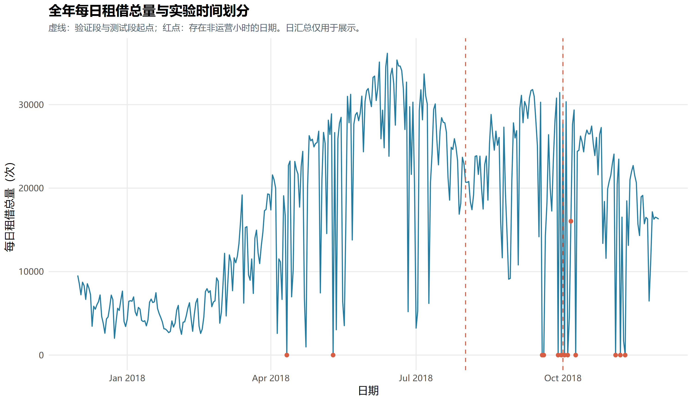

**图 1-1 全年每日租借总量、非运营日期与时间划分**

图 1-1 中，冬季总量总体较低，春季以后上升，后段又出现回落；一些接近零的日期与非运营记录重合。这说明序列并非围绕固定水平作简单随机波动。但每个月份仅出现一次，月份差异还可能同时包含天气、日历和运营变化，不能据此确认稳定的跨年季节性。

表 1-3 将全样本、正常运营记录与初始训练段的统计量合并比较，以免把非运营零值和通常的低需求混为一谈。

**表 1-3 小时租借量的描述性统计**

| 统计范围 | 小时数 | 均值 | 标准差 | 最小值 | 中位数 | 最大值 |
| --- | ---: | ---: | ---: | ---: | ---: | ---: |
| 全样本 | 8,760 | 704.602 | 644.997 | 0 | 504.500 | 3,556 |
| 正常运营小时 | 8,465 | 729.157 | 642.351 | 2 | 542.000 | 3,556 |
| 初始训练段 | 5,832 | 639.648 | 641.450 | 0 | 375.000 | 3,556 |

注：均值、标准差和各位置统计量单位为次/小时，来源为[描述统计结果](results/descriptive_statistics.csv)。

全样本均值高于中位数，标准差接近均值，最大值约为均值的五倍，表明租借量分布右偏，少量高峰具有较大影响。保留正常运营记录后最小值为 2，均值有所提高，但波动仍然很大，说明整体离散程度不能完全由停运解释。训练段均值低于全年均值，也提示长历史中的水平差异可能影响参数估计，后续需要比较固定回看窗口与扩展窗口。

总体统计无法说明高峰何时出现。图 1-2 因而仅使用初始训练段正常运营小时，比较工作日与周末的平均日内曲线，避免利用测试期形态决定模型结构。

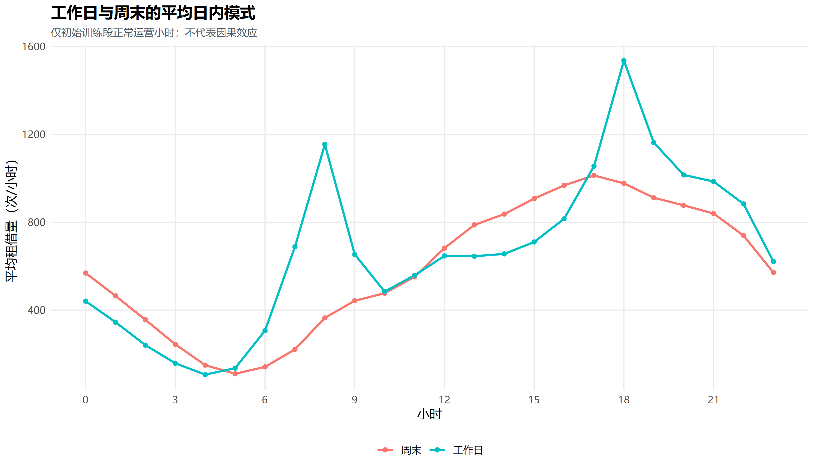

**图 1-2 初始训练段工作日与周末的平均日内模式**

工作日 08:00 和 18:00 的平均租借量分别约为 1,154.269 和 1,535.702 次/小时，呈现较集中的早晚高峰；周末 08:00 约为 364.543 次/小时，下午逐渐增多，17:00 附近约为 1,012.957 次/小时。这种形态差异与通勤和休闲时间安排相符，但数据没有个人出行目的，不能进一步确认具体用途。它为同时考虑 24 小时重复规律及周末交互提供了依据。

天气关系同样具有探索价值。在初始训练段正常运营小时中，气温与租借量的 Pearson 相关系数约为 0.639；降雨量与租借量的 Pearson、Spearman 相关系数分别约为 −0.112 和 −0.305。两种降雨相关指标存在差异，提示关系未必适合用单一直线概括。然而，这些统计量未控制月份和时段等共同因素，仅能作为描述证据。预测时也无法直接获得目标日实测天气，因此后续只考察已经观测到的滞后天气，其预测价值由验证集判断。

## 第二章 模型识别

本章从数据的时间结构出发，解释为什么需要变换、如何形成有限候选，以及拟合后是否仍有未解释的相关性。识别过程将图形、检验和验证结果结合起来，避免把某一检验或某个相关峰值当作唯一的定阶依据。

### 2.1 平稳性分析

弱平稳的基本要求是均值和方差不随时间变化，两个时点的协方差仅取决于它们的间隔。若序列水平不断移动，或不同时间位置具有系统性差异，直接用固定关系描述整个样本便可能不合适。ARIMA 的差分步骤正是为处理其中部分非平稳现象而设置的；相关理论可参见 [Hyndman 和 Athanasopoulos 的时间序列教材](https://otexts.com/fpp3/arima.html)[2]。

为区分缓慢水平变化与重复波动，先对初始训练段的 `log1p` 序列进行 24、168 小时多重季节分解。图 2-1 中的分量只用于结构识别，没有将全年分解所得的未来信息输入预测模型。

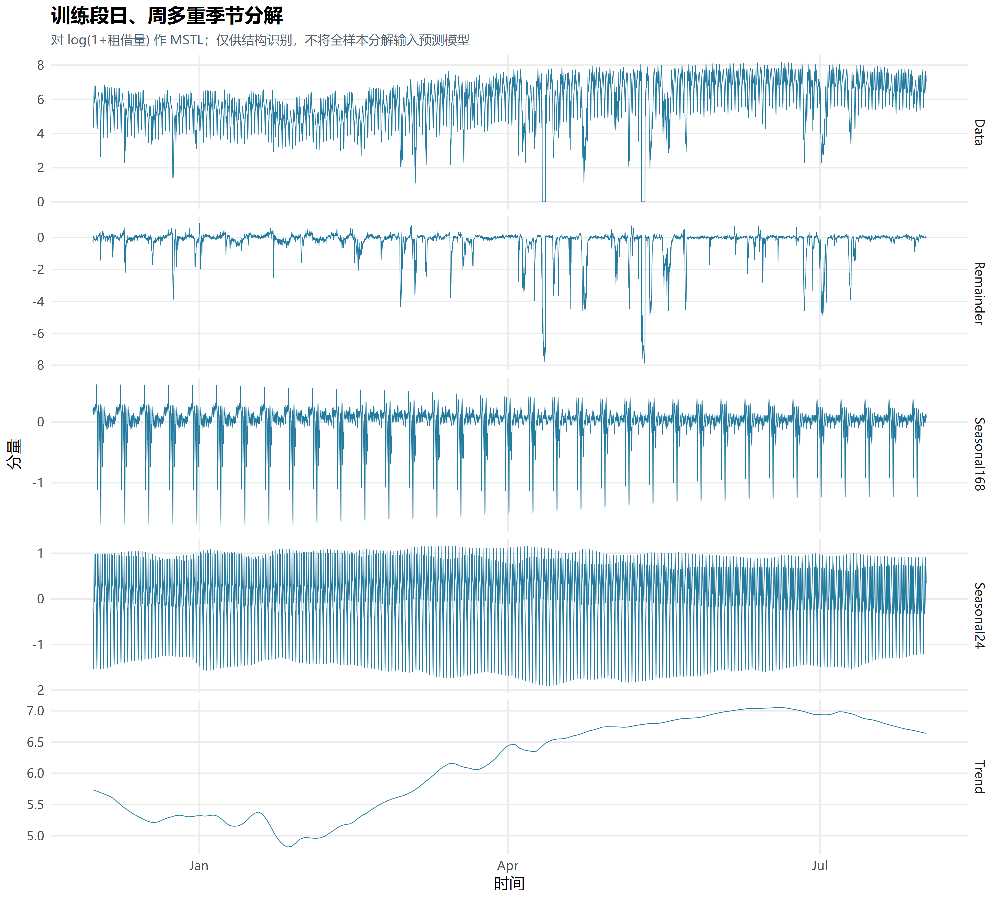

**图 2-1 初始训练段对数租借量的日周多重季节分解**

图 2-1 显示，训练段存在缓慢变化的趋势分量，也有日、周尺度的重复结构。余项中仍出现较大冲击，说明平滑季节分量不能吸收所有突发变化。该结果支持进一步检验和平稳化处理，却不足以证明某一固定周期模型能够完整描述序列。

本文同时使用 ADF 和 KPSS 检验。ADF 的原假设为存在单位根，KPSS 的原假设则为相应设定下平稳，二者从不同方向提供证据。基础设定中，ADF 在最大 48 阶内按 BIC 选择滞后，KPSS 采用 `long` 带宽；ADF 对原值和对数序列包含趋势项，对差分序列包含漂移项；KPSS 分别采用趋势平稳和水平平稳设定。表 2-1 保留关键统计量及周尺度敏感性结果，其中“拒绝”均以 5% 临界值判断。

**表 2-1 初始训练段关键平稳性检验结果**

| 序列及设定 | ADF 统计量 | ADF 5% 临界值 | 拒绝单位根 | KPSS 统计量 | KPSS 5% 临界值 | 拒绝相应平稳假设 |
| --- | ---: | ---: | --- | ---: | ---: | --- |
| 原值，基础设定 | −7.051 | −3.410 | 是 | 0.611 | 0.146 | 是 |
| `log1p`，基础设定 | −9.058 | −3.410 | 是 | 0.217 | 0.146 | 是 |
| 对数一阶差分，基础设定 | −15.904 | −2.860 | 是 | 0.003 | 0.463 | 否 |
| 对数 24 小时差分，基础设定 | −12.313 | −2.860 | 是 | 0.005 | 0.463 | 否 |
| 对数组合差分，基础设定 | −20.336 | −2.860 | 是 | 0.002 | 0.463 | 否 |
| 原值，168 小时设定 | −3.316 | −3.410 | 否 | 0.272 | 0.146 | 是 |
| `log1p`，168 小时设定 | −4.529 | −3.410 | 是 | 0.138 | 0.146 | 否 |

注：168 小时设定为 ADF 固定 168 阶、KPSS 带宽 168。原值及对数的 KPSS 原假设为趋势平稳，差分后为水平平稳。来源为[基础检验](results/stationarity_tests.csv)和[敏感性检验](results/stationarity_sensitivity.csv)。

基础设定下，原值和对数序列的 ADF 拒绝单位根，但 KPSS 同时拒绝趋势平稳。这并不构成逻辑矛盾：两种检验的原假设不同，对滞后、带宽及复杂结构的敏感性也不同。增加周尺度滞后后，原值 ADF 不再拒绝单位根，而对数 KPSS 不再拒绝趋势平稳，说明结论确实依赖设定。即使接受趋势平稳的解释，也不能直接把带有趋势的原序列认作均值恒定的弱平稳序列。因此，本文继续比较变换和差分，并用样本后续预测检验其实际价值。

### 2.2 相关函数与差分变换

自相关函数 ACF 衡量序列与其不同滞后值之间的线性相关，既包含直接联系，也包含经由中间时点传递的联系。偏自相关函数 PACF 则在控制中间滞后的线性作用后，考察某一滞后增加的联系。对小时序列而言，滞后 24 对应前一天同小时，168 对应前一周同星期同小时，336 对应两周。因此，相关函数不仅用于观察短期持续性，也能辨认重复时间结构。

初始训练段对数序列在滞后 1、24、168 小时的 ACF 分别约为 0.939、0.470、0.485，说明短期依赖与日周重复同时存在。采用 `log1p`，即令 $z_t=\log(1+y_t)$，可以保留零值定义，并减轻高峰对尺度的影响；它不会自动消除趋势和自相关。对该序列考察的差分定义为：

$$
\begin{aligned}
\Delta z_t &= (1-B)z_t=z_t-z_{t-1},\\
\Delta_{24}z_t &= (1-B^{24})z_t=z_t-z_{t-24},\\
\Delta\Delta_{24}z_t &= z_t-z_{t-1}-z_{t-24}+z_{t-25}.
\end{aligned}
\tag{1}
$$

其中，$y_t$ 为第 $t$ 小时租借量，$B$ 是一小时滞后算子，$B^{24}$ 表示向前取 24 小时的值。普通一阶差分关注相邻小时变化，季节差分关注相邻两天同小时的变化，组合差分同时处理两类联系。差分减少的是特定形式的依赖，不等于将所有时间信息清除。

表 2-1 中，三种差分序列均得到较一致的平稳性证据，周尺度敏感性检验也维持这一判断。进一步看相关系数，单独作 24 小时差分后，一阶 ACF 仍约为 0.930；再作普通一阶差分后降至约 0.062。为展示这种处理后的剩余结构，正文保留组合差分的相关图 2-2，原对数相关图和差分曲线比较置于附录 B。

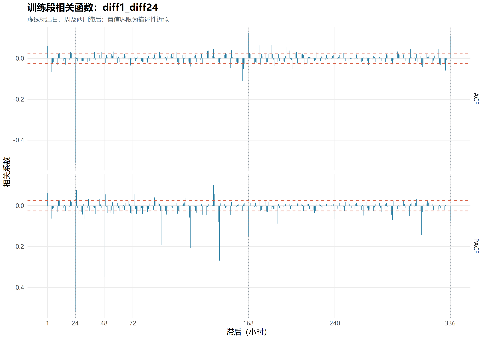

**图 2-2 初始训练段对数组合差分后的 ACF 与 PACF**

图 2-2 中，短期的强持续性明显减弱，但 24 小时 ACF 约为 −0.512，168 小时附近仍有相关，不能据此认定已成为白噪声。负季节相关既提示季节误差结构值得建模，也提醒差分可能改变原有依赖。相关图的近似界限只是识别线索，不是对所有滞后同时成立的严格判定。程序给出的普通差分和季节差分建议均为 1，但这些建议针对对数序列的预处理诊断；最终模型仍需独立比较原尺度、不同差分与回归结构，避免机械地对每个模型采用同一方案。

### 2.3 模型定阶与参数识别

自回归部分 AR 用过去的序列值解释当前值，移动平均部分 MA 用过去的随机冲击解释当前误差。这里的“移动平均”不是对最近若干天租借量直接取均值的预测基线。ARIMA 将两者作用于经过差分的序列，其中 $p$ 为自回归阶数，$d$ 为普通差分阶数，$q$ 为误差移动平均阶数。SARIMA 进一步引入季节项，以适应图 1-2 和图 2-1 所揭示的日重复结构。其基本表达式为：

$$
\phi(B)\Phi(B^{24})(1-B)^d(1-B^{24})^D y_t
=\theta(B)\Theta(B^{24})\varepsilon_t.
\tag{2}
$$

式中，$\phi$、$\theta$ 的阶数分别为 $p$、$q$，$\Phi$、$\Theta$ 的阶数分别为 $P$、$Q$；$D$ 为季节差分阶数，$\varepsilon_t$ 表示模型假定的零均值白噪声扰动。于是，SARIMA$(p,d,q)(P,D,Q)[24]$ 同时描述小时尺度和日尺度的动态。式（2）展示本文无额外漂移项的基本结构；包含日历回归时，将左侧的 $y_t$ 替换为扣除回归均值后的误差序列。

ACF/PACF 可帮助缩小候选范围：理想 AR 过程的 PACF、理想 MA 过程的 ACF 分别具有截尾特征，另一相关函数通常拖尾。但本数据兼有多重周期、水平变化与突发零值，图形并不呈现适合机械套用的简单模式。因此，实验保留有限阶数、不同变换和训练窗口的组合，再利用信息准则和验证结果综合判断。AIC、AICc 和 BIC 在拟合程度之外惩罚参数数量，其中 AICc 对有限样本作修正；本文只在变换、训练起止位置及差分阶数相同的组内比较，避免把短窗口较小的数值误认作普遍更优。

除普通 ARIMA 与 SARIMA 外，实验还尝试两类回归扩展。DHR_ARIMA 使用日周 Fourier 项及日历变量描述平均模式，误差由非季节 ARIMA 建模；SARIMAX 则在日历回归之外，为误差增加日季节动态。二者都属于[带 ARIMA 误差的回归思路](https://otexts.com/fpp3/dynamic-regression.html)[2]，区别在于剩余误差结构。最终回归配置均使用 5 对日周期、3 对周周期 Fourier 项，并加入周末主效应、前三对日周期项的周末交互及可识别的节假日项；均未选用天气变量。周末交互允许曲线形状随日期类型变化，而非只将全天统一上移或下移。

这一扩展也涉及可识别性。严格每 24 小时重复的 Fourier 项会被 24 小时季节差分消除，不能不加检查地将两者叠加。代码对差分后的回归矩阵检查常量和冗余列，预测时沿用保留下来的列结构。完整日周回归与季节误差并存的最终 SARIMAX 因而采用 $D=0$。这一选择与第 2.2 节对数序列的差分诊断针对不同对象，并不冲突。

项目登记并尝试了 28 个 ARIMA 类候选，其中 24 个完成全部 61 天、1,464 小时验证，4 个因未收敛或协方差异常、数值问题、耗时限制而未完成。未完成候选不参与误差排名，也不能被描述为预测最差。每个模型族最终按全小时验证 RMSE 选择，相同 RMSE 时以 MAE 辅助排序，主要结构见表 2-2。固定 84 天窗口用于贴近近期水平，扩展窗口则利用从样本开始至起点的历史；二者的取舍由验证结果确定。

**表 2-2 按完整验证结果保留的 ARIMA 类模型**

| 模型 | 最终结构（均为原尺度） | 参数重估窗口 | 日历回归 | 验证 RMSE |
| --- | --- | --- | --- | ---: |
| ARIMA | ARIMA(3,1,2) | 最近 84 天 | 无 | 667.475 |
| SARIMA | SARIMA(1,0,1)(0,1,1)[24] | 扩展窗口 | 无 | 486.807 |
| DHR_ARIMA | 日周回归＋ARIMA(2,0,2) 误差 | 最近 84 天 | 日周 Fourier、节假日及周末交互 | 500.223 |
| SARIMAX | 日周回归＋SARIMA(2,0,2)(1,0,1)[24] 误差 | 最近 84 天 | 日周 Fourier、节假日及周末交互 | 478.759 |

注：RMSE 单位为次/小时。文件和图中的 `SARIMA24`、`SARIMAX24` 分别对应正文的 SARIMA、SARIMAX。结构与分数据[所选配置](results/selected_arima_specifications.csv)和[完整验证结果](results/arima_validation_metrics.csv)整理。

为使抽象阶数与实际拟合相联系，采用截至 2018 年 9 月 30 日、历史测试开始前估计的 SARIMA 系数，可写出：

$$
(1-0.831856B)(1-B^{24})y_t
=(1+0.273726B)(1-0.934000B^{24})\varepsilon_t.
\tag{3}
$$

式（3）的 $B$、$y_t$ 和 $\varepsilon_t$ 含义与式（2）相同，MA 符号遵循 `forecast` 的约定。普通 AR 项描述相邻小时联系，季节差分及季节 MA 项描述日尺度变化。这里展示的是测试起点前的参数快照，滚动重估和样本末端重新拟合后系数会改变，不能将其与截至 11 月 30 日的最终模型摘要混用。主要动态系数及标准误列于附录 C；参数推断均以所选模型为条件，不能据选模后的渐近结果作因果解释。

### 2.4 白噪声检验

模型得到有限的训练误差，并不代表已经解释了序列的全部时间依赖。若残差仍有系统相关，说明过去残差中还保留可预测信息，也会削弱以简化误差假设构造预测区间的依据。白噪声通常指均值为零、方差稳定且不同时间之间不相关的扰动；正态性是另一个要求，二者不能混同。

本文对测试开始前拟合的残差进行 Ljung–Box 检验，其原假设为所考察的一组滞后自相关均为零，检验时扣除已估计的 AR、MA 动态参数自由度。程序考察 24、48、168、336 小时，并结合图 2-3 判断具体相关形态。它们是训练残差诊断，不能与第三、四章的次日多步测试误差混为同一评价。

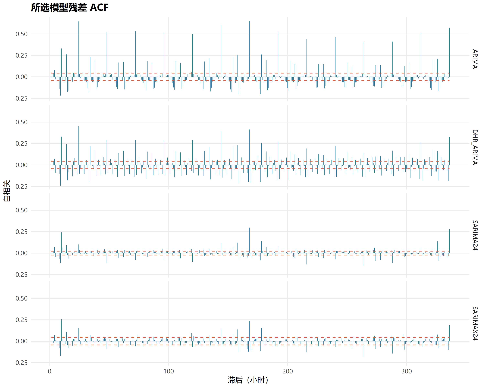

**图 2-3 历史测试起点前所选 ARIMA 类模型的残差 ACF**

普通 ARIMA 的残差在 24、168 小时的 ACF 分别为 0.646、0.654；DHR_ARIMA 分别为 0.452、0.414。SARIMA 的对应值降至 0.100、0.298，表明显式日季节结构吸收了部分周期相关，但周尺度仍有明显剩余。SARIMAX 的对应值为 0.156、0.237，日、周位置的变化方向并不一致。各模型残差样本数依次为 2,015、2,016、7,272、2,016，窗口不同，不能把相关系数差异全部归因于某个新增变量。

在 168 小时检验中，四模型的 Ljung–Box 统计量分别约为 7,898.552、4,958.377、2,612.550、934.696，均在 5% 水平拒绝原假设；SARIMAX 的上尾概率约为 $6.78\times10^{-109}$，其余三者部分概率已低于浮点数可表示范围。24、48、336 小时结果同样拒绝，完整结果见[残差诊断文件](results/selected_model_diagnostics.csv)。因此不能宣称残差全部通过白噪声检验。实验的价值在于识别并量化这种不足：日周结构有所改善，仍未充分吸收全部依赖。后续继续报告预测表现，是考察这些有限模型的实际用途，不等于确认其统计假设完全成立。

## 第三章 模型预测

本章将模型识别转化为明确的预测任务，重点分析经典时间序列模型的点预测与区间预测。评价既考察平均误差，也关注大误差和不确定性范围，以免只凭一段贴合的曲线判断效果。

### 3.1 短期预测

预测任务设定为：在前一天 23:00，以当时已知的租借量、允许使用的历史天气及可提前确定的日历，连续预测次日 00:00—23:00。这种任务能够给出完整的次日需求曲线，同时要求模型承担最长 24 小时的预测误差。每个目标日只在起点生成一次全天预测，不能用当天已经发生的真实值回头修正当天后续小时的结果。

按时间划分能够保持这一信息顺序。验证段决定结构、窗口和超参数，测试段描述所选配置在后续历史的表现。验证和测试均包含 61 个目标日，完成候选覆盖每个星期位置，各有 8 或 9 个预测日。与只评价某个固定星期位置相比，完整覆盖能更充分地考察工作日和周末差异，但也不能消除有限验证样本带来的选模不确定性。

滚动更新区分参数重估与状态更新。每个评价阶段开始先拟合，此后当目标日为周一时，用截至前一日 23:00 的历史重新估计参数；两个阶段各有 9 个重估日。周内 ARIMA 固定参数，借助新观测更新状态后再预测。84 天窗口是重估时的回看范围，周内状态更新继续接收起点前的新历史。测试期间已经结束日期的数据可以参与以后日期的滚动预测，这符合真实使用场景；禁止的是提前读取尚未发生的目标日信息。

表 2-2 的四类模型均按此规则产生预测，使用 [R `forecast` 软件](https://pkg.robjhyndman.com/forecast/)[3–4]实现。点预测表示模型给出的一个数量估计，80% 和 95% 预测区间表示在模型假设下对未来观测波动的范围描述，不能当作点预测均值的置信区间。为说明日内曲线和不确定性如何共同变化，图 3-1 展示固定日期 2018 年 10 月 15—21 日的 SARIMA 结果；该图仅是示例，覆盖率使用完整测试段计算。

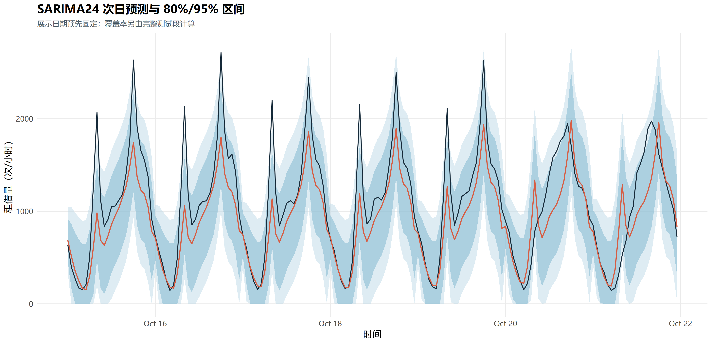

**图 3-1 SARIMA 在历史测试固定一周的点预测及 80%/95% 预测区间**

图 3-1 中，SARIMA 能反映夜间低谷和白天回升，但多个工作日高峰仍低于真实租借量，部分实际值超出区间。区间随起点后的步数改变，其宽度既取决于误差传播，也受到模型和非负处理影响。点预测及区间下界统一截为非负，没有为了评分而强制四舍五入。这能避免不合实际的负租借量，却不意味着区间已经经过充分校准。

除历史测试外，按锁定配置在截至 2018 年 11 月 30 日的可用历史上重新拟合，得到图 3-2 的样本末端外推。扩展窗口模型使用完整适用历史，固定窗口模型仍遵循最近 84 天的规则。外推对象是 **2018 年 12 月 1 日**，日历设为普通非节假日情景，未使用该日实测天气或运营状态。

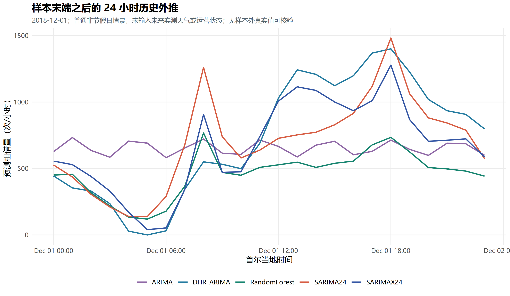

**图 3-2 各模型对 2018 年 12 月 1 日的历史样本末端 24 小时外推**

图 3-2 同时列出第四章随机森林作为参照，本节关注时间序列模型。SARIMA 的 08:00、18:00 点预测分别约为 1,261.198、1,482.166 次/小时，SARIMAX 则约为 906.499、1,277.919 次/小时；不同结构保留高峰的程度存在差异。这一天为周六，纯 SARIMA 仍可能沿用近期日模式，而日历回归允许周末形态调整。但项目没有这一天的真实值，无法判断哪条曲线更准确。它是历史样本末端外推演示，不能描述为当前真实世界的实时预测。

### 3.2 效果分析

本文以 RMSE 为预先确定的主要选择指标，并用 MAE 辅助解释平均偏离。将共同评价期的小时观测按顺序编号，两项指标定义为：

$$
\operatorname{MAE}=\frac{1}{n}\sum_{i=1}^{n}|y_i-\hat y_i|,
\qquad
\operatorname{RMSE}=\sqrt{\frac{1}{n}\sum_{i=1}^{n}(y_i-\hat y_i)^2}.
\tag{4}
$$

其中，$y_i$、$\hat y_i$ 分别为真实租借量与此前生成的预测，$n$ 为纳入评价的小时数，两者单位均为次/小时。MAE 衡量通常意义上的绝对偏离，RMSE 对少量大误差给予更重惩罚。本文将 1,464 个小时的平方误差汇总后开方，未以每日 RMSE 的简单平均替代。sMAPE 和周周期 MASE 仅作辅助：零值会影响比例误差的解释；MASE 分母是评价开始前全部可用历史上的 168 小时滞后绝对误差均值，而不是仅取此前 168 小时。测试分母约为 281.221，故 MASE 大于 1 也不等于必然输给本测试段的周朴素预测。

在全小时历史测试中，普通 ARIMA 的 RMSE 为 606.216，SARIMA 降至 460.089，约降低 24.10%。这与日重复结构具有预测价值的判断一致，但两者的差分和窗口也不同，不能将全部差值视为只增加季节项的净效应。DHR_ARIMA 的 RMSE 为 496.785，表明日周平均形态虽有帮助，当前非季节误差结构仍未得到与 SARIMA 相同的测试表现。SARIMAX 在验证段的 RMSE 比 SARIMA 低约 1.65%，测试段却为 469.089，高约 1.96%；更多回归项与季节动态的组合并未稳定转化为后续收益。

简单基线使这一比较更完整。Naive24、Naive168 分别沿用前日、前周同小时；Mean7、Median7 分别取过去七天同小时的均值、中位数；DayTypeMean28 取过去 28 天同属工作日或周末的同小时均值。日期类型仅区分周一至周五与周六、周日，不另按节假日分类，所有方法保留历史零值。DayTypeMean28 以验证 RMSE 481.235 被预先选作强基线，测试 RMSE 为 458.132；Mean7 的测试 RMSE 进一步降至 452.327。均值方法通过汇总多日信息减少单日波动，说明显式季节模型虽优于当前普通 ARIMA，仍需与稳定、易复现的参照比较。

区间评价还需同时考虑覆盖率和宽度。表 3-1 将四类模型的全小时经验覆盖率及 95% 区间宽度合并列出，避免分别展示多张覆盖率和区间图。

**表 3-1 ARIMA 类模型在全部历史测试小时的区间表现**

| 模型 | 80% 区间实际覆盖率 | 95% 区间实际覆盖率 | 95% 区间平均宽度 | 95% Winkler 评分 |
| --- | ---: | ---: | ---: | ---: |
| ARIMA | 89.21% | 98.02% | 2,798.111 | 3,011.764 |
| SARIMA | 78.01% | 88.32% | 1,358.395 | 2,832.702 |
| DHR_ARIMA | 81.22% | 90.64% | 1,529.097 | 2,906.297 |
| SARIMAX | 80.46% | 90.16% | 1,499.025 | 2,764.856 |

注：各行均评价 1,464 小时；宽度和评分单位为次/小时。Winkler 评分同时惩罚区间过宽和真实值越界，越低越好。来源为[预测区间结果](results/prediction_interval_coverage.csv)。

SARIMA 和 SARIMAX 的名义 95% 区间分别仅覆盖 88.32%、90.16%，存在覆盖不足。普通 ARIMA 虽有更高覆盖率，平均区间却宽达 2,798.111 次/小时，点误差也较大，高覆盖不能单独说明其不确定性估计更有效。SARIMAX 的 95% Winkler 评分在四者中最低，但仍不足以证明已完成校准。结合第二章残余相关和附录的 Q–Q 图，尚未捕获的依赖、尾部偏离及未知运营变化都是需要进一步检验的解释。经典模型能够恢复部分规律，其误差边界仍需通过更充分的样本外证据评价。

## 第四章 随机森林模型及其预测

本章选择随机森林作为课程模板要求的其他模型，检验以历史特征表达时间结构的非线性方法能否带来额外预测收益。其比较沿用前章的目标、时间划分和信息边界，避免将更多未来信息误认作算法优势。

### 4.1 短期预测

随机森林通过对训练样本进行有放回抽样、在节点分裂时随机选择部分特征，构造多棵回归树，再对预测取平均，降低单棵树的不稳定性。基本方法依据 [Breiman 的随机森林论文](https://doi.org/10.1023/A:1010933404324)[5]，项目使用 R [`ranger`](https://imbs-hl.github.io/ranger/)[6]实现。它不要求观测与特征呈统一线性关系，但不会自动理解记录的时间顺序，因此必须先把序列转换为符合预测场景的监督学习样本。

具体而言，每个历史目标日构造 24 行样本，一行对应一个目标小时，响应为该小时实际租借量。所选模型共使用 45 个特征，包括目标小时、星期、周末、节假日及小时正余弦；目标小时前 24、48、168、336 小时的租借量；过去七天同小时均值；起点前 24、168 小时的均值和波动；最后一次观测；以及前一天整条 24 小时曲线。较长滞后反映日周重复，起点前统计量描述最近整体状态，前日曲线则提供近期高峰形状。24 个目标小时共用一个森林直接预测，没有训练 24 套独立模型，也没有把当天先发生的真实租借量递推给后续小时。

天气特征为目标小时前 24 小时已经观测的气温、湿度、降雨、风速和太阳辐射。对于次日最晚一个目标小时，其对应源时间也不晚于起点 23:00，因此全部可用。滚动统计量在共同起点前计算，训练目标时间不晚于起点，目标日实际运营状态从预测特征中排除。这样的设计允许使用历史环境与需求状态，却不能等同于拥有准确的次日天气预报。

实验的七组配置均固定 400 棵树和最大深度 20，以控制计算量并保持比较条件；这两个数值是预设值，并非由树数或深度搜索证明最优。验证比较了 56、84、112 天及扩展窗口、最小叶样本数、分裂候选特征比例、是否使用历史天气和目标变换。完整验证后选定 `RF_raw_84_leaf5_weather`：原尺度、最近 84 天、`min.bucket=5`、`min.node.size=10`、候选特征比例 0.8，即每次分裂考虑 45 项中的 36 项，随机种子为 20261026。全部小时验证 RMSE 为 470.005，略低于不含天气配置的 471.183，不能将这点有限差异解释成天气带来了很大的独立收益。各配置明细置于附录 C。

随机森林沿用阶段起始拟合及每周一重训规则，周内使用新起点能够获得的历史特征预测，不修改森林结构。为理解该模型主要依赖什么信息，图 4-1 给出测试开始前拟合模型的不纯度重要性，避免将测试后模型的重要性反用于解释预先选择。

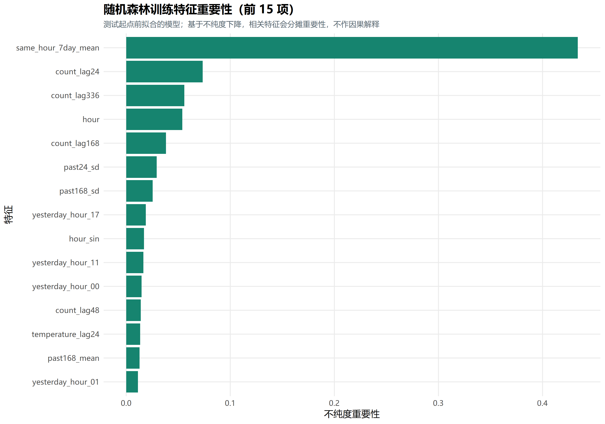

**图 4-1 历史测试开始前随机森林的前十五项特征重要性**

过去七天同小时均值的重要性约为 0.434，明显高于单项其他特征；前日、前两周同小时及目标小时也位居前列。这与序列具有稳定日内形态的观察相吻合，也解释了均值基线为何值得重视。不过，重要性来自树内不纯度下降，受特征相关性和可分裂方式影响，不是误差减少的独立贡献比例，更不是因果效应。历史天气排名较后，也不能据此断言天气本身不影响实际出行。

### 4.2 模型对比分析

为避免只展示有利的模型或指标，表 4-1 汇总四类 ARIMA、随机森林和全部五种基线。各方法均覆盖共同的 1,464 个测试小时，正常运营子集为其中 1,313 小时；配置按验证段锁定，表内测试排序只描述已有历史表现。验证预选强基线仍为 DayTypeMean28，不能因为 Mean7 的测试 RMSE 更低而事后替换参照。

**表 4-1 各方法在统一评价框架下的预测误差**

| 方法 | 验证全小时 RMSE | 测试全小时 RMSE | 测试全小时 MAE | 测试正常运营 RMSE | 测试正常运营 MAE |
| --- | ---: | ---: | ---: | ---: | ---: |
| RandomForest | 470.005 | **443.390** | 289.249 | 369.389 | 237.634 |
| Mean7 | 498.559 | 452.327 | 308.002 | 390.565 | 262.617 |
| DayTypeMean28 | 481.235 | 458.132 | **282.198** | **340.760** | **213.883** |
| SARIMA | 486.807 | 460.089 | 304.916 | 370.195 | 247.094 |
| SARIMAX | 478.759 | 469.089 | 312.218 | 369.862 | 250.430 |
| DHR_ARIMA | 500.223 | 496.785 | 339.397 | 394.782 | 278.335 |
| Median7 | 526.548 | 528.607 | 314.346 | 441.162 | 254.292 |
| ARIMA | 667.475 | 606.216 | 488.248 | 581.296 | 459.804 |
| Naive168 | 666.452 | 610.054 | 378.691 | 540.637 | 329.754 |
| Naive24 | 592.950 | 611.216 | 359.341 | 510.486 | 293.723 |

注：误差单位为次/小时，行按测试全小时 RMSE 升序排列，粗体为相应测试指标列最小值。来源为[统一验证结果](results/validation_model_comparison.csv)与[历史测试结果](results/test_model_comparison.csv)。正常运营结果为事后补充，不用于重新选模。

随机森林的全小时 RMSE 最低，相对 DayTypeMean28 降低约 3.22%，相对 Mean7 降低约 1.98%。与前周同期相比的改进约为 27.32%，但较弱参照会放大优势的观感；强基线提供了更严格的判断。对当前有限测试样本而言，随机森林取得了一定的大误差控制收益，尚不能说其复杂性带来了压倒性提升，也未进行支持统计显著性或普遍优越性的推断。

MAE 给出另一种排序：DayTypeMean28 的 282.198 低于随机森林的 289.249，而 Mean7 的 RMSE 较低、MAE 却高于 DayTypeMean28。RMSE 加重大偏差的权重，MAE 对每一单位绝对误差等量计分，两者反映误差分布的不同侧面。随机森林 RMSE 更低而 MAE 更高，与它在部分大误差上占优、在通常绝对偏离上未全面占优的情形相容；仅凭汇总值不能进一步确定每个日期的误差机制。图 4-2 因而同时展示两项指标及两种运营口径，使这种差别更容易辨认。

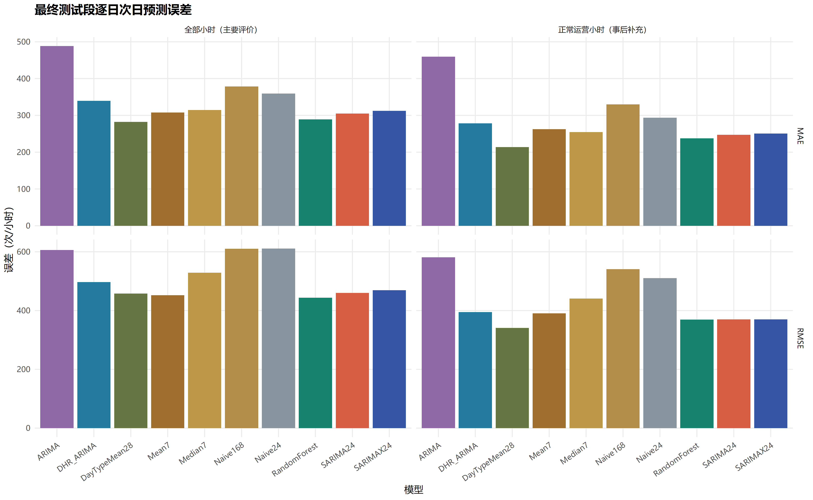

**图 4-2 全部测试小时与正常运营小时的 MAE、RMSE 比较**

正常运营子集中，DayTypeMean28 的 RMSE 为 340.760，低于随机森林的 369.389，也低于 SARIMAX 的 369.862 和 SARIMA 的 370.195。随机森林相对该基线由全小时领先变为运营子集落后约 8.40%，表明“最好”的判断依赖评价范围。运营标记只在真实结果发生后用于分组，这组成绩不能解释为模型可以提前识别哪些小时会停运。

停运小时解释了排名变化的一部分。在 151 个非运营测试小时中，随机森林的 RMSE 为 848.287，DayTypeMean28 为 1,012.535，而 Mean7 为 810.725。全小时平方误差是正常运营和非运营两部分的加总，因此，即使占比较低，非运营大误差仍能显著影响 RMSE；随机森林相对 DayTypeMean28 的全小时优势与其较低的非运营误差一致。与此同时，Mean7 在该组优于随机森林，普通 ARIMA 该组误差也较低，却均未取得最低全小时 RMSE，说明模型不能只针对一种状态评价。保留零值使任务更真实，也暴露了没有未来运营计划时的预测局限。

为观察综合分数背后的曲线形态，图 4-3 比较固定一周的真实值、随机森林、季节模型及预选强基线。该周与图 3-1 相同，便于对照点预测和区间，无须再增设多个日期示例。

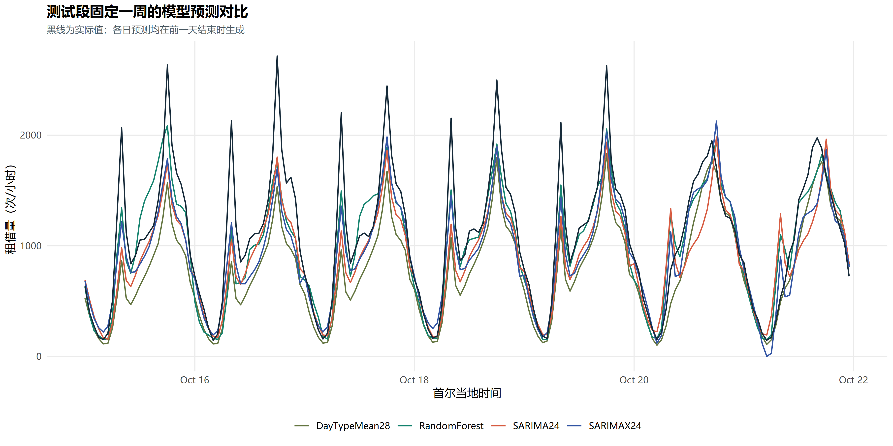

**图 4-3 历史测试固定一周的实际租借量与主要模型预测**

图 4-3 中，各方法大体恢复夜间低谷和日间回升，多数工作日尖峰仍被压低；周末曲线较缓，不同方法的差异也随日期改变。随机森林有时更贴近高峰，但没有逐点占优。强基线能够用近期同类日期均值恢复主要形态，说明可重复时间结构已解释了相当一部分变化；额外模型的收益更多取决于对偏离常规情形的处理。更长的窗口提供稳定均值，也可能滞后于快速变化；更复杂的模型能够适配局部关系，也可能增加估计不稳定性。这些是与现象相符的解释，不能仅由一周曲线作因果确认。

从统一比较看，复杂度与泛化效果没有单调关系。SARIMAX 的验证改善未持续到测试，随机森林未在 MAE 和正常运营子集同时领先，简单均值方法则表现出很强竞争力。分时段结果还显示高峰预测较困难，但每日起点固定为 23:00，预测步长与目标小时一一对应，不能把步长曲线完全解释为“预测越远越难”。此外，候选曾根据开发诊断补充，验证分数可能存在选择乐观性，测试又已被重复观察；所有差异均应限定为当前信息条件和历史样本下的描述性证据。

## 第五章 课程总结

本实验围绕次日连续 24 小时实际租借量预测，完成了数据核验、时间结构分析、模型识别、验证选择、残差诊断及历史测试比较。研究从具体预测起点出发约束输入信息，使传统时间序列与随机森林能够在共同任务中比较。保留非运营零值和连续小时轴，也使实验面对真实记录中的业务变化，而没有通过删除困难时段改善分数。

数据分析表明，小时粒度能够揭示日总量无法呈现的早晚高峰与日期类型差异。ADF、KPSS 结论及其敏感性提示，复杂实际序列很难由单次检验作出充分判断；差分改善部分性质，也需要结合剩余相关和验证表现决定是否采用。预处理诊断、最终模型结构和参数快照各有适用对象，准确区分这些对象，是将课程理论用于实际问题的重要环节。

经典模型中，显式考虑日季节结构的 SARIMA 优于当前普通 ARIMA，但日周回归和更复杂季节误差没有保证持续改善。随机森林通过历史均值、滞后和日历特征获得最低全小时测试 RMSE，却未在 MAE 或正常运营子集上全面领先。这说明两类方法各有表达时间结构的方式，模型名称或复杂程度无法替代实际评价。验证期预选强基线尤其重要：加入有竞争力的均值方法后，复杂模型收益的范围和大小才能得到更客观的衡量。

现有结论受到多方面限制。数据仅覆盖一年，测试集中于秋季，不能验证跨年稳定性；未来天气和运营计划未知，停运比例又随阶段变化；所选 ARIMA 类模型残差仍有自相关，部分预测区间存在覆盖不足。七组森林与有限 ARIMA 候选也不构成所有可行模型的穷尽比较。原测试结果曾被查看，开发诊断与候选补充进一步要求审慎解释验证优势，本文没有将有限误差差异宣称为统计显著或可普遍推广的结果。

后续研究最有价值的方向是补充更长、覆盖不同季节的历史，在固定候选规则后保留新的未观察时期评价；若能取得预测时真实可用的天气预报和运营计划，可进一步检验它们的增益。对残余相关，应优先识别周尺度和日期类型变化，而非单纯不断提高阶数；对预测区间，应结合时间顺序开展独立校准与覆盖评价。课程实验由此形成的认识是，可信预测依赖清楚的任务边界、可解释的时间特征和诚实的验证，而不只是获得一个更低的误差数值。

## 参考文献

[1] UCI Machine Learning Repository. Seoul Bike Sharing Demand[DS/OL]. 2020[2026-10-26]. DOI: [10.24432/C5F62R](https://doi.org/10.24432/C5F62R). [数据集官方页面](https://archive.ics.uci.edu/dataset/560/seoul+bike+sharing+demand).

[2] HYNDMAN R J, ATHANASOPOULOS G. Forecasting: Principles and Practice[M/OL]. 3rd ed. Melbourne: OTexts, 2021[2026-10-26]. [在线教材](https://otexts.com/fpp3/).

[3] HYNDMAN R J, KHANDAKAR Y. Automatic Time Series Forecasting: The forecast Package for R[J]. Journal of Statistical Software, 2008, 27(3): 1–22. DOI: [10.18637/jss.v027.i03](https://doi.org/10.18637/jss.v027.i03).

[4] HYNDMAN R, ATHANASOPOULOS G, BERGMEIR C, et al. forecast: Forecasting Functions for Time Series and Linear Models[CP/OL]. [2026-10-26]. DOI: [10.32614/CRAN.package.forecast](https://doi.org/10.32614/CRAN.package.forecast). [软件官方文档](https://pkg.robjhyndman.com/forecast/). 本实验版本为 9.0.2。

[5] BREIMAN L. Random Forests[J]. Machine Learning, 2001, 45: 5–32. DOI: [10.1023/A:1010933404324](https://doi.org/10.1023/A:1010933404324).

[6] WRIGHT M N, ZIEGLER A. ranger: A Fast Implementation of Random Forests for High Dimensional Data in C++ and R[J]. Journal of Statistical Software, 2017, 77(1): 1–17. DOI: [10.18637/jss.v077.i01](https://doi.org/10.18637/jss.v077.i01).

## 附录（程序代码及补充结果）

### 附录 A 关键 R 程序代码

以下片段取自项目实际 R 源文件，保留原始实现。片段依赖入口脚本提供的 `config`、数据及辅助函数，不是彼此独立的完整程序。正文对应的实验由 R 完成，软件版本记录于[环境文件](results/r_package_versions.csv)。

#### A.1 数据读取、时间轴与零值核验

摘自 [scripts/01_data_preparation.R](scripts/01_data_preparation.R) 第 1—25 行。

```r
raw_path <- path_for("data", "raw", "SeoulBikeData.csv")
if (tolower(unname(tools::md5sum(raw_path))) != "bf632307dcb419f67df589faaa0318e1")
  stop("The official frozen source checksum changed. Do not reuse cached experiments with another dataset.")
raw <- utils::read.csv(raw_path, fileEncoding = "latin1", check.names = FALSE)
stopifnot(ncol(raw) == 14L, nrow(raw) == 8760L)
original_names <- names(raw)
names(raw) <- c("date", "count", "hour", "temperature", "humidity", "wind_speed", "visibility",
  "dew_point", "solar_radiation", "rainfall", "snowfall", "season", "holiday", "functioning_day")
d <- raw
d$date <- as.Date(d$date, "%d/%m/%Y")
d$timestamp <- as.POSIXct(paste(d$date, sprintf("%02d:00:00", d$hour)), tz = config$timezone)
d <- d[order(d$timestamp), ]
d$index <- seq_len(nrow(d))
d$operating <- as.integer(d$functioning_day == "Yes")
d$holiday_flag <- as.integer(d$holiday == "Holiday")
d$weekday <- as.integer(format(d$date, "%u"))
d$weekend <- as.integer(d$weekday >= 6)
d$month <- format(d$date, "%Y-%m")
d$split <- ifelse(d$date <= config$initial_end, "initial_training",
  ifelse(d$date <= config$validation_end, "validation", "test"))
stopifnot(!anyNA(d), !anyDuplicated(d$timestamp), all(diff(as.numeric(d$timestamp)) == 3600),
  all(d$count >= 0), all(d$count == floor(d$count)), all(d$hour %in% 0:23),
  all(d$count[d$operating == 0] == 0), sum(d$count == 0) == 295,
  all(d$count[d$operating == 1] > 0), min(d$date) == as.Date("2017-12-01"),
  max(d$date) == as.Date("2018-11-30"))
```

#### A.2 平稳性检验与差分构造

摘自 [scripts/03_stationarity_analysis.R](scripts/03_stationarity_analysis.R) 第 1—15 行。

```r
d <- hourly(); z <- d[d$date <= config$initial_end, ]; y <- z$count
series <- list(raw = y, log1p = log1p(y), diff1 = diff(log1p(y)),
  diff24 = diff(log1p(y), lag = 24), diff1_diff24 = diff(diff(log1p(y), lag = 24)))
tests <- do.call(rbind, lapply(names(series), function(nm) {
  v <- series[[nm]]; tr <- nm %in% c("raw", "log1p")
  adf <- urca::ur.df(v, type = if (tr) "trend" else "drift", lags = 48, selectlags = "BIC")
  kp <- urca::ur.kpss(v, type = if (tr) "tau" else "mu", lags = "long")
  data.frame(series = nm, n = length(v), adf_deterministic = if (tr) "trend" else "drift",
    adf_max_lag = 48, adf_selected_lag = sum(grepl("^z.diff.lag", rownames(adf@testreg$coefficients))),
    adf_statistic = adf@teststat[1, 1], adf_cv_5pct = adf@cval[1, "5pct"],
    adf_reject_unit_root_5pct = adf@teststat[1, 1] < adf@cval[1, "5pct"],
    kpss_statistic = kp@teststat[1], kpss_cv_5pct = kp@cval[1, "5pct"],
    kpss_reject_stationarity_5pct = kp@teststat[1] > kp@cval[1, "5pct"])
}))
write_csv(tests, "results", "stationarity_tests.csv")
```

#### A.3 ACF 与 PACF 的真实滞后对齐

摘自 [scripts/03_stationarity_analysis.R](scripts/03_stationarity_analysis.R) 第 30—36 行。

```r
correlations <- function(v, nm, maxlag = 336) {
  a <- as.numeric(acf(as.numeric(v), lag.max = maxlag, plot = FALSE)$acf)[-1]
  p <- as.numeric(pacf(as.numeric(v), lag.max = maxlag, plot = FALSE)$acf)
  stopifnot(length(a) == maxlag, length(p) == maxlag, abs(a[1] - p[1]) < 1e-10)
  rbind(data.frame(series = nm, lag = seq_len(maxlag), value = a, function_type = "ACF"),
    data.frame(series = nm, lag = seq_len(maxlag), value = p, function_type = "PACF"))
}
```

#### A.4 ARIMA 类模型建立与次日预测

拟合调用中的阶数和季节结构来自候选配置，回归列在此前完成可识别性筛选；此处省略缓存和重试机制。

摘自 [scripts/04_model_engine.R](scripts/04_model_engine.R) 第 84—87 行。

```r
  fit_once<-function(method) withCallingHandlers(forecast::Arima(y,order=spec$order,
    seasonal=list(order=spec$seasonal,period=if(any(spec$seasonal>0)) 24 else 1),xreg=xr,
    include.mean=sum(spec$order[2],spec$seasonal[2])==0,include.drift=FALSE,method=method,
    optim.control=list(maxit=300)),warning=function(w) {warnings<<-c(warnings,conditionMessage(w));invokeRestart("muffleWarning")})
```

预测函数在固定参数下接收新历史，未来回归输入与拟合列保持一致。以下保留原函数及其中的对数候选逆变换分支，最终所选模型实际使用原尺度分支。

摘自 [scripts/04_model_engine.R](scripts/04_model_engine.R) 第 101—125 行。

```r
predict_arima <- function(origin,spec,fitted) {
  ii<-seq.int(fitted$start,origin)
  xr<-design_matrix(ii,spec)
  if(!is.null(xr)) xr<-if(length(fitted$kept_columns)) xr[,fitted$kept_columns,drop=FALSE] else NULL
  if(origin==fitted$origin) fit<-fitted$fit else {
    yy<-d$count[ii];if(spec$transform=="log1p") yy<-log1p(yy)
    fit<-forecast::Arima(yy,model=fitted$fit,xreg=xr)
  }
  fit$call$xreg<-xr
  future<-origin+seq_len(24L)
  if(spec$weather) stopifnot(max(future-24L)<=origin)
  fx<-design_matrix(future,spec)
  if(!is.null(fx)) fx<-if(length(fitted$kept_columns)) fx[,fitted$kept_columns,drop=FALSE] else NULL
  fc<-forecast::forecast(fit,h=24,xreg=fx,level=c(80,95))
  mu<-as.numeric(fc$mean);lo80<-as.numeric(fc$lower[,1]);hi80<-as.numeric(fc$upper[,1])
  lo95<-as.numeric(fc$lower[,2]);hi95<-as.numeric(fc$upper[,2])
  if(spec$transform=="log1p") {
    variance<-((hi95-lo95)/(2*qnorm(.975)))^2
    mu<-exp(mu+variance/2)-1
    lo80<-expm1(lo80);hi80<-expm1(hi80);lo95<-expm1(lo95);hi95<-expm1(hi95)
  }
  z<-data.frame(index=future,prediction=pmax(0,mu),lo80=pmax(0,lo80),hi80=pmax(0,hi80),lo95=pmax(0,lo95),hi95=pmax(0,hi95))
  stopifnot(all(is.finite(as.matrix(z))),all(z$lo95<=z$lo80),all(z$lo80<=z$hi80),all(z$hi80<=z$hi95))
  z
}
```

#### A.5 Ljung–Box 残差检验

函数按差分阶数去除起始残差，并在检验中修正动态参数自由度；上尾概率直接计算，减少极小概率的数值损失。

摘自 [scripts/04_model_engine.R](scripts/04_model_engine.R) 第 167—179 行。

```r
diagnose_bundle <- function(obj,spec,model=spec$family) {
  rr<-as.numeric(residuals(obj$fit));burn<-spec$order[2]+24*spec$seasonal[2]
  if(burn>0) rr<-rr[-seq_len(burn)]
  fitdf<-sum(spec$order[c(1,3)],spec$seasonal[c(1,3)])
  ac<-as.numeric(acf(rr,lag.max=336,plot=FALSE)$acf)[-1]
  do.call(rbind,lapply(c(24L,48L,168L,336L),function(lag) {
    lb<-Box.test(rr,lag=lag,type="Ljung-Box",fitdf=fitdf)
    data.frame(model=model,candidate=spec$id,training_n=length(rr),transform=spec$transform,lag=lag,fitdf=fitdf,
      statistic=unname(lb$statistic),p_value=pchisq(unname(lb$statistic),df=lag-fitdf,lower.tail=FALSE),
      residual_mean=mean(rr),residual_sd=sd(rr),AICc=obj$fit$aicc,
      acf10=ac[10],acf24=ac[24],acf168=ac[168],max_abs_acf=max(abs(ac)))
  }))
}
```

#### A.6 随机森林的历史特征与训练

特征函数中的 `actual`、`operating` 仅随记录保存供训练目标或事后评价使用，随后从输入列排除；真正预测使用 `bundle$columns` 指定的特征列。

摘自 [scripts/05_rf_engine.R](scripts/05_rf_engine.R) 第 8—41 行。

```r
rf_features<-function(day) {
  day<-as.Date(day);origin<-max(which(rf_d$date<day));targets<-origin+1:24
  stopifnot(origin>=336,origin<=nrow(rf_d))
  weekday<-as.integer(format(day,"%u"))
  z<-data.frame(index=targets,origin_index=origin,horizon=1:24,hour=0:23,weekday=weekday,
    weekend=as.integer(weekday>=6),holiday=if(day<=max(rf_d$date))rf_d$holiday_flag[match(day,rf_d$date)] else 0,
    hour_sin=sin(2*pi*(0:23)/24),hour_cos=cos(2*pi*(0:23)/24))
  for(lag in c(24L,48L,168L,336L)) {
    stopifnot(max(targets-lag)<=origin)
    z[[paste0("count_lag",lag)]]<-rf_d$count[targets-lag]
  }
  z$same_hour_7day_mean<-rowMeans(vapply(1:7,function(k)rf_d$count[targets-24L*k],numeric(24)))
  for(window in c(24L,168L)) {
    x<-rf_d$count[(origin-window+1):origin]
    z[[paste0("past",window,"_mean")]]<-mean(x)
    z[[paste0("past",window,"_sd")]]<-sqrt(mean((x-mean(x))^2))
  }
  z$last_observed_count<-rf_d$count[origin]
  for(hour in 0:23) z[[sprintf("yesterday_hour_%02d",hour)]]<-rf_d$count[origin-23+hour]
  for(col in c("temperature","humidity","rainfall","wind_speed","solar_radiation"))
    z[[paste0(col,"_lag24")]]<-rf_d[[col]][targets-24L]
  z$max_source_index<-origin;z$forecast_day<-as.character(day)
  z$timestamp<-paste(day,sprintf("%02d:00:00",0:23))
  z$actual<-rf_d$count[targets];z$operating<-rf_d$operating[targets]
  z
}
rf_all_days<-seq(min(rf_d$date)+14,max(rf_d$date),by="day")
rf_frame<-do.call(rbind,lapply(seq_along(rf_all_days),function(j)rf_features(rf_all_days[j])))
rf_excluded<-c("index","origin_index","horizon","max_source_index","forecast_day","timestamp","actual","operating")
rf_columns<-setdiff(names(rf_frame),rf_excluded)
stopifnot(!any(c("actual","count","operating","functioning_day","season")%in%rf_columns))
rf_cols_for<-function(spec) {
  if(spec$weather) rf_columns else rf_columns[!grepl("_lag24$",rf_columns)|grepl("^count_",rf_columns)]
}
```

训练截取仅包含预测日前的样本，候选配置决定窗口、叶样本数与特征比例。

摘自 [scripts/05_rf_engine.R](scripts/05_rf_engine.R) 第 45—55 行。

```r
  training<-rf_frame[as.Date(rf_frame$forecast_day)<day,]
  if(spec$window>0)training<-training[as.Date(training$forecast_day)>=day-spec$window,]
  origin<-max(which(rf_d$date<day))
  stopifnot(max(training$index)<=origin)
  cols<-rf_cols_for(spec);target<-training$actual
  if(spec$transform=="log1p")target<-log1p(target)
  model<-ranger::ranger(x=training[,cols,drop=FALSE],y=target,num.trees=400L,
    min.node.size=as.integer(2*spec$leaf),min.bucket=as.integer(spec$leaf),
    mtry=max(1L,as.integer(floor(spec$fraction*length(cols)))),max.depth=20L,
    importance="impurity",write.forest=TRUE,replace=TRUE,sample.fraction=1,
    num.threads=4L,seed=config$seed)
```

#### A.7 误差指标与历史 MASE 缩放

摘自 [scripts/00_setup.R](scripts/00_setup.R) 第 54—60 行。

```r
metrics <- function(actual, predicted, scale) {
  e <- actual - predicted; den <- abs(actual) + abs(predicted)
  c(n = length(e), MAE = mean(abs(e)), RMSE = sqrt(mean(e^2)),
    sMAPE = mean(ifelse(den == 0, 0, 200 * abs(e) / den)),
    MASE168 = mean(abs(e)) / scale, bias = mean(predicted - actual))
}
scale_at <- function(y, end) mean(abs(y[169:end] - y[1:(end - 168)]))
```

### 附录 B 补充图表

#### B.1 变换前后的结构证据

图 B-1 补充第 2.2 节的原对数相关函数。24 小时及其倍数附近的重复峰值说明，对数变换并没有去除周期依赖；与图 2-2 对照，可以区分尺度变化和差分对相关结构的影响。

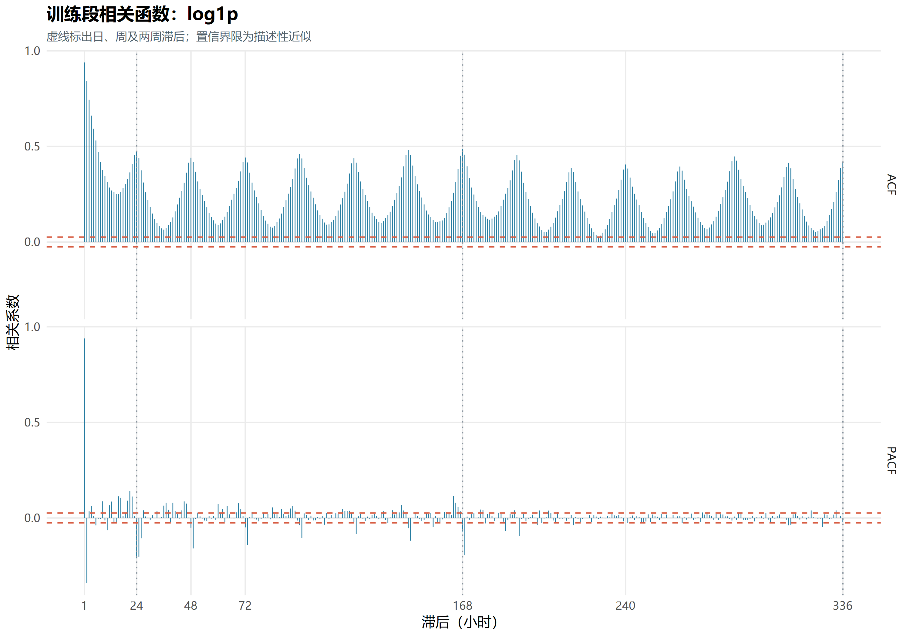

**图 B-1 初始训练段对数序列的 ACF 与 PACF**

图 B-2 将对数、一阶差分、季节差分与组合差分置于同一时间范围。差分后长期水平变化减弱，但冲击仍然保留；各面板纵轴尺度不同，不宜直接凭线条高度比较方差大小。

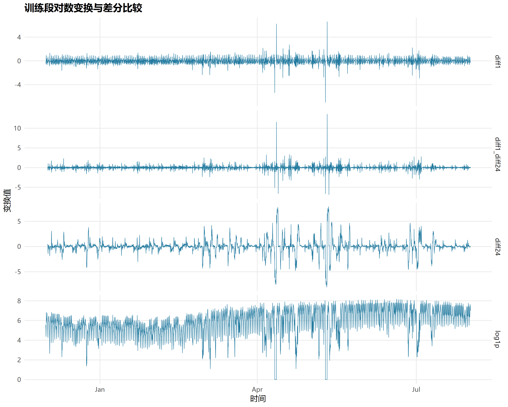

**图 B-2 初始训练段对数变换及不同差分方案比较**

#### B.2 残差分布与区间预测

第 2.4 节检验关注无自相关，图 B-3 则展示与正态分布的偏离。尾部分位点偏离直线，提示极端误差不宜完全依赖简单正态近似描述；Q–Q 图不能代替白噪声检验。

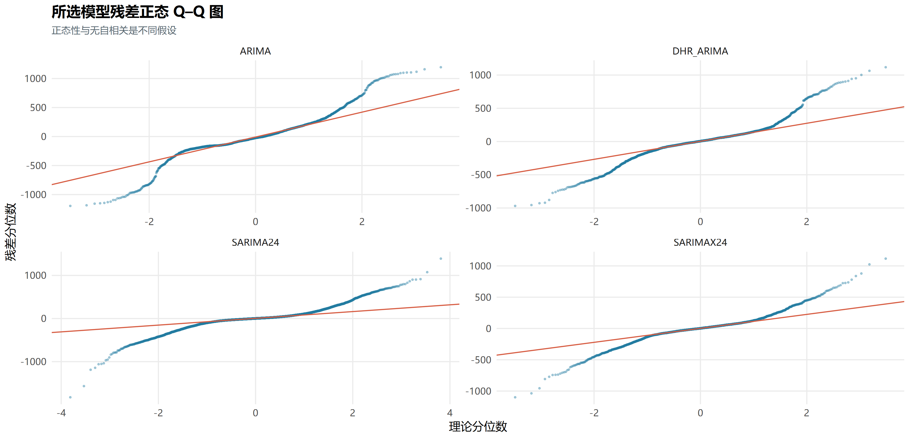

**图 B-3 所选 ARIMA 类模型训练残差的正态 Q–Q 图**

图 B-4 与图 3-1 使用相同的 2018 年 10 月 15—21 日，提供 SARIMAX 区间的补充对照。其高峰拟合与区间宽度有所变化，但是否充分覆盖仍应依据表 3-1 的完整测试结果判断。

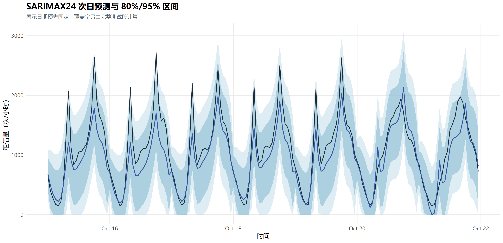

**图 B-4 SARIMAX 在固定测试一周的点预测及 80%/95% 预测区间**

#### B.3 停运与预测步长的误差诊断

图 B-5 展示 2018 年 11 月 2—10 日。实际曲线在非运营日期降为零，模型仍可能预测常规日内需求；恢复运营后，部分模型又会受近期异常历史影响。该图支持第 4.2 节对未知运营变化的讨论，不能据此推断非运营期间潜在需求也为零。

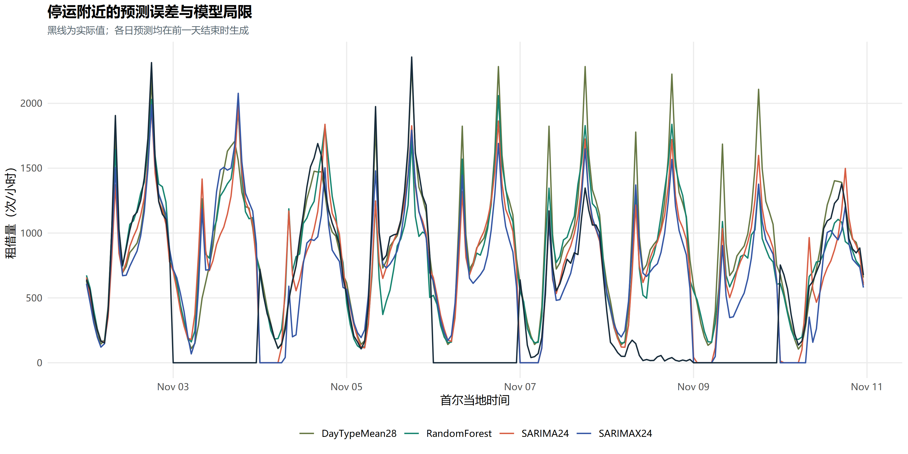

**图 B-5 停运附近的实际租借量与主要模型预测**

图 B-6 的误差高峰对应部分高需求小时。由于每天起点均为 23:00，步长 9 总对应 08:00，步长 19 总对应 18:00，曲线同时反映预测距离与时段难度。要分离这两种因素，需设计其他起点的实验，本文未开展此项新增研究。

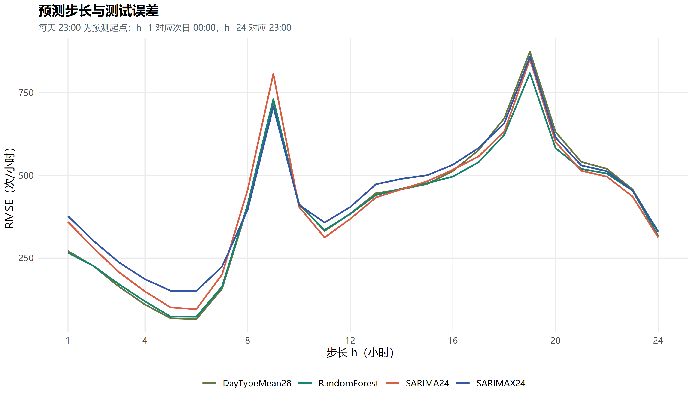

**图 B-6 不同预测步长的历史测试 RMSE**

### 附录 C 补充实验结果

#### C.1 所选模型的主要参数

表 C-1 列出截至 2018 年 9 月 30 日拟合模型的动态系数与截距，补充第 2.3 节的模型表达。Fourier 与交互系数较多，完整 68 项参数、标准误和条件渐近结果保留在[完整参数文件](results/selected_model_parameters.csv)及[中文参数表](results/report_tables/table_2_5.md)，不在此重复展开。这里的 `intercept` 是软件对未差分模型均值部分的参数名称，不能解释为零特征下的普遍业务需求。

**表 C-1 测试起点前所选模型的主要动态系数与截距**

| 模型 | 参数 | 估计值 | 条件标准误 |
| --- | --- | ---: | ---: |
| ARIMA | `ar1` | 0.727025 | 0.181624 |
| ARIMA | `ar2` | 0.149356 | 0.217020 |
| ARIMA | `ar3` | -0.121812 | 0.070140 |
| ARIMA | `ma1` | -0.540310 | 0.179089 |
| ARIMA | `ma2` | -0.459679 | 0.179064 |
| DHR_ARIMA | `ar1` | 0.668718 | 0.105942 |
| DHR_ARIMA | `ar2` | 0.186265 | 0.089491 |
| DHR_ARIMA | `ma1` | 0.179532 | 0.104008 |
| DHR_ARIMA | `ma2` | -0.138181 | 0.023659 |
| DHR_ARIMA | `intercept` | 951.815407 | 44.568885 |
| SARIMA | `ar1` | 0.831856 | 0.007330 |
| SARIMA | `ma1` | 0.273726 | 0.012934 |
| SARIMA | `sma1` | -0.934000 | 0.004126 |
| SARIMAX | `ar1` | 1.096158 | 0.159399 |
| SARIMAX | `ar2` | -0.188820 | 0.135793 |
| SARIMAX | `ma1` | -0.060296 | 0.157260 |
| SARIMAX | `ma2` | -0.148047 | 0.037614 |
| SARIMAX | `sar1` | 0.984845 | 0.005244 |
| SARIMAX | `sma1` | -0.869532 | 0.020715 |
| SARIMAX | `intercept` | 952.455635 | 209.821382 |

这些标准误以当前选定模型和误差假设为条件，不能充分反映候选选择、残差相关和模型不确定性。另存的 `*_final_summary.txt` 是截至 2018 年 11 月 30 日的末端拟合，系数与本表不同具有明确的时间原因。

#### C.2 随机森林验证配置

表 C-2 将七组配置与全部验证小时的误差对应。所有配置均为 400 棵树、最大深度 20；“扩展”指使用全部可用的历史训练行，原始特征需要至少 14 天历史，因此并非直接将数据首行作为监督学习样本。历史天气均指滞后 24 小时观测。

**表 C-2 七组随机森林配置的完整验证结果**

| 配置（窗口及天气） | 最小叶样本数 | 分裂特征比例 | 目标尺度 | 验证 RMSE | 验证 MAE |
| --- | ---: | ---: | --- | ---: | ---: |
| 84 天、不含天气 | 5 | 0.8 | 原尺度 | 471.183 | 292.376 |
| 84 天、含历史天气 | 5 | 0.8 | 原尺度 | 470.005 | 291.322 |
| 84 天、含历史天气 | 15 | 0.6 | 原尺度 | 475.639 | 298.119 |
| 56 天、含历史天气 | 5 | 0.8 | 原尺度 | 496.271 | 305.903 |
| 112 天、含历史天气 | 5 | 0.8 | 原尺度 | 482.829 | 290.878 |
| 扩展窗口、含历史天气 | 15 | 0.8 | 原尺度 | 473.033 | 289.156 |
| 84 天、含历史天气 | 5 | 0.8 | log1p | 506.834 | 314.273 |

表 C-2 的误差单位为次/小时，据[森林候选配置](results/rf_candidate_specifications.csv)和[森林完整验证指标](results/rf_validation_metrics.csv)整理。原尺度 84 天含天气配置按 RMSE 入选，MAE 最低的配置与其不同，再次说明选择指标必须提前确定。

#### C.3 候选完成情况与补充结果索引

28 个 ARIMA 类候选的完整阶数、变换、窗口与回归配置见[候选登记表](results/arima_candidate_specifications.csv)；24 个完成候选的全小时及运营子集误差见[完整验证结果](results/arima_validation_metrics.csv)。表 C-3 单列四个未完成候选，保留失败日期与原因，不将计算失败转换为预测优劣结论。

**表 C-3 未完成完整验证的 ARIMA 类候选**

| 候选编号 | 失败日期 | 实际记录的原因 | 评价处理 |
| --- | --- | --- | --- |
| `D_log_K5_84d` | 2018-08-13 | 未收敛或参数协方差异常 | 不纳入完整验证排名 |
| `A_raw_212_84d_v2` | 2018-08-27 | 未收敛或参数协方差异常 | 不纳入完整验证排名 |
| `C_raw_601_111_week_84d` | 2018-08-01 | 数值差分计算出现非有限值 | 不纳入完整验证排名 |
| `C_raw_1001_111_week_84d` | 2018-08-01 | 达到预设耗时限制 | 不纳入完整验证排名 |

表 C-3 来源为[失败记录](results/candidate_failures.csv)。信息准则的可比组及组内排序见[训练信息准则](results/training_information_criteria.csv)，初始训练结束与测试开始前两个起点的诊断见[两起点残差结果](results/training_diagnostics_two_origins.csv)。这些资料保留识别过程的可核查性，不把不同窗口和协议的差异归因于单一因素。

区间的正常运营子集、宽度和 Winkler 评分保留在[完整区间结果](results/prediction_interval_coverage.csv)；[运营状态误差](results/test_errors_by_operating_status.csv)、[时段误差](results/test_errors_by_time_of_day.csv)和[逐日误差](results/test_daily_errors.csv)可补充第四章的解释。末端五模型各 24 小时、共 120 个点预测及可用区间见[外推结果](results/future_24h_forecasts.csv)。未在本文展示的其他原始图片和表格继续保留于项目目录，未作为新的独立证据反复陈列。
